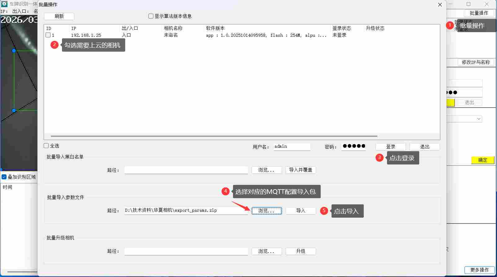

import DownloadButton from '@site/src/components/DownloadButton';

:::tip[工具下载]
<DownloadButton href="https://share.feijipan.com/s/mG4PJBz9">相机调试工具下载</DownloadButton>
:::

## 一、批量上云配置（MQTT 参数导入）   
1.打开工具，点击批量操作  
2.勾选相机：在列表中勾选需要上云的相机（如 192.168.1.25）。    
3.登录相机：输入用户名（admin）和密码，点击「登录」，确保相机登录状态为 “已登录”。  
4.选择配置包：在 “批量导入参数文件” 区域，点击「浏览...」，选择对应的 MQTT 配置导入包（如 export_params.zip）。  
5.导入配置：确认路径无误后，点击「导入」，完成 MQTT 参数的批量配置。
:::tip[配置包下载]
<DownloadButton href="https://share.feijipan.com/s/jW1v8u7W">配置包下载【不用解压】</DownloadButton>
:::

## 二、设备 MAC 地址获取操作说明
搜索并选择相机  
1.点击「搜索」按钮，在相机列表中找到目标设备（如 192.168.1.25），点击选中该相机。  
2.登录相机，选择相机，点击「登录」，确认状态为 “已登录”。  
3.点击界面右下角的「更多操作」按钮，在下拉菜单中选择「设备维护」。  
4.在弹出的 “设备维护” 窗口中，切换至「设备信息」标签页，找到 “MAC 地址” 字段（如 180300224E92），点击「复制 mac 地址」按钮完成地址复制。  
5.复制完成后，点击「确定」保存设置并关闭设备维护窗口。

## 三、平台添加相机
1. 登录平台后，点击**停车云** → **车场管理** → **相机管理**
2. 点击**新增**，填写相机名称、类型（HX）、相机ID（Mac）等信息
3. 点击**确定**完成添加
:::danger[特别注意]
复制出来的MAC地址是大写的，加入到平台，要全部改成小写！！！如下图所示
:::

:::tip
LED卡类型对应：
- 绿色，黄色，红色对应001 (9600)
- 蓝色对应002 (19200)
- 紫色对应002LCD (19200)
:::

## 四、通道绑定
1. 在对应车场中**新建通道**
2. 将相机绑定至通道

