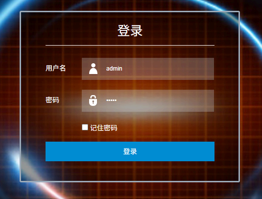
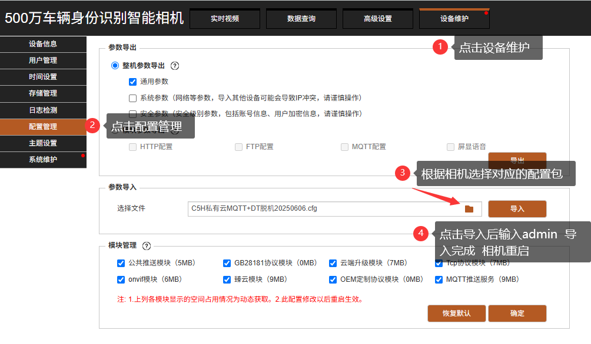

import DownloadButton from '@site/src/components/DownloadButton';
import Tabs from '@theme/Tabs';
import TabItem from '@theme/TabItem';

# R5E上云方式

:::danger 一定要注意
不要使用360浏览器！！！推荐谷歌浏览器

<DownloadButton href="https://www.google.cn/intl/zh-CN/chrome/">谷歌浏览器下载</DownloadButton>
:::

## 📋 接入方式概览

R5E 相机支持以下两种上云方式，**任选其一**即可：

| 接入方式 | 相机侧操作 | 平台侧接入方式 | 特点 |
| --- | --- | --- | --- |
| **方式一：设备厂商 MQTT** | 后台确认 MQTT 配置（默认配置，一般无需改动） | 设备厂商 MQTT | 相机固件较新时推荐 |
| **方式二：配置包导入** | 导入配置包，相机自动重启 | 平台 MQTT | 配置简单，适合快速部署 |

**通用登录信息：**

| 项目 | 说明 |
| --- | --- |
| 相机默认地址 | `192.168.1.100` |
| 登录账号 | `admin` |
| 登录密码 | `admin` |

---

## 一、相机登录（两种方式通用）

1. 打开浏览器，输入相机 IP 地址 **默认地址：192.168.1.100**
2. 输入登录信息，账号 / 密码均为：`admin`
3. 可勾选「记住密码」，点击登录完成操作

---

## 二、选择接入方式

<Tabs>
<TabItem value="way1" label="方式一：设备厂商 MQTT" default>

### 1️⃣ 相机后台配置

:::tip MQTT 参数（默认配置，无需改动）
进入相机后台页面，选择 **高级设置** → **高级网络** → **MQTT配置** → MQTT服务器选择【VZMQTT】。
:::

:::tip 调整上传图片分辨率
平台上传的图片大小不能超过 **200K**，所以需要调整一下图片分辨率大小，一般调整为 **704\*576** 即可。
:::

:::danger 特别注意
如果相机不在线，请检查相机软件版本是否在 **12.17.1.202607310** 之上，否则请升级至最新版本。
:::

### 2️⃣ 平台添加相机

1. 登录平台后，点击 **停车** → **车场管理** → **相机管理**
2. 点击 **新增**，填写相机名称、类型（**VZ R相机**）、相机ID（序列号）等信息
3. 接入方式选择 **设备厂商MQTT**（平台新增VZ相机对接类型），保存即可
4. 点击 **确定** 完成添加

:::danger 特别注意
<b>添加完相机后要点下「远程」触发相机心跳才能上线，如果不行要点下「编辑」，然后再点「保存」。</b>
:::

</TabItem>
<TabItem value="way2" label="方式二：配置包导入">

### 1️⃣ 配置包导入

1. 相机登录后，点击菜单栏 **设备维护**
2. 在设备维护页面，选择 **配置管理**
3. 配置包获取方式：下面可以直接下载
4. 点击 **参数导入** → **选择文件**，选中对应配置包（示例：`R5E私有云MQTT+FK脱机20260828.cfg`）
5. 点击 **导入**，输入验证密码 `admin`，等待导入完成后相机会自动重启

:::tip 配置包下载
<DownloadButton href="https://share.feijipan.com/s/6V8Z2efT">配置包下载</DownloadButton>
:::

### 2️⃣ 平台添加相机

1. 登录平台后，点击 **停车** → **车场管理** → **相机管理**
2. 点击 **新增**，填写相机名称、类型（VZ**C**相机）、相机ID（序列号）等信息
3. <b>接入方式选择「平台MQTT」</b>
4. 点击 **确定** 完成添加

</TabItem>
</Tabs>

---

## 三、LED 卡类型对应（通用）

:::tip LED 卡类型对照
| LED 卡颜色 | 类型编号 | 波特率 |
| --- | --- | --- |
| 🟢🟡🔴 绿 / 黄 / 红 | `001` | `9600` |
| 🔵 蓝 | `002` | `19200` |
| 🟣 紫 | `002LCD` | `19200` |
:::

---

## 四、通道绑定（两种方式通用）

1. 在对应车场中 **新建通道**
2. 将相机绑定至通道

