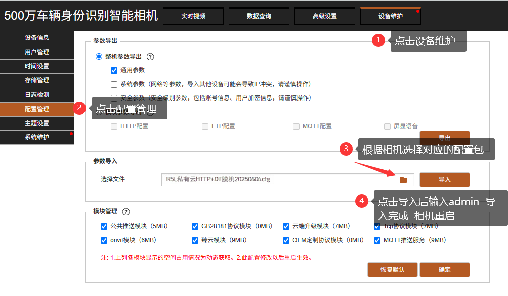
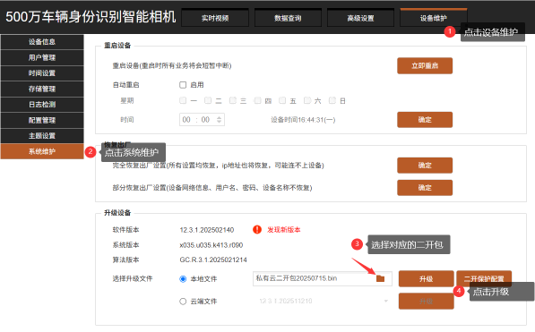

import DownloadButton from '@site/src/components/DownloadButton';

# R5L上云方式
:::danger 一定要注意
不要使用360浏览器！！！推荐谷歌浏览器

<DownloadButton href="https://www.google.cn/intl/zh-CN/chrome/">谷歌浏览器下载</DownloadButton>
:::
import Tabs from '@theme/Tabs';
import TabItem from '@theme/TabItem';

  <Tabs>
    <TabItem value="225" label="二开上云" default>
      

        <strong>二开上云</strong> 
        二开上云要注意的是，需要两个步骤
        - 1.导入HTTP配置文件（不传的话不影响在线，但是识别结果没图片）
        - 2.从升级版本的地方升级下二开文件（bin格式的）
      

    {/*
      <ul style={{ margin: 0, paddingLeft: '24px' }}>
        <li><a href="#">关闭系统病毒防护教程</a></li>
      </ul>
      */}
    </TabItem>

    <TabItem value="226" label="MQTT上云">
      

        <strong>MQTT上云</strong> 
    这个上云方式就是和C相机一致，通过MQTT方式上云，不过相机类型要选择**VZ C相机**
    <a href="/docs/bl/cloud/C5H/" target="_blank" class="download-item">
  <svg class="item-icon" viewBox="0 0 24 24">
    <path d="M18 13v6a2 2 0 0 1-2 2H5a2 2 0 0 1-2-2V8a2 2 0 0 1 2-2h6" />
    <polyline points="15 3 21 3 21 9" />
    <line x1="10" y1="14" x2="21" y2="3" />
  </svg>
  MQTT上云
</a>
      

      {/*
      <ul style={{ margin: 0, paddingLeft: '24px' }}> 
      <li><a href="#">其他相关教程</a></li>
      </ul>
      */}
    </TabItem>
  </Tabs>

## 一、相机登录
1. 打开浏览器，输入相机 IP 地址 **默认地址：192.168.1.100**
2. 输入登录信息，账号 / 密码均为：admin
3. 可勾选「记住密码」，点击登录完成操作

## 二、配置包导入
1. 相机登录后，点击菜单栏**设备维护**
2. 在设备维护页面，选择**配置管理**
3. 配置包获取方式：下面可以直接下载
4. 点击**参数导入** → **选择文件**，选中对应配置包（示例：R5L私有云HTTP+DT脱机20250606.cfg）
5. 点击**导入**，输入验证密码`admin`，等待导入完成后相机会自动重启
:::tip
<DownloadButton href="https://share.feijipan.com/s/6z18OUPs">配置包下载</DownloadButton>
:::

## 三、二开包升级
1. 相机登录后，点击菜单栏**设备维护**
2. 在设备维护页面，选择**系统维护**
3. 二开包获取方式：下面可以直接下载
4. 找到**升级设备** → **选择文件**，选中对应的二开包（示例：私有云二开包20250715.bin）
5. 点击**升级**，等待升级完成后相机会自动重启

:::tip
<DownloadButton href="https://share.feijipan.com/s/A818buM3">二开包下载</DownloadButton>
:::

## 四、平台添加相机
1. 登录平台后，点击**停车云** → **车场管理** → **相机管理**
2. 点击**新增**，填写相机名称、类型（VZ R相机）、相机ID（序列号）等信息
3. 点击**确定**完成添加

:::tip

相机类型要选择：**VZ R相机**
LED卡类型对应：
- 绿色，黄色，红色对应001 (9600)
- 蓝色对应002 (19200)
- 紫色对应002LCD (19200)
:::

## 五、通道绑定
1. 在对应车场中**新建通道**
2. 将相机绑定至通道

