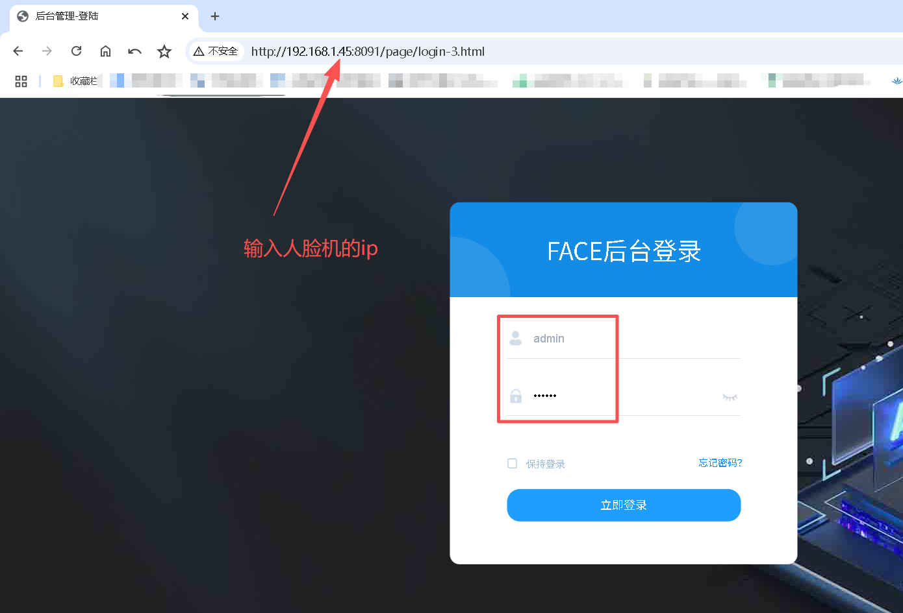
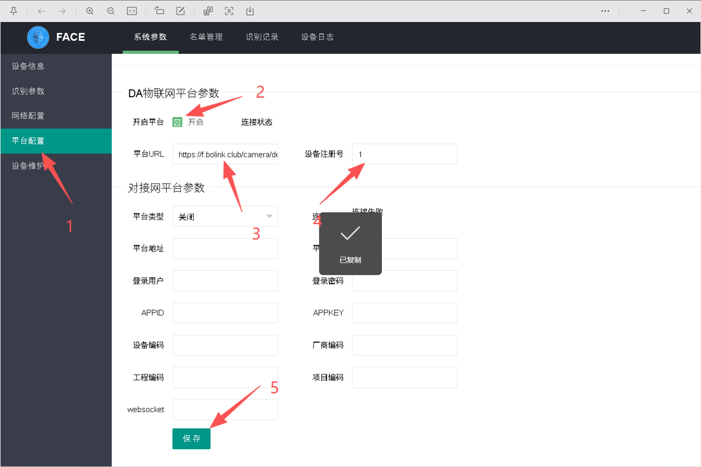
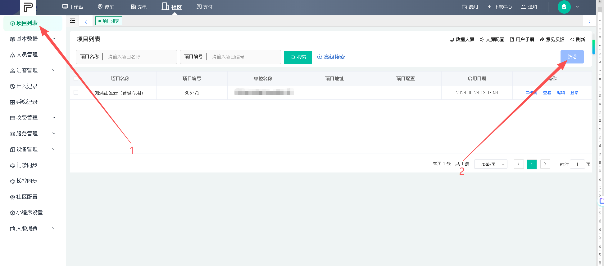
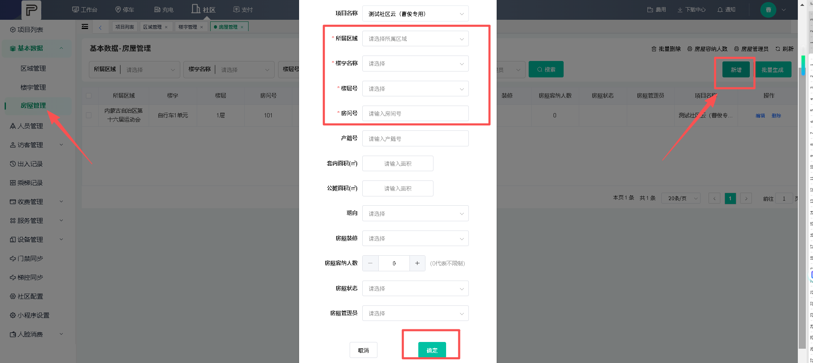
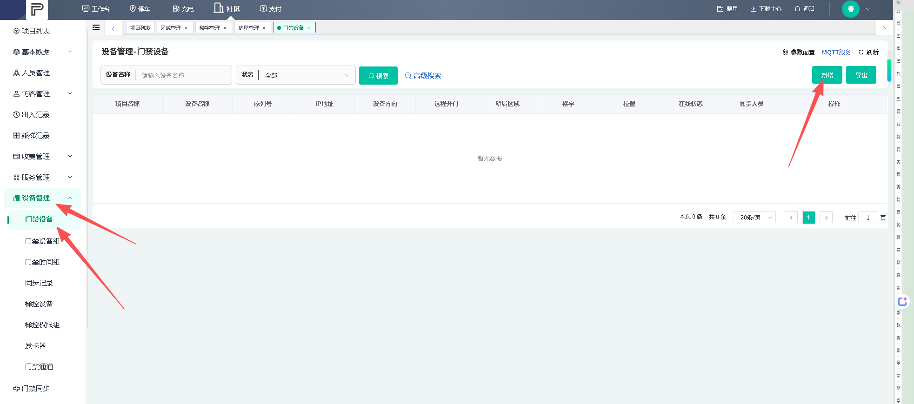
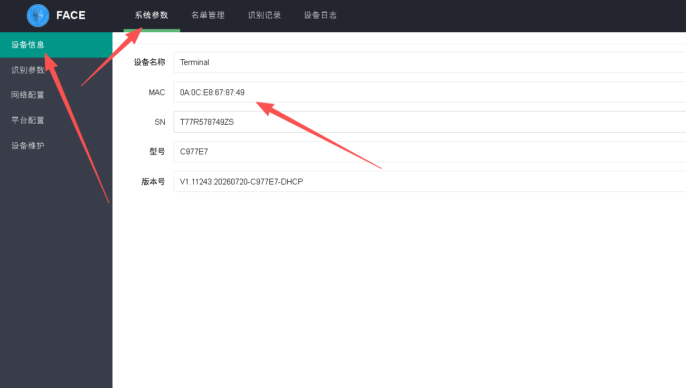
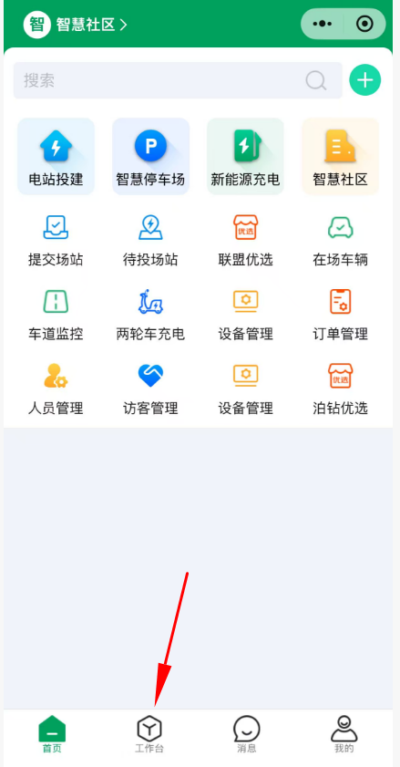
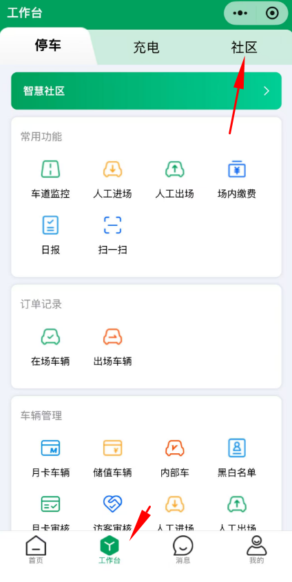
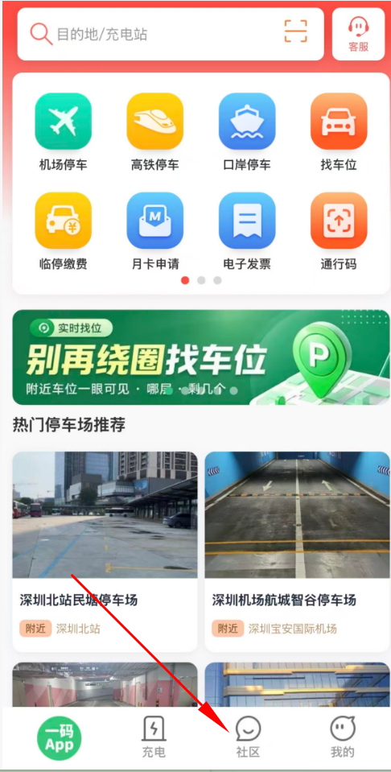
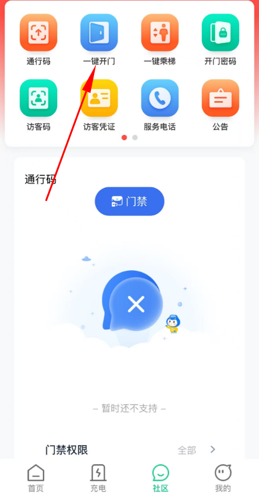

# DA人脸上云方式

## 一、人脸机联网登录

1. 人脸机联网，保证设备外网通讯
2. 用人脸机的 IP 登录浏览器
3. 输入账号密码：账号 `admin`，密码 `123456`

## 二、平台参数配置

1. 登录成功后，打开**平台配置** → **系统参数**
2. **平台开启**打钩
3. 填入平台 URL：`https://f.bolink.club/camera/device`

## 三、开通车场账号

联系技术人员开通车场账号。

## 四、登录社区云

1. 登录账号
2. 点开**社区云**

## 五、创建项目

在**项目列表**创建一个项目。

## 六、添加基础数据

进入**基本数据**，按 **区域管理 → 楼宇管理 → 房屋管理** 的顺序添加。

### 6.1 区域管理

### 6.2 楼宇管理

- **区域**：选择上一步创建的区域名称
- **楼栋名称**：自定义
- **楼层**：自定义，随便填个数字都可以
- **电梯**：有或者无

:::tip 填写提示
带星号为必填项，没有强制性内容，**自定义填写即可**。
:::

### 6.3 房屋管理

带星号必填，内容自定义填写，默认填 `1` 都可以。

## 七、添加门禁设备

1. 进入**添加设备** → **设备管理** → **门禁设备** → **新增**

2. 填写设备信息：

| 字段 | 填写内容 |
| --- | --- |
| 设备名称 | 自定义 |
| 设备类别 | 人脸门禁 |
| 设备类型 | DA-L001 |
| 联网类型 | 以太网 |
| 设备方向 | 进 或 出 |
| 设备位置 | 平台手选 |
| 安装位置 | 自定义填写 |

:::warning 序列号（MAC 地址）获取方式
序列号为人脸机的 **MAC 地址**，需要登录人脸机后台查看：

**设备信息 → 系统参数** 里面的 MAC 地址，填写到平台。
:::

## 八、小程序录入人脸

### 8.1 打开小程序

微信搜索 **「运营小管家」** 小程序。

### 8.2 进入工作台

**车场账号密码 → 工作台**

### 8.3 新增人员

**社区 → 人员管理 → 新增**

## 九、一码 App 远程开门

手机端访问**一码 app**小程序可以远程开闸。

:::warning 使用前提
需要提前录入好被注册进去的人员，**人员必须填写手机号**，访问一码 app 需要手机号验证登录。
:::

**社区 → 一键开门**

:::danger 查看不到开门权限？
登录平台**人员管理**，查看该人员是否已**授权开门权限**。
:::
