# HA人脸上云方式

## 第一步：人脸机联网并登录后台

1. 为人脸机接通网络，确保设备可以访问外网。
2. 在浏览器输入人脸机的 **IP 地址** 登录后台。
3. 输入账号密码：
   - **账号**：`admin`
   - **密码**：`admin`

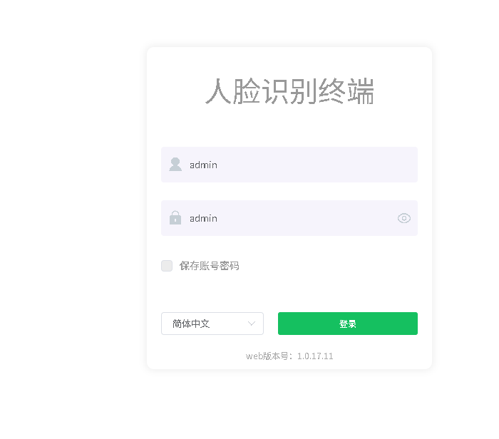

## 第二步：配置数据上传与外网穿透

进入 **更多参数 → 数据上传**，按下图填写：

| 参数项 | 填写内容 |
| --- | --- |
| 上传方式 | HTTP 上传 |
| 心跳 | 不打勾 |
| IP/域名 | `f.bolink.club` |
| 端口 | `80` |
| URL | `camera/face01Device/upload` |

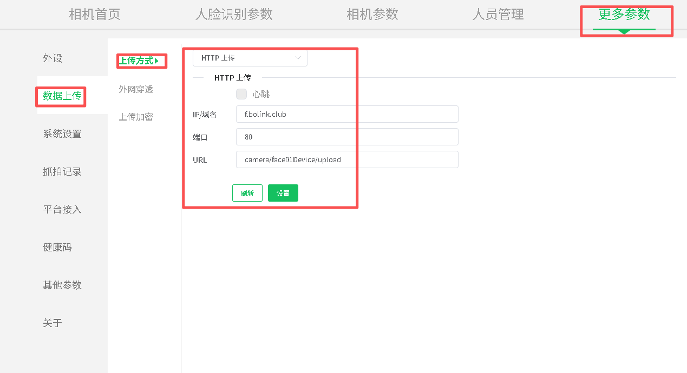

继续在同一页面配置 **外网穿透**：

| 参数项 | 填写内容 |
| --- | --- |
| 外网穿透 | 使能（打勾） |
| 外网穿透类型 | comet 长轮询 |
| IP/域名 | `f.bolink.club` |
| 端口 | `80` |
| URL | `camera/face01Device/download` |

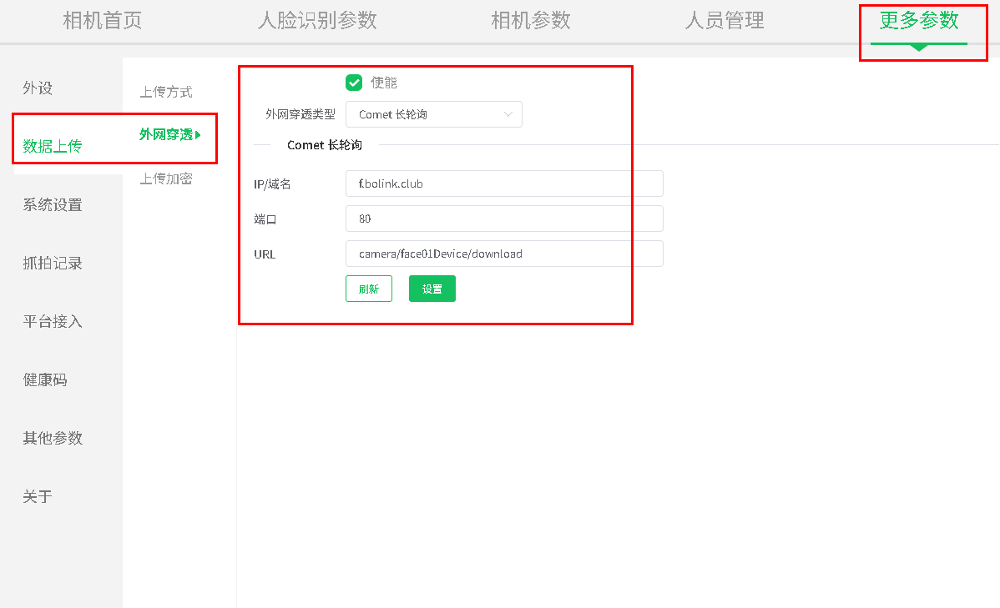

## 第三步：开通车场账号

联系技术人员开通车场账号。

## 第四步：登录社区云

1. 登录平台账号。
2. 在首页点开 **社区云**。

## 第五步：创建项目

在 **项目列表** 创建一个项目。

## 第六步：添加基础数据

进入 **基本数据**，按 **区域管理 → 楼宇管理 → 房屋管理** 的顺序依次添加。

### 6.1 区域管理

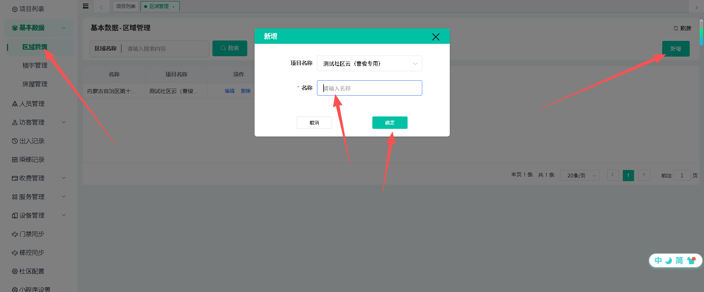

### 6.2 楼宇管理

:::tip 填写提示
带星号为必填项，没有强制性内容，**自定义填写即可**。
:::

| 字段 | 填写说明 |
| --- | --- |
| 区域 | 选择上一步创建的区域名称 |
| 楼栋名称 | 自定义 |
| 楼层 | 自定义，随便填个数字都可以 |
| 电梯 | 有 或 无 |

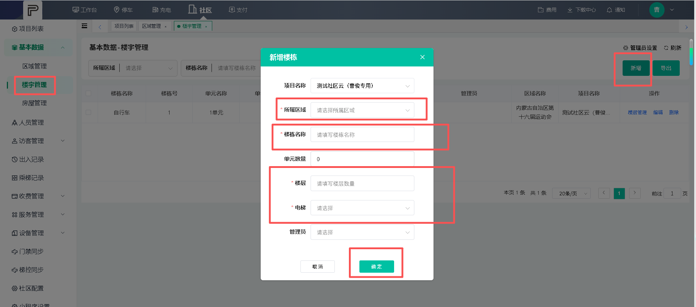

### 6.3 房屋管理

带星号必填，内容自定义填写，默认填 `1` 都可以。

## 第七步：添加门禁设备

1. 进入 **添加设备 → 设备管理 → 门禁设备 → 新增**。

2. 填写设备信息：

| 字段 | 填写内容 |
| --- | --- |
| 设备名称 | 自定义 |
| 设备类别 | 人脸门禁 |
| 设备类型 | HA-L001 |
| 联网类型 | 以太网 |
| 设备方向 | 进 或 出 |
| 设备位置 | 平台手选 |
| 安装位置 | 自定义填写 |

:::warning 序列号（SN）获取方式
序列号为人脸机的 **SN 地址**，需登录人脸机后台查看：**更多参数 → 关于 → 相机序列号**。将该序列号填写到平台。
:::

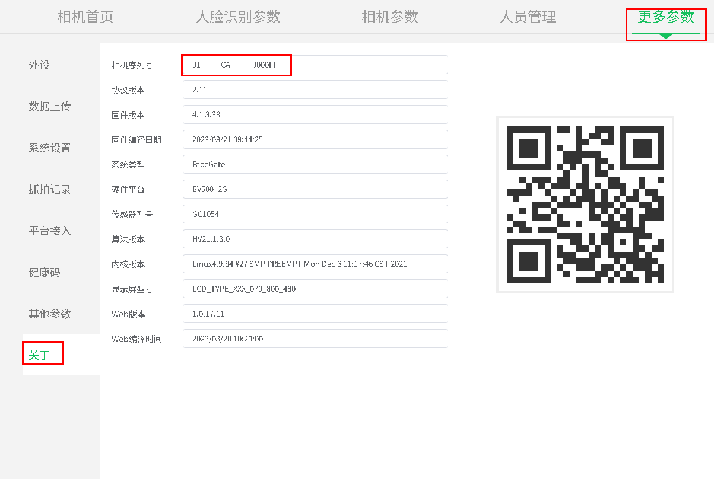

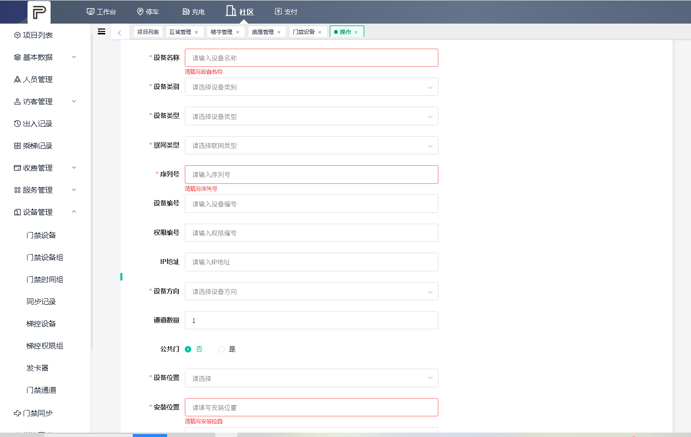

## 小程序录入人脸教程

微信搜索 **「运营小管家」** 小程序。

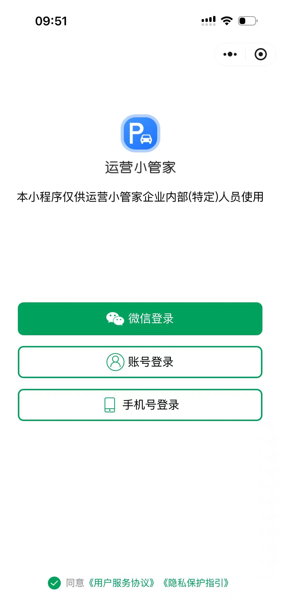

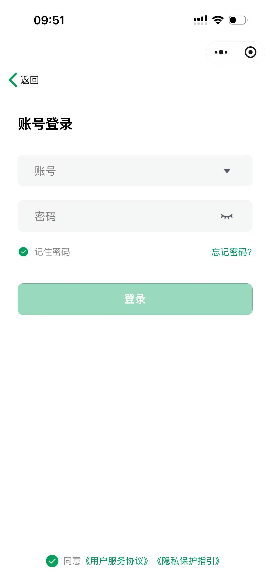

👉 使用 **车场账号密码** 登录后，进入 **工作台**。

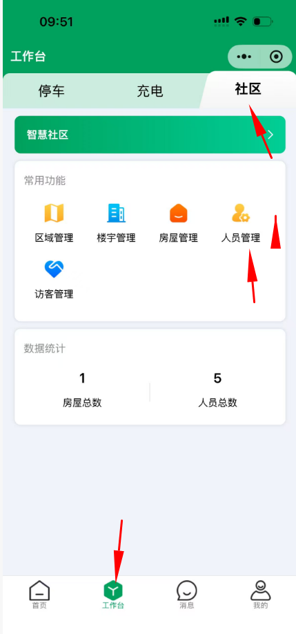

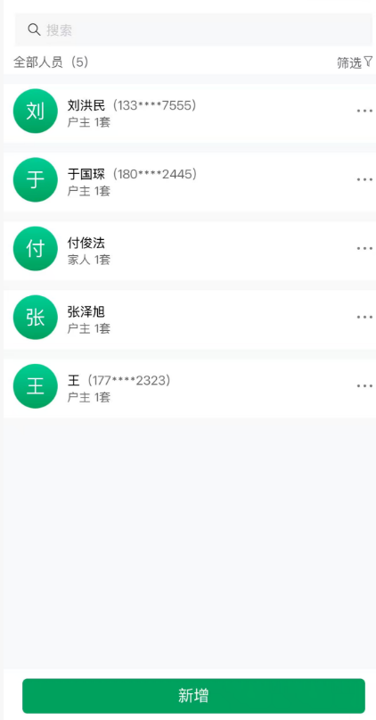

👉 进入 **社区 → 人员管理 → 新增** 录入人脸。

:::tip 远程开门须知
手机端访问 **一码 app / 小程序** 可以远程开闸。注意：需要提前录入好被注册人员，且人员必须填写手机号，访问一码 app 需要手机号验证登录。
:::

👉 进入 **社区 → 一键开门** 即可远程开门。

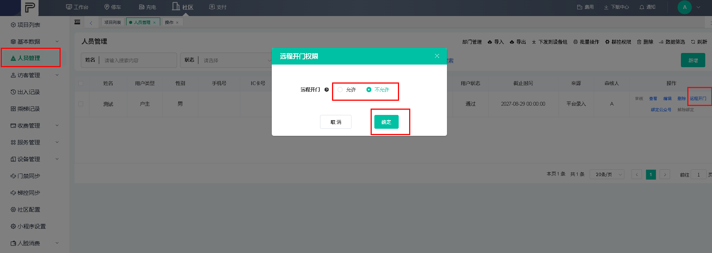

:::info 开门权限排查
如果查看不到开门权限，请登录平台 **人员管理**，检查该人员是否已授权开门权限。
:::
