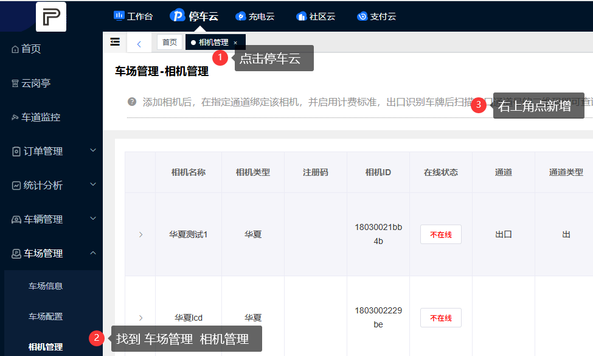
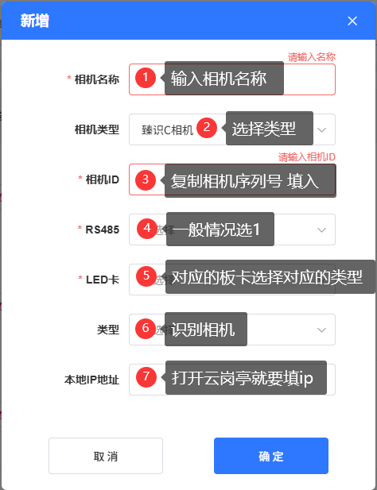
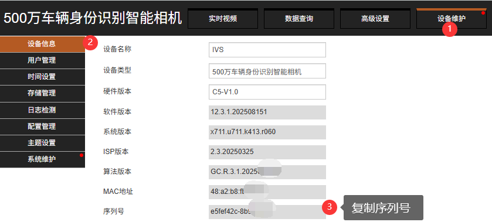
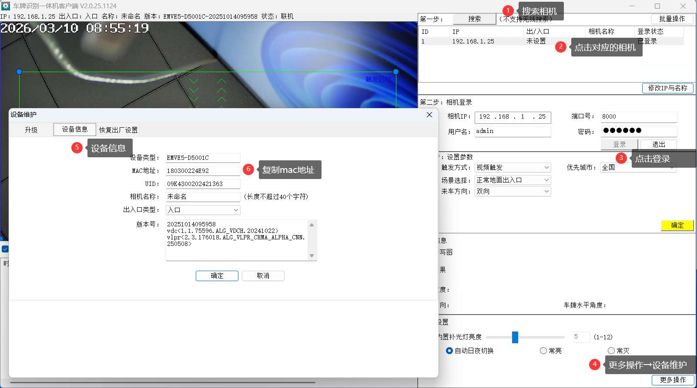
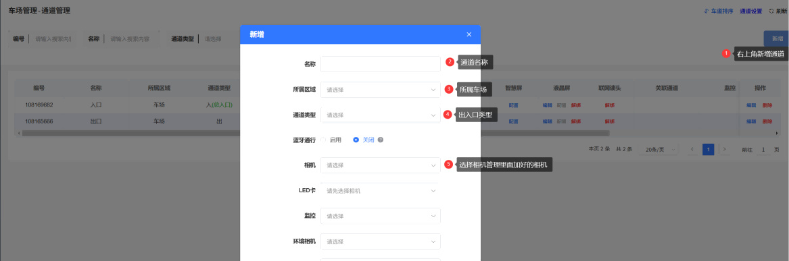

import DownloadButton from '@site/src/components/DownloadButton';

{/*
:::tip
上云神器，目前适配**VZ相机**和**HX相机**！！
<a href="https://parking-soft-1258921546.cos.ap-nanjing.myqcloud.com/BolinkCameraConfigTool.zip" target="_blank" class="download-item">
  <svg class="item-icon" viewBox="0 0 24 24">
    <path d="M18 13v6a2 2 0 0 1-2 2H5a2 2 0 0 1-2-2V8a2 2 0 0 1 2-2h6" />
    <polyline points="15 3 21 3 21 9" />
    <line x1="10" y1="14" x2="21" y2="3" />
  </svg>
  上云神器下载
</a>
:::
*/}

:::tip
上云神器，目前适配**VZ相机**和**HX相机**！！

本工具支持相机如下：
- **VZ**：R5L、C5H、C5HE、R3、C3
- **HX**：v87c、v87cl、E5

<DownloadButton href="https://parking-soft-1258921546.cos.ap-nanjing.myqcloud.com/BolinkCameraConfigTool.zip">上云神器下载</DownloadButton>
:::

## 一、使用方法
:::tip
使用方法如下图所示  
**1**.下载完成后解压软件，解压后打开软件【BolinkCameraEasyDiscoverTool.exe】，注意别点错，要点蓝色🅿图标的  
**2**.打开软件后，先搜索相机搜索到对应的相机后，直接勾选相机  
**3**.勾选后再输入车场的账号密码可以到【员工设置】查看，也可以联系技术人员  
**4**.完毕后点击一键配置，成功后相机就配置好了，直接添加到平台即可  
:::

## 二、平台添加相机
1. 登录平台后，点击**停车云** → **车场管理** → **相机管理**
2. 点击**新增**，填写相机名称、类型（选择对应的类型）、相机ID（序列号）【HX是MAC】
3. 点击**确定**完成添加

:::tip

相机类型要选择：**对应的相机类型**
LED卡类型对应：
- 绿色，黄色，红色对应001 (9600)
- 蓝色对应002 (19200)
- 紫色对应002LCD (19200)
:::

## 三、通道绑定
1. 在对应车场中**新建通道**
2. 将相机绑定至通道

