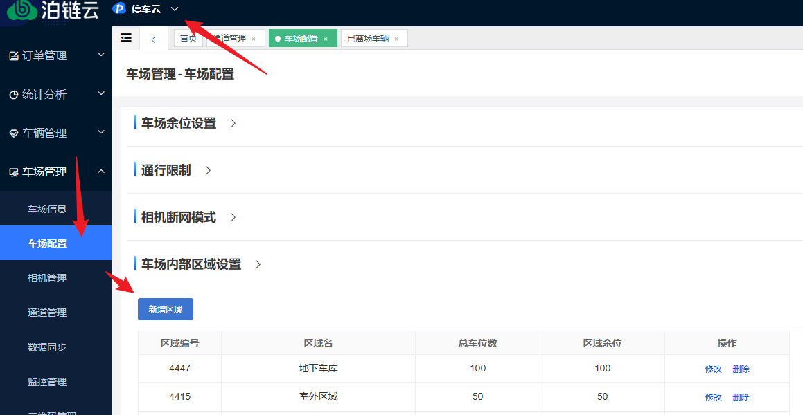
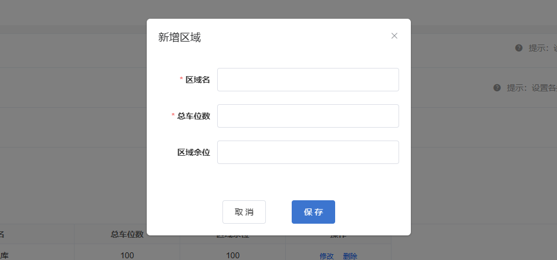
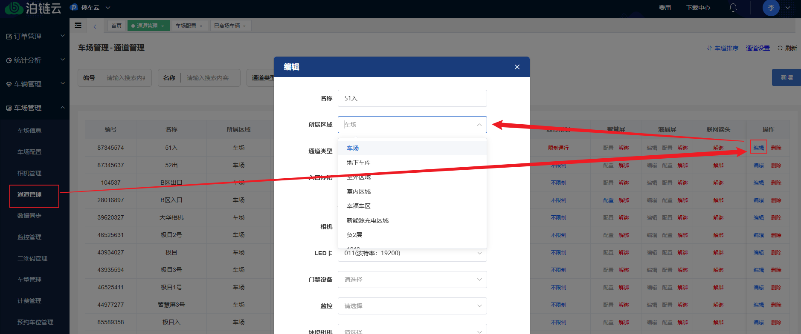
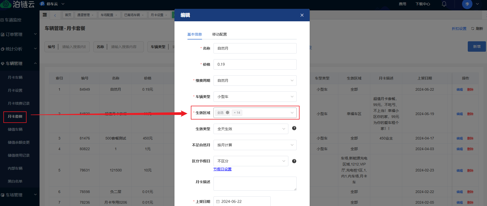
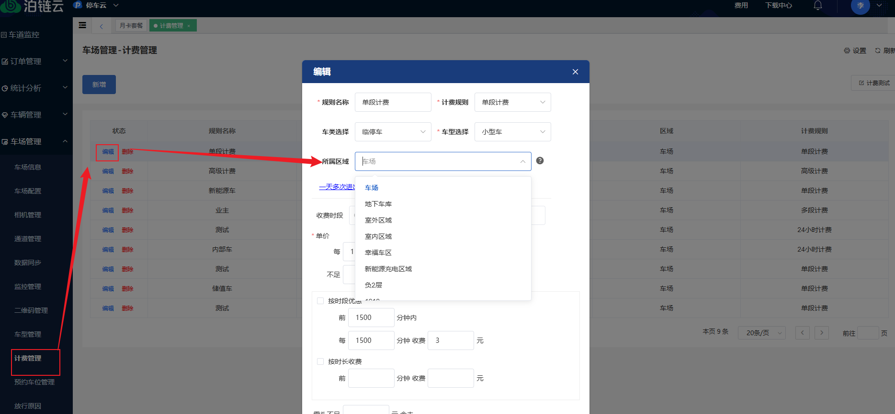

## 一、新增区域

进入停车云，找到 **车场管理 → 车场配置 → 车场内部区域配置**，点击【新增区域】，填好必填项后点【保存】。

## 二、通道绑定区域

进入 **通道管理** 编辑通道，选择对应的区域。

## 三、区域的使用

### 1、月卡套餐区域

在 **车辆管理 → 月卡套餐** 中新建或编辑月卡套餐，可以添加区域；使用该套餐的车辆只会在对应区域生效。

### 2、区域计费规则

在 **车场管理 → 计费管理** 中添加或编辑计费规则时选择区域，车辆在该区域停放时按该计费规则计费。

