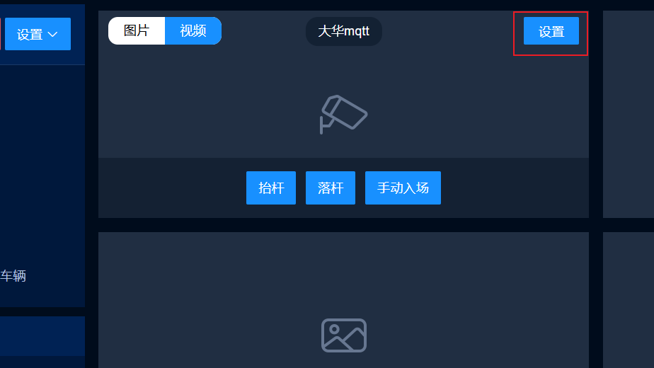
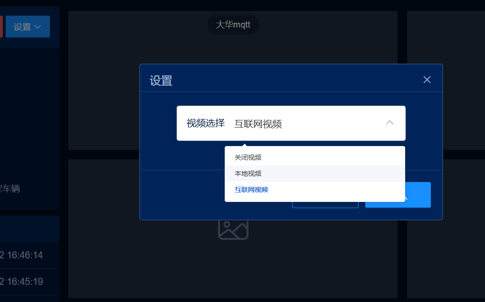
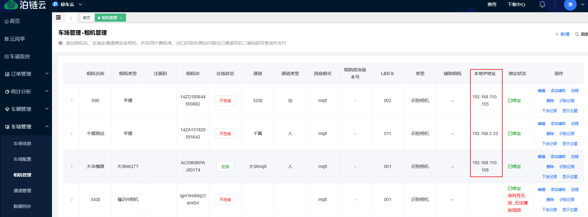
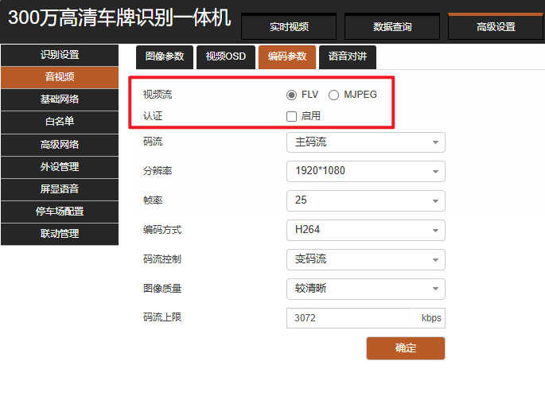
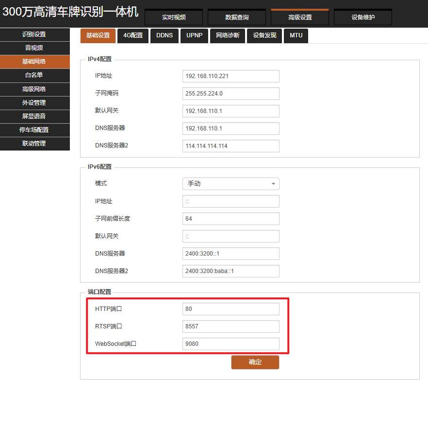

:::warning
只有**支持本地视频的相机**才能观看本地视频。可点击查看纯云车场支持的[相机列表](https://udoc.bolinkpaas.com/doc/1902/)。
:::

## 一、登录观看本地视频

观看本地视频需要登录网址：**http://m.yima.world/**（注意是 `http` 不是 `https`，不要加 `s`）。

在岗亭界面对应的通道上点【设置】，选择【本地视频】。

## 二、添加相机 IP 并检查网段

进入 **车场管理 → 相机管理 → 添加相机** 的 IP 地址。观看本地视频的电脑要和相机处于**同一网段**，编辑添加相机地址后检查网络是否在同一网段、是否能互通。

:::tip
**VZ相机**还需设置相机后台：视频流要选择 **FLV**；音视频 → 参数编码 → 认证 → 启用，并**取消勾选**。
:::

## 三、socket 报错的排查

如果出现 socket 报错，可能需要检查相机的端口配置。

