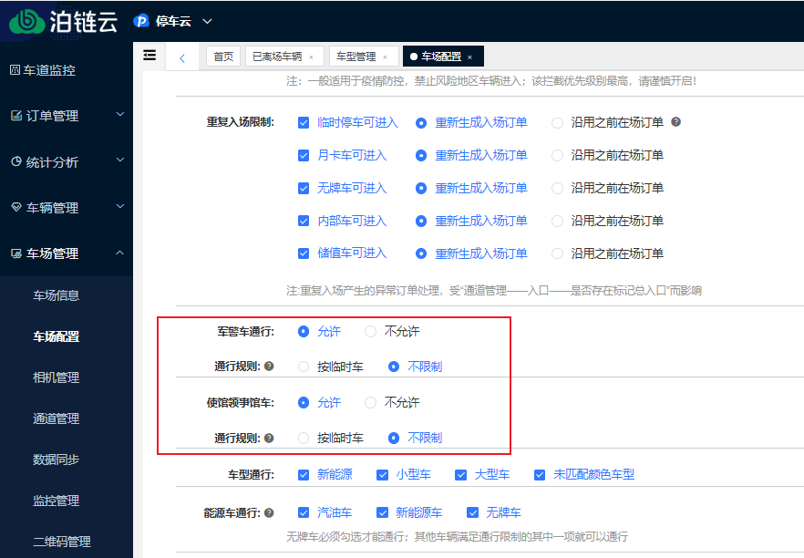
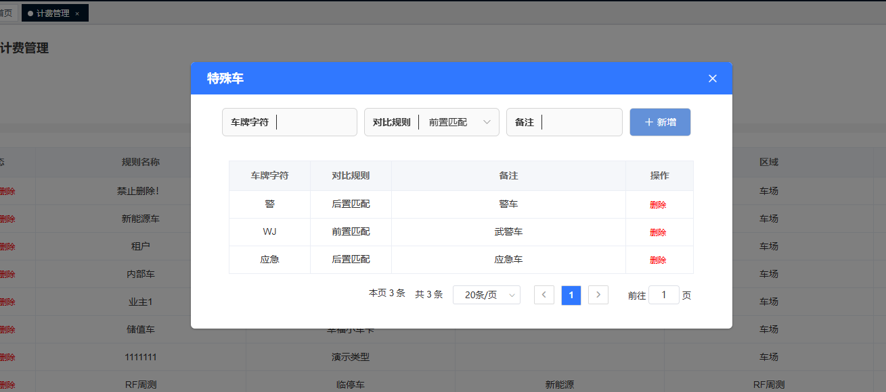
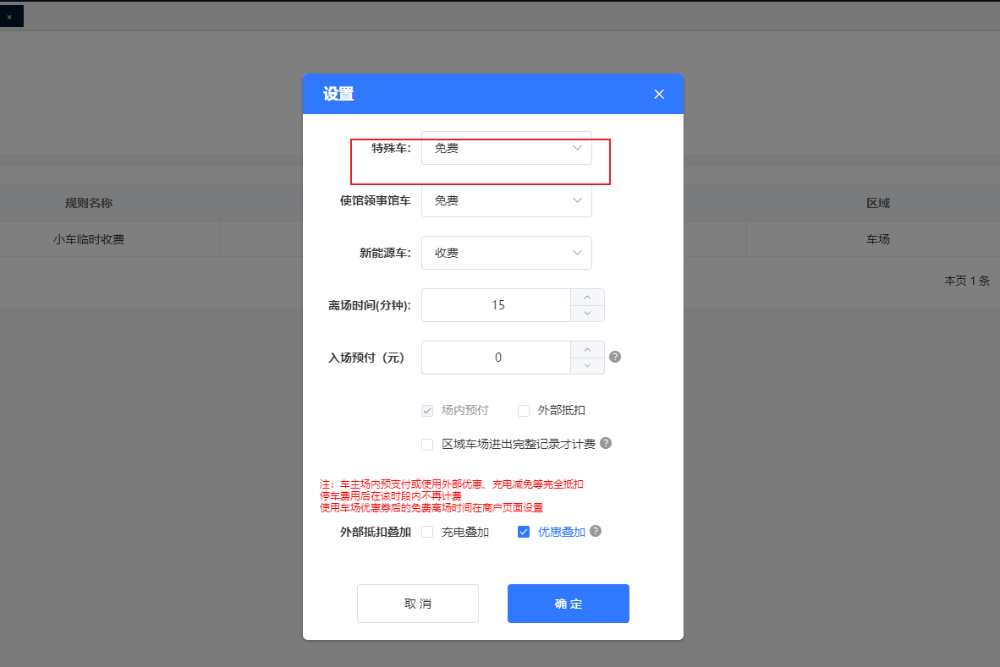
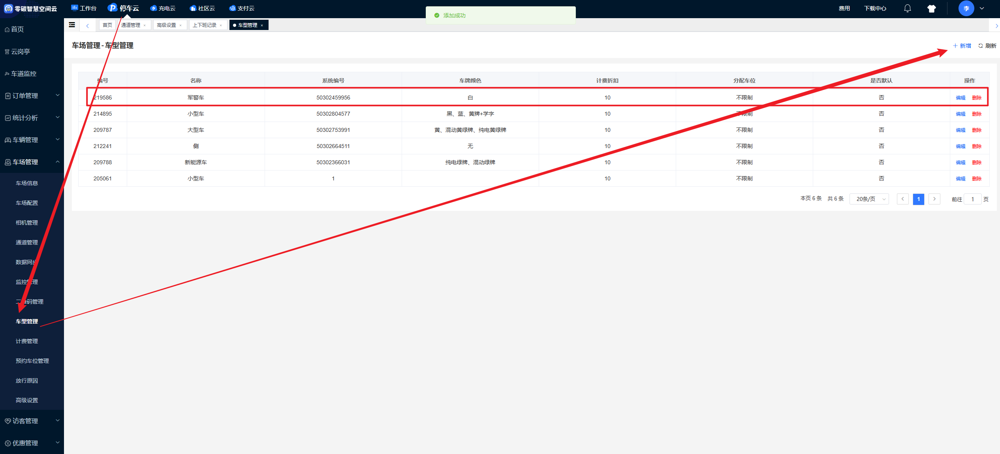

## 方法一：使用特殊车规则

进入 **车场管理 → 车场配置 → 通行限制**，找到军警车和领事馆车，设置允许不限制。

进入 **车场管理 → 计费管理**，右上角【特殊车】添加对应特殊车的匹配规则，再点击旁边的设置让特殊车免费。

## 方法二：添加白牌车型

在 **车型管理** 中添加 **白牌** 车型，只要车场没有设置白牌的计费规则，该车型就不会计费。

:::warning
**注意：不能禁止临时车通行。**
:::

