# 复杂模式

### 1.车型费率设置

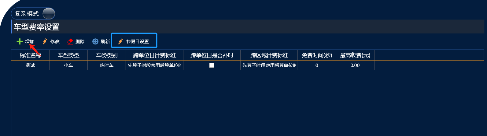
#### 节假日设置

注：节假日设置有需要的看即可

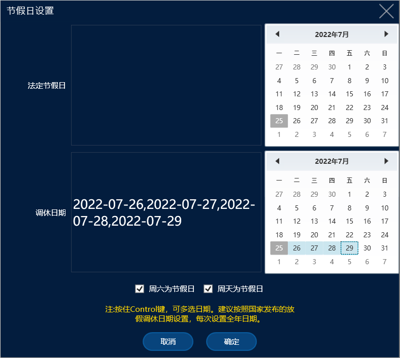

在车场收费规则需要设置节假日来配合使用时在这里添加节假日，设置调休日期时可以按住鼠标左键进行大规模的筛选

#### 收费标准

1. **收费标准名称**：自定义昵称
2. **车型类型**：选择你想要配置收费规则的车型
3. **车类类型**：选择你想要配置收费规则车型的车类
4. **跨区域计费规则**：比如A和B 两个平级区域  从A区域去B区域停车优先按照子时段计费还是单位时段计费
5. **跨单位日计费规则**：比如收费规则为白天和黑夜收费不同的收费规则(白天停车跨段到晚上)或者(晚上停车跨段到白天)是优先按照子时段计费还是单位时段计费													
6. **跨单位日是否补时**：针对与白天和晚上的收费标准																		白天6:00-18:00  晚上18:00-6:00  比如16:30-19:00出场																						补时:16:30-18:00 停车1小时30分钟 后30分钟为达到1小时就获取跨段后的停车时间 所以16:30-18:30  算白天的停车费用 18:30-19:30算晚上的停车费用																																			(补时的意思跨段之后如果前时段停车时间为满足1小时整 就会在跨段后的时段里面去获取时间 满足1小时后(注:这段1小时是按照跨段钱的收费规则计费的) 之后才算跨段后的收费标准）																			不补时:16:30-18:00 停车1小时30分钟 算白天的停车费用																					18:00-19:00算晚上的停车费用
7. **免费时间(秒)**：这里的免费时间要以秒来填写
8. **单次最高收费**：这里的单次最高收费级别是最高的

---

### 2.区域费率设置

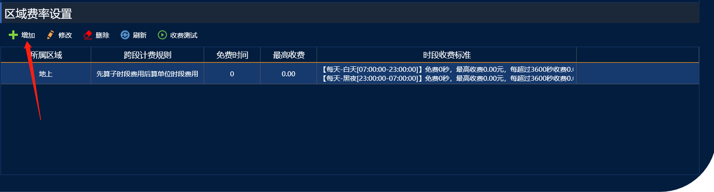

点击增加后会出现这个界面,再次点击增加后

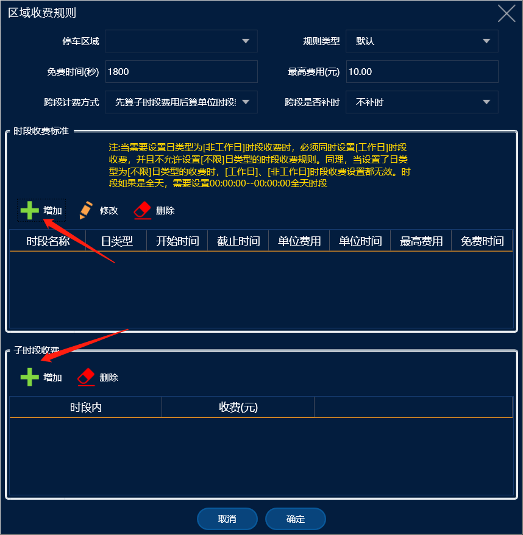
#### 时段设置

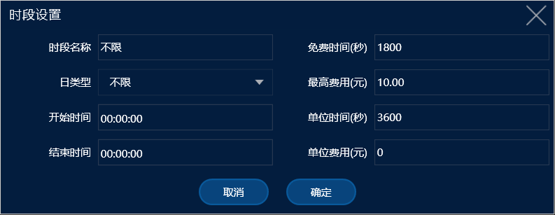

1. 时段名称：自定义名字
2. 免费时间：自定义时间以秒为单位填写
3. 日类型：分为工作日和非工作日，工作日可以在车型费率那里增加节假日
   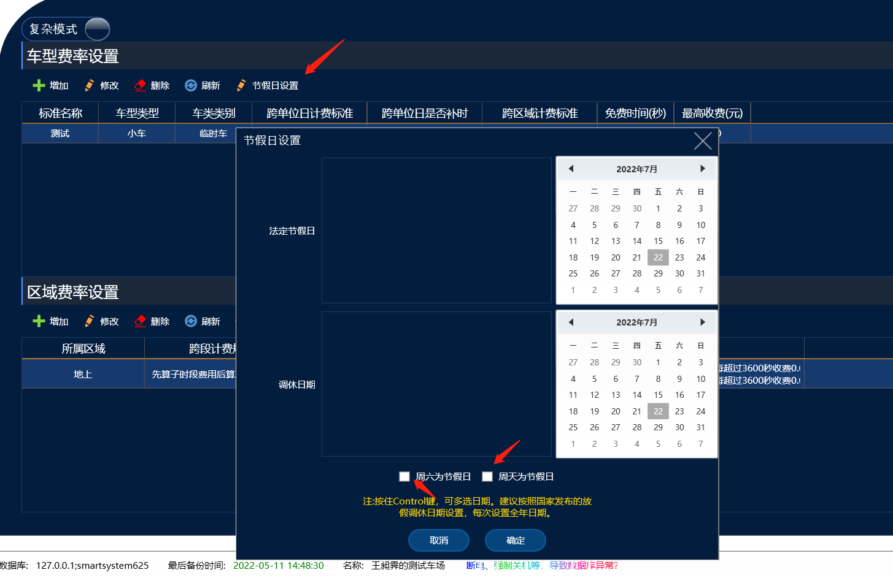添加好后可以根据是否为工作日来设置两个收费规则
4. 最高费用：根据时段来设置最高费用
5. 开始时间--结束时间：可以设置多个时段，分时段进行收费
6. 单位时间--单位费用：这里的单位时间和单位费用时一体的，例如要设置每小时收费2元，单位时间就要填1小时（软件内填写3600，软件的单位时间是以秒来计算的），单位费用就要填写2元。

#### 子时段设置

子时段为你自定义的这个时间段（这里的时间指停车时间），这个设置的意思是在你自定义的子时段内收费多少钱

---

如果暂时理解不了的话，我们这里有几个基础收费规则的方案

## 单位时段设置方案

#### **A-24小时循环计费收费标准**

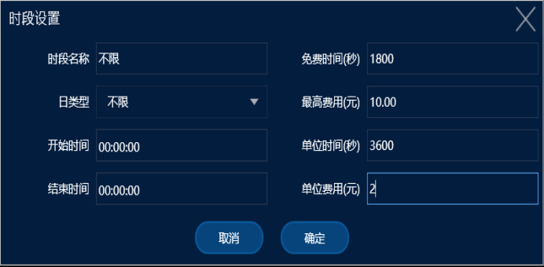

【车场收费规则：车辆免费时长30分钟，每个小时收费2元，最高收费10元】

免费时间：1800秒=30分钟

日类型：可以设置工作日和非工作日不同的收费规则

最高收费：10元

开始时间和结束时间都是设置00:00:00表示就是24小时循环计费

单位时间：3600秒=1小时

单位费用：2元

---

#### B-白天晚上循环计费收费标准

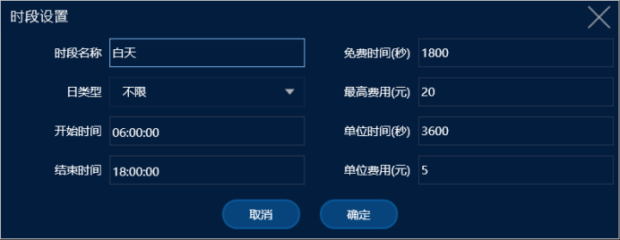

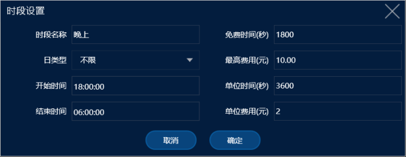

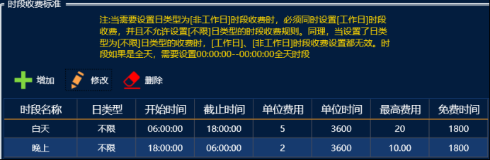

收费规则：

白天6:00-18:00 免费30分钟 每1小时收费5元 最高收费20元

晚上18:00-6:00  免费30分钟 每1小时收费2元 最高收费10元

---

#### C-工作日和非工作日收费标准

要先设置好非工作日再进行配置

收费规则：

工作日：24小时循环计费 免费30分钟 每1小时收费5元最高收费20元

非工作日：

白天：6:00-18:00 免费30分钟 每1小时收费2元最高收费10元

晚上：18:00-6:00 免费30分钟 每1小时收费3元最高收费15元

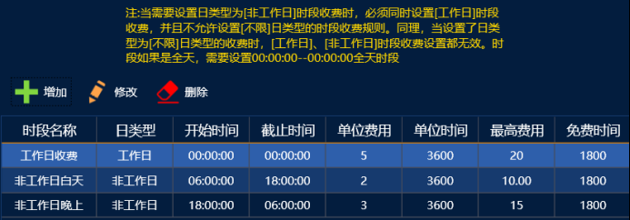

---

#### D-多时段不同收费标准

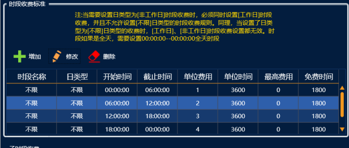

收费规则：

00:00-06:00 免费30分钟 每小时收费1元 最高收费0元

06:00-12:00 免费30分钟 每小时收费2元 最高收费0元

12:00-18:00 免费30分钟 每小时收费3元 最高收费0元

18:00-00:00 免费30分钟 每小时收费4元 最高收费0元

## **子时段设置方案：**

子时段分为二种意思

第一种：相当于首时段（比如1小时收费5元 之后算单位时段每小时收费2元）

第二种：是强制在多少时间内最高收费多少（可用来限制多个时段的最高收费比如每1小时收费2元  12小时限制最高收费10元 24小时限制最高收费20元）

同时设置了单位时段和子时段的收费标准是优先算子时段的时间之后才会算单位时段的时间

**免费时间：**

另外免费时间还有一个重点就是在免费时间内不计费，超过免费时间会计算加上免费时间的费用，比如每小时收费2元 ，第1小时收费0元 第2小时就会收费4元，如果不需要加上免费时间来收费，就需要设置1小时内收费0元的子时段规则 强制不计费，第2小时才只会收费2元。

#### **第一种设置方案：**

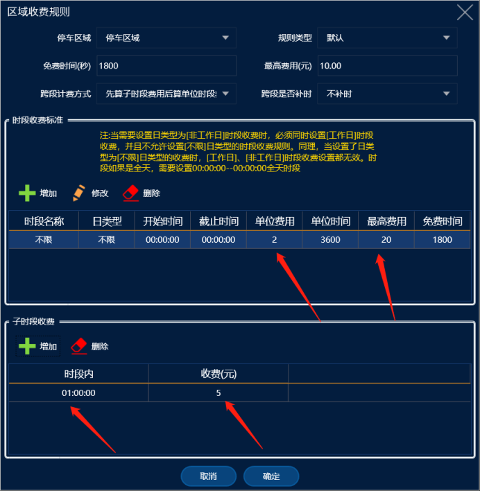

|单位时段设置了30分钟免费 每3600秒（1小时）收费2元 ，最高收费20元，子时段设置了1小时收费5元|

比如停车了6小时：收费15  （系统默认先计算子时段，再计算单位时段）（先计算了子时段的费用即第一个小时5

元，后面按照单位时段计算为10元（停车6h减去子时段计算的1h，为5h，单位费用为1h收费2元，所以得出10元）

两者相加为15元。

#### **第二种设置方案：**

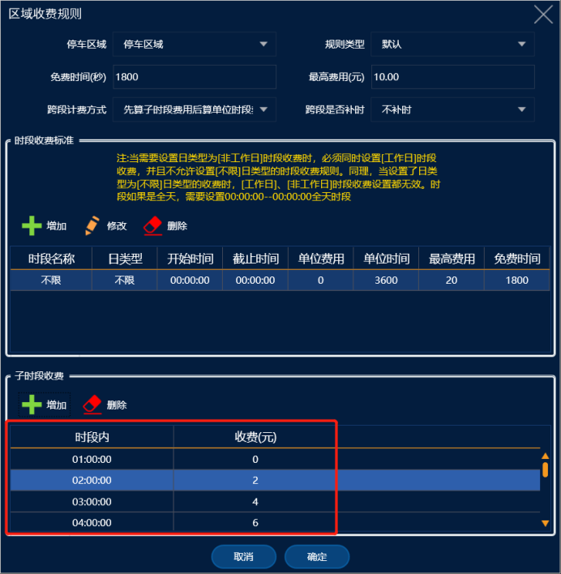

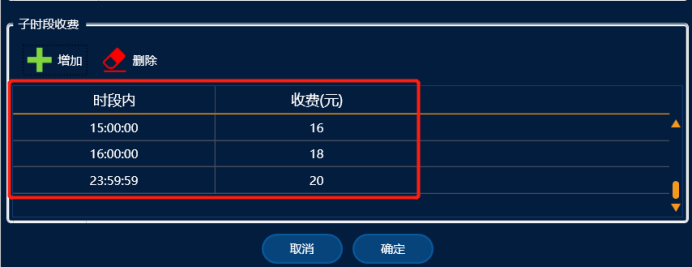

这种收费规则就是完全用子时段限制多少时间内收费多少，没有用到单位时段设置规则

比如第1小时免费， 之后每1小时收费2元， 12小时内最高收费10元， 24小时内最高收费20元，											 (多段时间限制了最高收费金额12小时和24小时)

就用子时段设置：1小时收费0元，2小时收费2元， 3小时收费6元， 4小时收费8元， 12小时收费10元， 13小时收费12元， 14小时收费14元， 15小时收费16元， 16小时收费18元， 23:59:59小时收费20元，以此达到多段时间限制最高收费的要求。

---

#### 按次收费标准

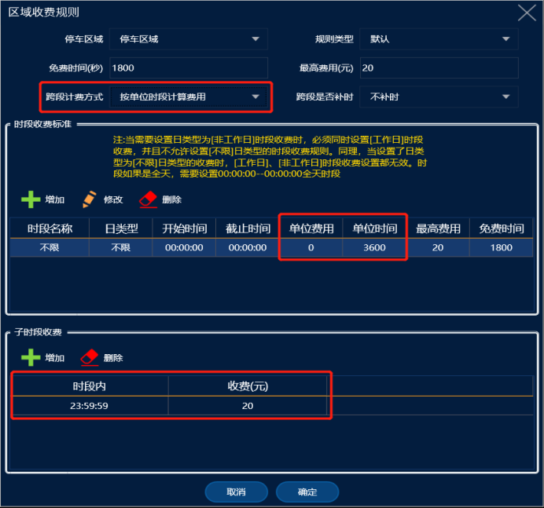

单位时段设置：3600小时收费0元

子时段设置：23:59:59  收费20元

**跨段计费**方式改成：**按单位时段计算费用**

**讲解：**

单位时段和子时段同时设置了，就先按照子时段时间计费，子时段设置23:59:59 然后子时段收费了20元，停车时

间跨段到第2天时，因跨段模式为按单位时段计算，所以跨段时就只算单位时段不算子时段了，又因为单位时段设置的

是每小时收费0元，所以后面的停车时间都是收费0元。（跨段计费设置成按照单位时段计费）
