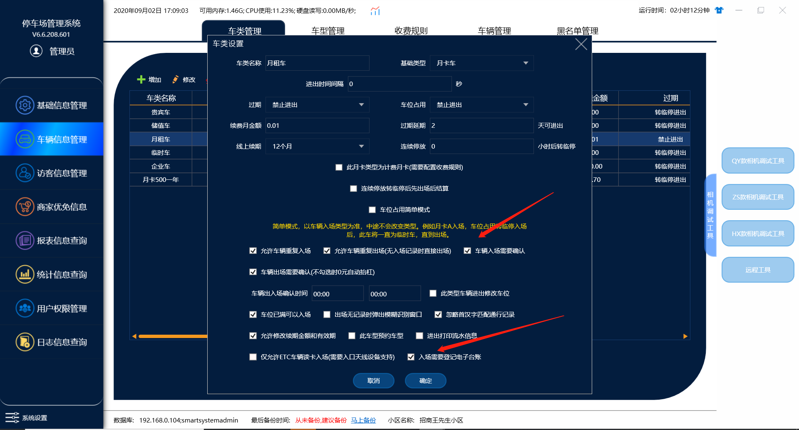
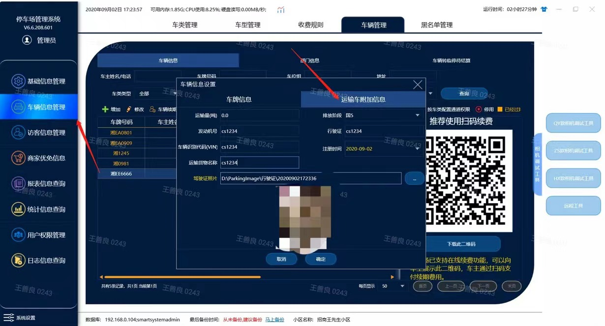
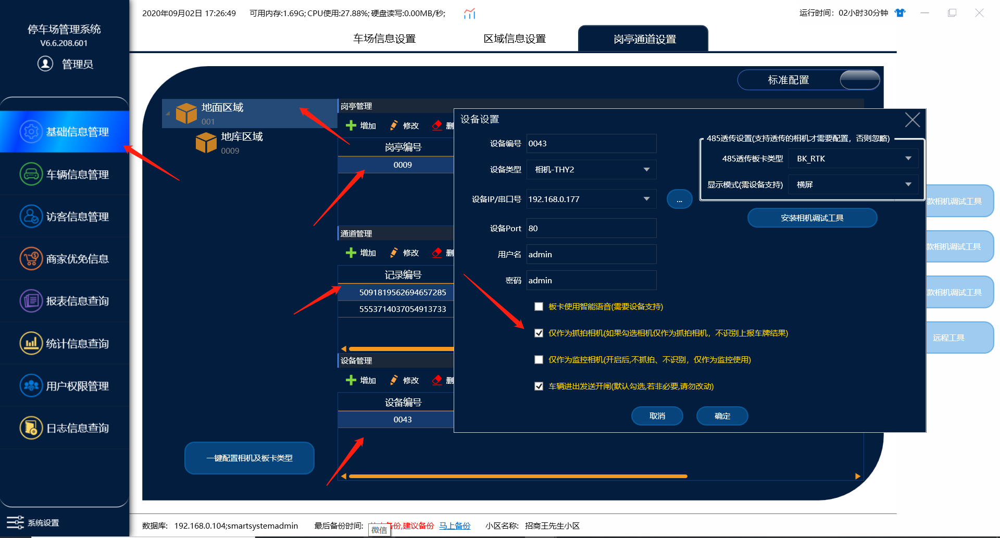
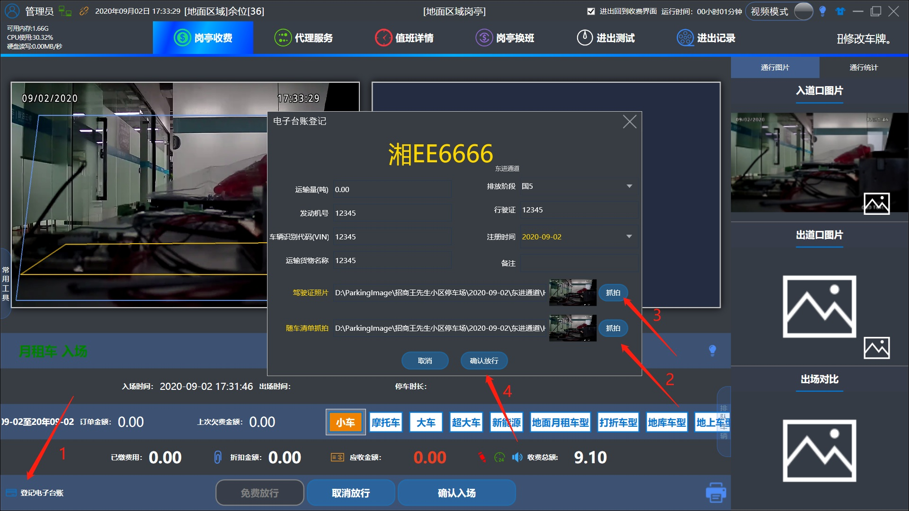
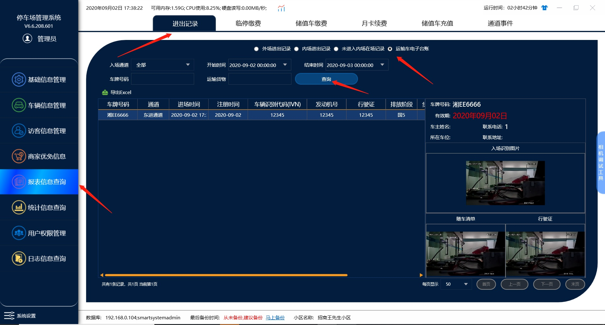

# 电子台账说明书

## 1.在车类管理里面勾选

（*需要登记电子台账和入场确认*）

## 2.添加车辆信息的时候设置运输车附加信息

## 3.在设备管理里面添加一个抓拍相机

（*勾选抓拍相机*）

—**注意**:抓拍相机需要另外添加一台相机来做为抓拍相机,不能用进口相机来做为抓拍相机,这样会导致车辆入场不识别

## 4.在收费端车辆入场的时候点

（登记电子台账）

然后可以抓拍随车清单和驾驶证照片最后点确认放行

## **5.最后在管理端报表信息**

> 进出记录->运输车电子台账可以查询记录

