# mysql版本软件安装流程

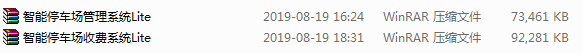

软件一般是采用压缩包形式，在我们提供的网址中下载好后第一步是解压出来

### 1.解压文件

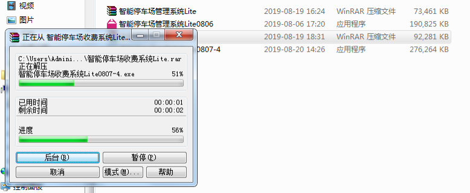

### 2.安装管理端

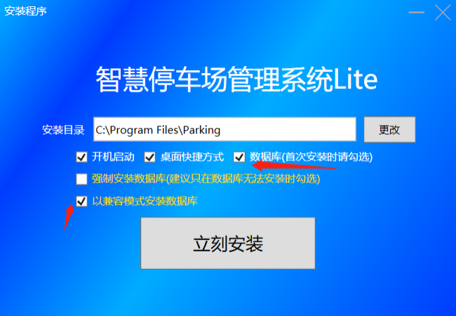

首次安装数据库是要将箭头指向的选项勾选上

### 3.安装数据库

点击立刻安装后会出现这个安装数据库的界面

点击下一步后还会出现一个界面，再点击一次下一步耐心等待就安装好了

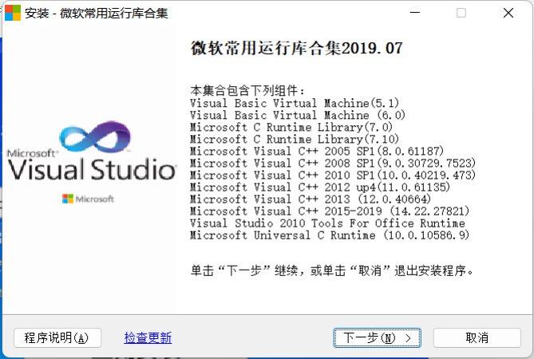

### 4.创建数据库

安装好管理端后打开软件

打开软件后点击创建数据库

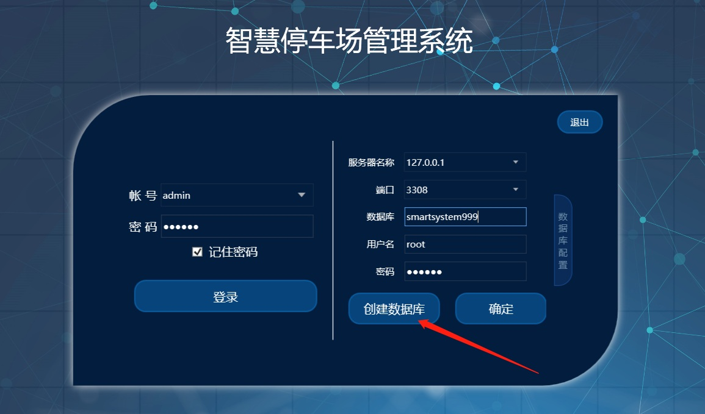

点击后会出现以下界面，点击确认
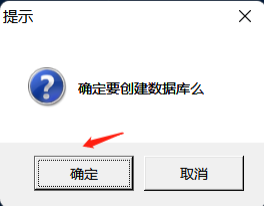

再耐心等待一会儿
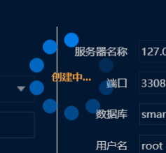

等待30秒左右后会出现这个界面

**第一次使用我们软件的用户请选择本地创建数据库**

如果是老用户可以在之前电脑的备份上恢复，点击从备份数据恢复，然后选择您要恢复的数据库进行恢复即可

如果没有备份但是有在我们平台上上传的话可以点击从平台恢复，注意这个从平台恢复需要您车场的编号，具体编号联系我们技术人员

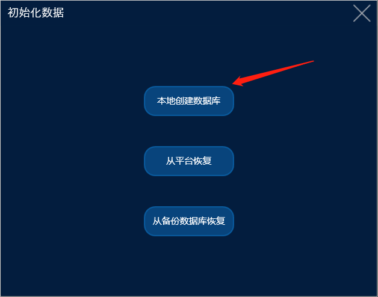

点击本地创建数据库后会出现这个界面

根据你的小区名字来填写（车场名字也可以）

这个账号和密码系统默认的是 admin  888888（6个8）
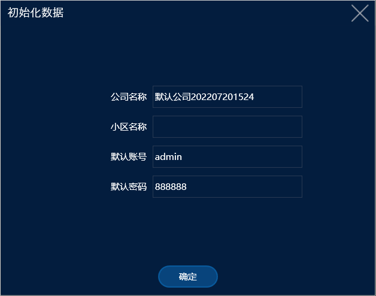
点击确认后会出现这个界面

### 5.登录管理系统

初始化完成之后再点击确认
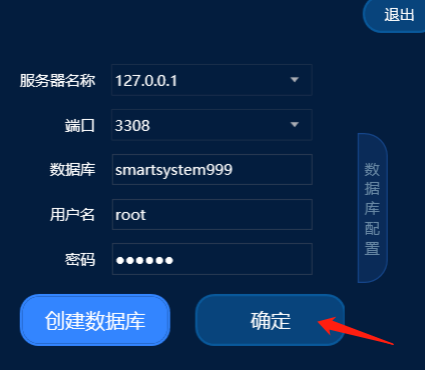

输入好账号密码后再点击登录便完成了

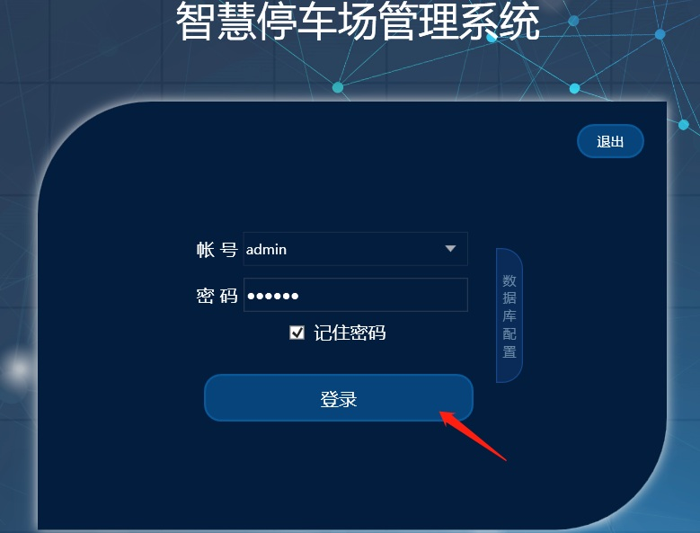

**注意：遇到创建不了数据库，登不上软件或者报错请联系售后技术人员。**
