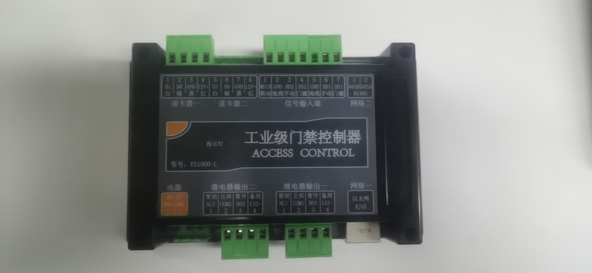
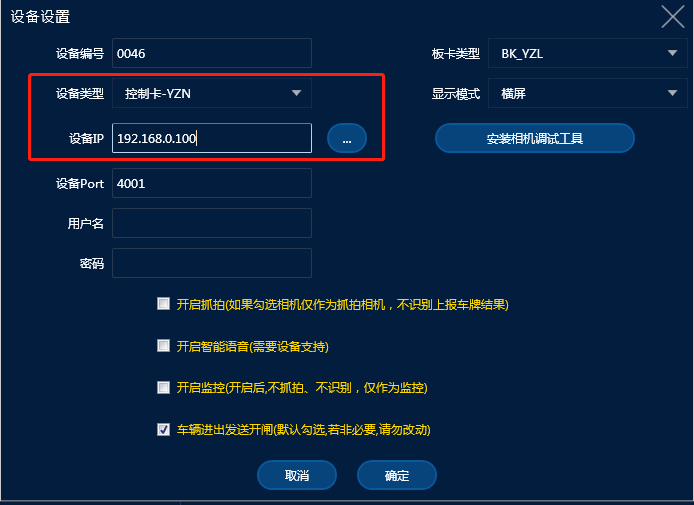
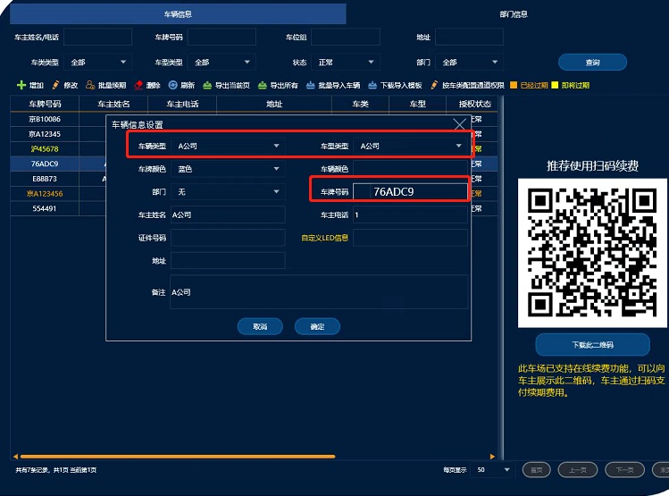
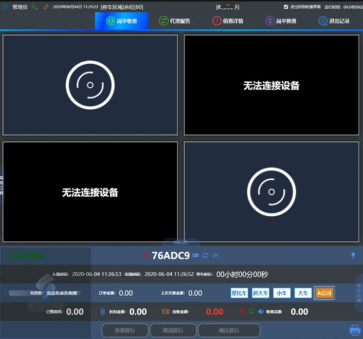
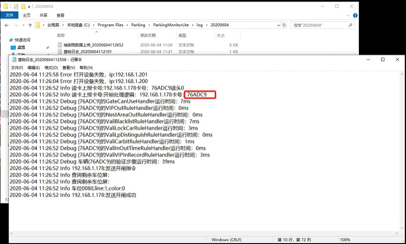

# 非机动车刷卡使用说明

**摩托车的月卡和临时卡管控，刷卡设备可以放在机动车通道也可以放在非机动车道**

### 1.添加刷卡设备

> 这款是常用的刷卡主板

在添加设备的时候一般与相机添加在同一通道下面

只需要选择好对应设备类型添加IP地址即可，其它的设置不必要去动

### 2.卡号录入系统

在管理端车辆管理里面需要把所有的卡号都录入进去才能使用  **选择好车类车型之后在车牌号码那一栏里面首汉字可以点击一下选择空白然后用发卡器读出来卡号保存即可**（月卡，临时的都要录入进去临时的可以根据车类车型添加收费规则会正常计费）

### 3.收费端使用

在收费端只要刷卡都会有提示,处理流程等同车牌

## **注意事项：**

有客户反映**刷卡之后收费端没有反映**，这个应该是刷卡器和读卡器的频率不一样，导致读卡器读到的卡号和刷卡器录入的卡号对不上 这个时候**必须联系硬件的厂家**  把设备的频率调试成一样的才可以

下面图片可以看到在日志里面看到读卡器的卡号，只要刷了，就算收费端没反应也可以查到，如果没反应证明这个卡片在车辆管理里面没有添加

