# 公众号说明书

在公众号搜索并关注该公众号即可使用菜单所展示的功能

公众号一共三个一级菜单

一，**临停缴费**：

车主点击后输入车牌可以在线缴纳停车费用，在15分钟内（默认时间可修改：在管理端软件上车场管理里面，修改支付免费出场时间），可以直接出场，

支付完成后 会自动记住上一次支付的车牌信息 下次在用同一个微信操作支付 就不用在输入车牌号了

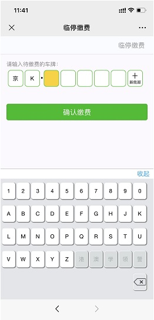
默认车牌前缀在车场云平台上，车场管理里面进行修改

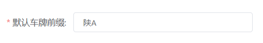
二，**个人中心**

1.我要发票（该功能主要是车主支付完之后可以到这里开通电子发票，需要车场开通此功能才支持）

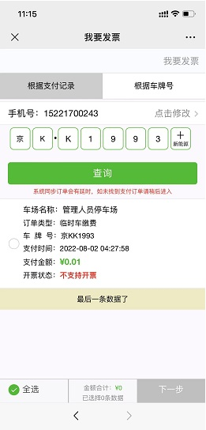
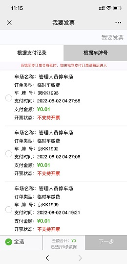

可以根据支付记录查询车牌号进行开票也可以根据手机号搜索车牌进行开票

2.月租续期

a.根据车牌号续期，输入月租车的车牌号直接可以在线续期（储值车输入车牌可以直接充值）

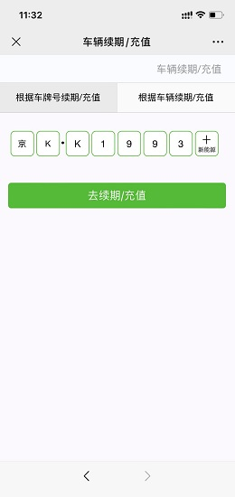
b.根据车辆续期，输入办理月卡车的正确手机号码 可以绑定所有在我们平台下车场的月租车

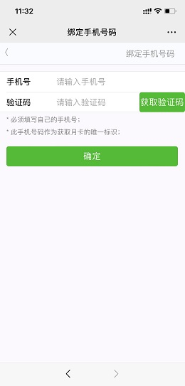

c.绑定手机号后便可查询对应手机号绑定的所有车场的车牌号，进行续期

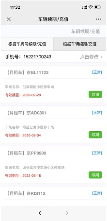

可以直接点击续期进行续费或者储值车充值操作

3.缴费记录

可以在这里查到所有临停车缴费和月卡续期缴费的记录

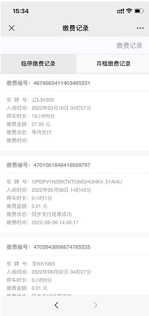

查询这个手机扫码支付的临停费用

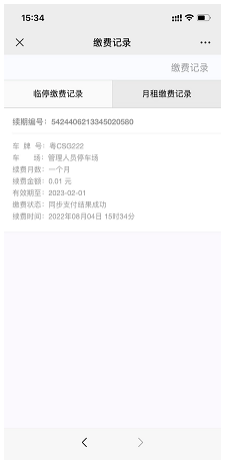

查询这个手机月租车扫码续期的记录

4.访客管理

车场上了平台即可使用。主要是管理员或者在月卡续期绑定了手机号码并且有效期在正常使用范围内的月卡车主添加访客车辆，主要用于小区或者办公单位只允许月租车进不允许临时车进的情况，这种情况添加的访客车可以进出。并且可以通过进出次数和时间来对访客车进行管理

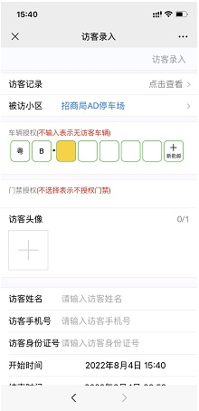

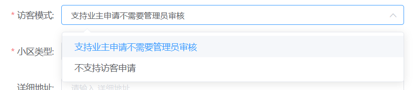

在车场云平台上 小区管理里面 访客模式改成支持业主申请不需要管理员审核  业主添加访客的时候才能选择对应的车场，在管理端车辆信息里面 添加月租的信息 电话号码需要填业主的手机号 业主才能在公众号里面添加访客，添加的访客默认是小车车型 停车时长按小车车型的收费规则计费

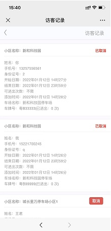

查询申请的访客记录状态

5.锁车解锁

用于车辆防盗的一个功能，适用于月卡车，锁车之后车辆就不能离场必须在公众号里面解锁完才可以离场

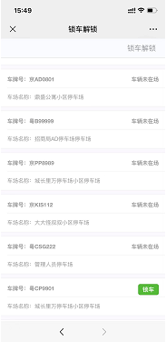

三，**其他服务**

1.车辆申请

主要适用于在线申请月租车辆，车主点击车辆申请后通过搜索车场名字找到需要申请月租车的车场点击申请

填好相关资料即可（可以用来申请的车类型可以在平台设置）

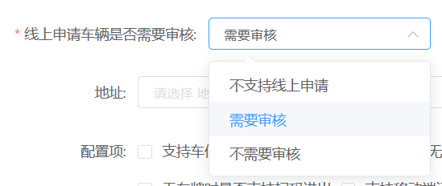

平台上车场管理里面：线上申请车辆是否需要审核有三种

不支持线上申请：业主在公众号里面车辆申请就查不到这个车场

需要审核：业主添加好车牌号后 管理员在车场云平台上 车辆信息里面有一个车辆审核 可以操作允许或者拒绝 允许就的情况下管理系统里面自动录入成月租车

不需要审核：业主添加好车牌号后 就会自动录入到管理端系统里面 就已经变成月租车了

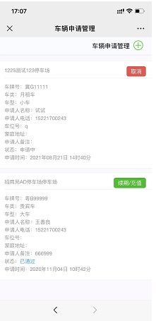

点击加号申请月租车

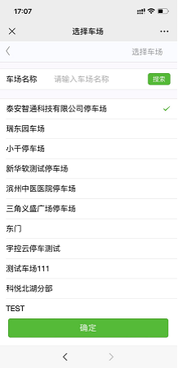

搜索需要申请对应的车场名称

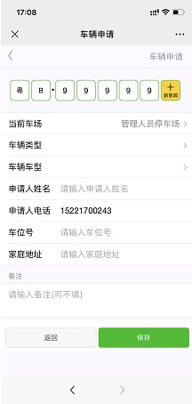

添加车牌号码 车辆类型 车辆车型  （需要在平台上车类管理里面勾选，线上申请车辆允许申请该车类）在申请月租车的时候才能选择车类和车型

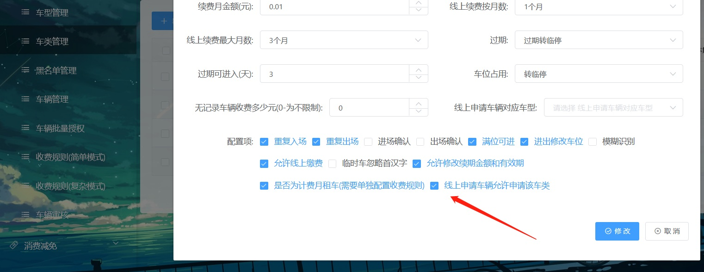

添加好之后点保存即可

2.车场运营（可通过平台账号登录）

车场管理员可以在里面查到当天的收费情况查询车场的进出记录在场车辆等报表也可以实现在线监控和远程开闸还有月卡增加续期等功能
