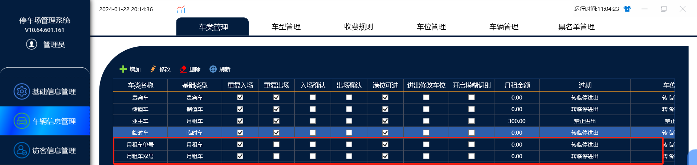
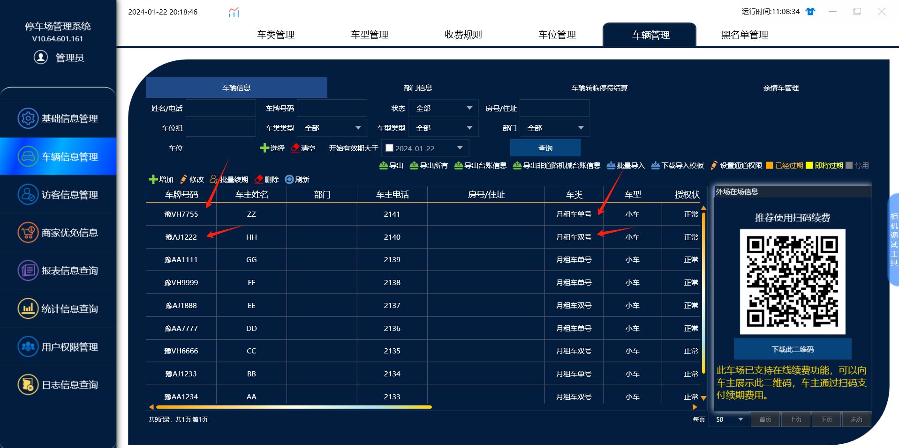
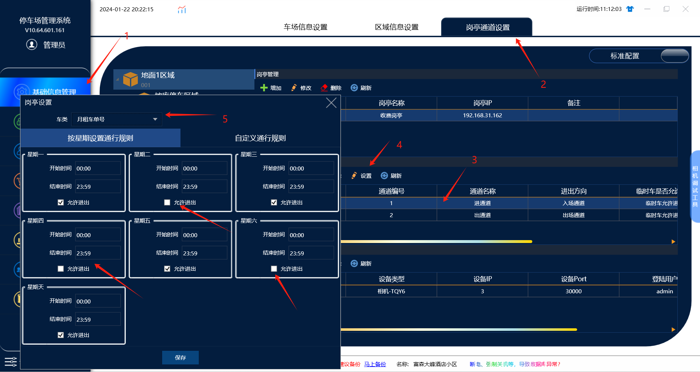
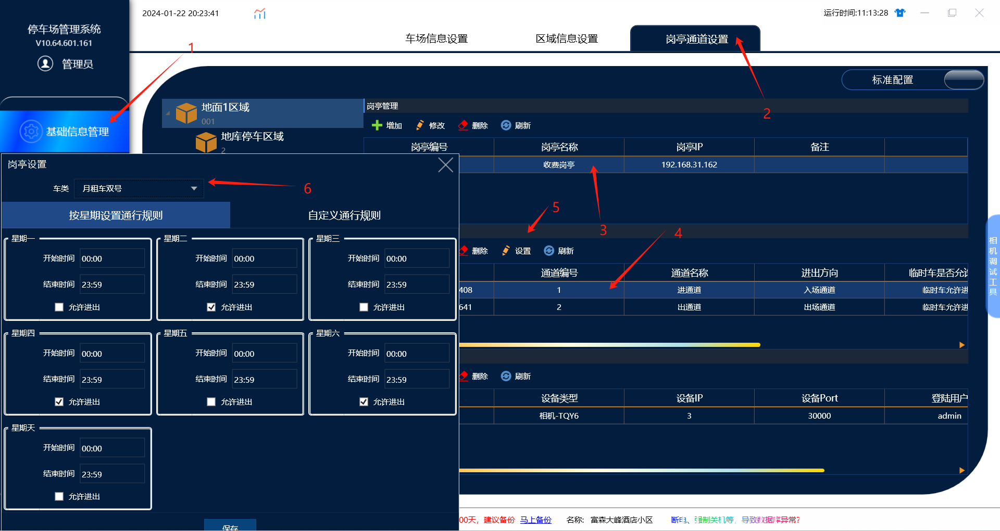

# 单双号限行功能

此功能只能适用把车牌录入在软件里面的车牌，外来临时车的话不支持设置

可以实现，单号车只有周一，周三，周五，周日可以进出，双号车只有周二，周四，周六可以进出

基础车类默认是有四种：【临时车，月租车，储值车，贵宾车】其中只有临时车类只能存在一个，不能重复添加，其他的基础类型的车类就可以添加多个

所以我们需要在车类管理里面添加2个基础类型为月租车的车类：一个月租车单号，一个月租车双号，车类名称是可以修改的，基础类型名称是无法修改的

设置流程：

一。首先需要添加2个车类，一个月租车单号的车类，一个月租车双号的车类

二。然后在车辆信息里面绑定车牌，车牌尾号为单号的绑定成月租车单号车类，车牌尾号为双号的绑定成月租车双号

三。最后在通道管理里面，点击【设置】对应车类的允许进出的时间

单号车类：就取消勾选周二，周四，周六的允许进出的权限，然后点击保存

双号车类：就取消勾选周一，周三，周五，周日的允许进出权限，然后点击保存

