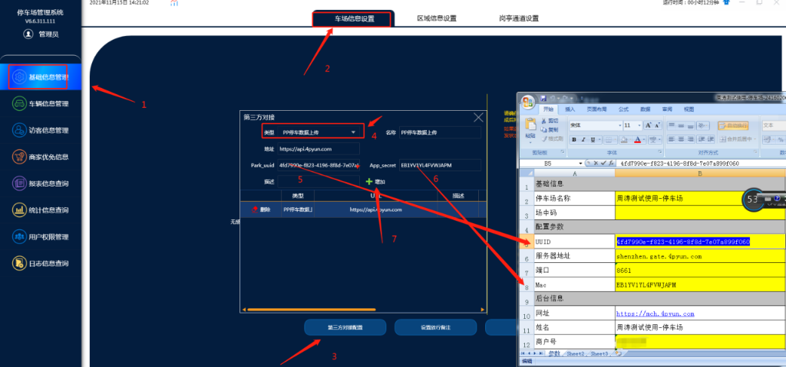
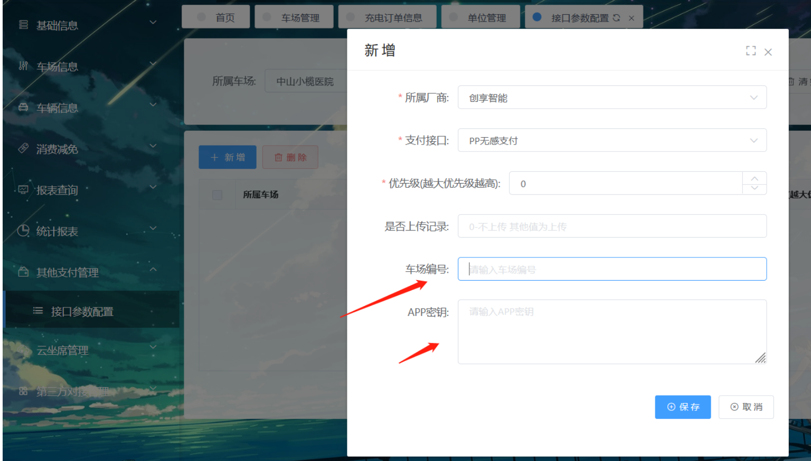
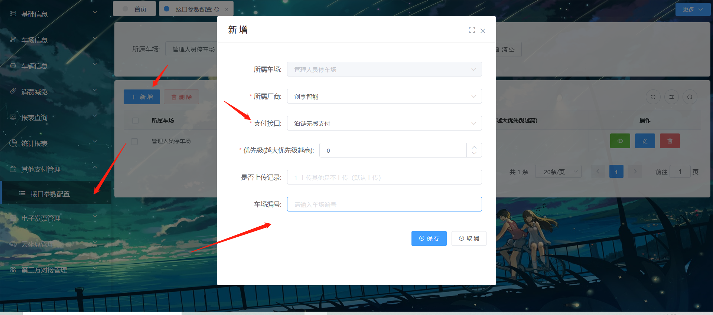
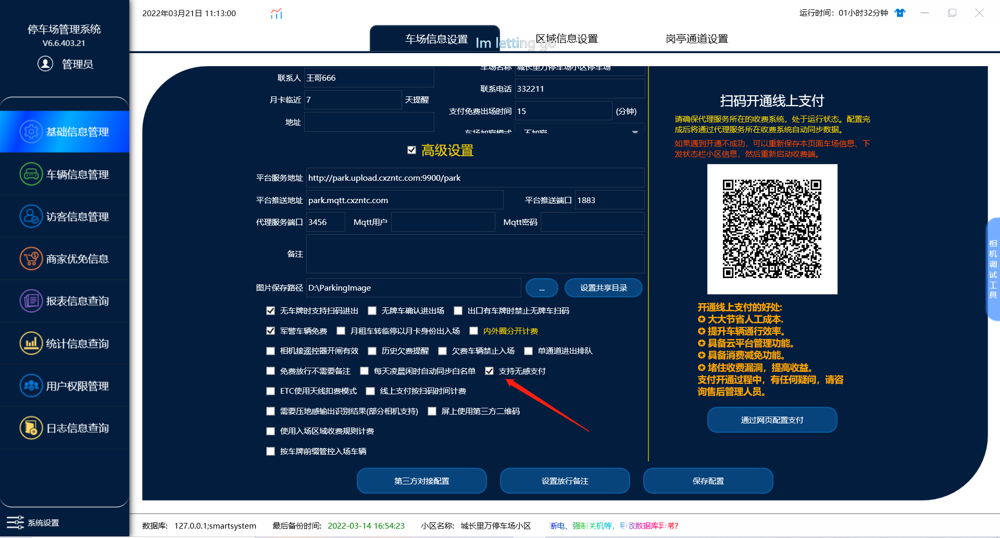

# 开通无感支付的方式

目前就pp无感支付 和 泊链无感支付

一，**pp无感支付配置方案**

首先把管理软件和收费软件更新到最新版本

1. **打开管理端** →**基础信息管理** →**车场管理** →**第三方对接配置**

类型选择  ：PP停车数据上传

地址      ：https://api.4pyun.com（系统默认会有）

park_uuid  :  UUID (对应PP参数文档里面的UUID)

App_serced :  Mac  (对应PP参数文档里面的MAC)

对应PP文档在哪里申请的就找对应的厂商 要求提供

配置这个把进出记录上传到pp平台

a.软件上在勾选这个 支持无感支付的功能 （勾选上后需要重启一下收费端岗亭软件）

b.然后再平台上其他支付管理里面在添加一个pp无感支付

车场编号填：UUID (对应PP参数文档里面的UUID)

APP密钥填：Mac  (对应PP参数文档里面的MAC)

配置好这3步 然后联系pp支付那边开通无感支付就可以了

二。泊链无感支付配置

a. 在平台上其他支付管理里面直接添加一个泊链无感支付， 然后填入在泊链平台申请的车场编号就行。

b.在管理系统里面勾选支持无感支付的功能。（勾选后需要重启一下收费软件）

c.最后联系泊链平台那边的人帮忙把这个申请的泊链车场编号的这个车场开通无感支付就好了。
