# 基础信息管理

## A.车场信息设置

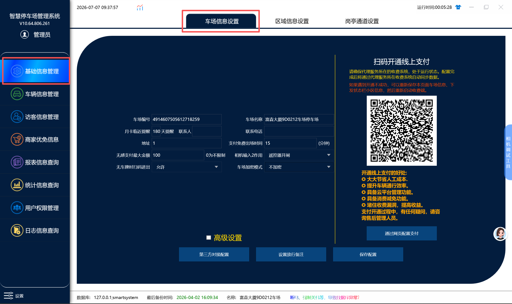

**车场信息设置几个常用设置（下面没有介绍的不需要去修改，都用默认即可）**

:::warning 原文图片缺失
原文档此处有 2 张配图，来源为作者本机的临时路径（`C:\Users\86159\AppData\Local\Temp\...`），无法获取。如需补充请联系文档原作者。
:::

1. **车场名称**：实际停车场的名字，后续如果上平台车场有问题需要告知售后人员停车场名字以便后续处理问题
2. **月卡临近（7）天提醒**：7这个数值自定义，可以修改，代表月租车辆在只有7天以内的有效期的时候，在进出场的时候显示语音会对这些车辆做出提示
3. **支付免费出场时间（）分钟**：走线上支付的时候，可以提前扫码缴费，免费出场时间代表场内提前缴费后可以免费出场的时间，超出这个时间之后又会重新计算费用
4. **支付免费时间（）分钟**：在车主支付完金额后在车场内会免费的时间
5. **无感支付最大金额**：设置多少金额用无感支付就最多扣多少钱。比如设置10元停车费产生了15元， 用无感支付最多就扣10元。
6. **相机输入2作用**：车场有配置遥控器的话，这里需要改成遥控器，然后通过遥控器开闸就能在通道事件里面查到遥控器开闸的记录
7. **无车牌时扫码进出**：可以设置成允许直接扫进出口二维码，触发无牌车进出，或者设置不允许扫和仅入口或者仅出口支持直接扫码进出，不允许直接扫的话，就需要配合在高级设置里面勾选无牌车确认进出场的功能，这样就是需要车压地感，相机触发一个无牌车，无牌车在入场确认的情况下，才能扫进口二维码触发无牌车入场。
8. **车场加密模式**：默认设置不加密，如果相机有加密的话，就需要通过软件来解密相机，这里加密模式选择自定义，然后把密钥填进去保存就能解密相机，或者相机多的情况下，都加密成了一种密钥，可以联系我们这边做一个固定的模式，后面直接选择对应模式解密相机

---

## 1.高级设置
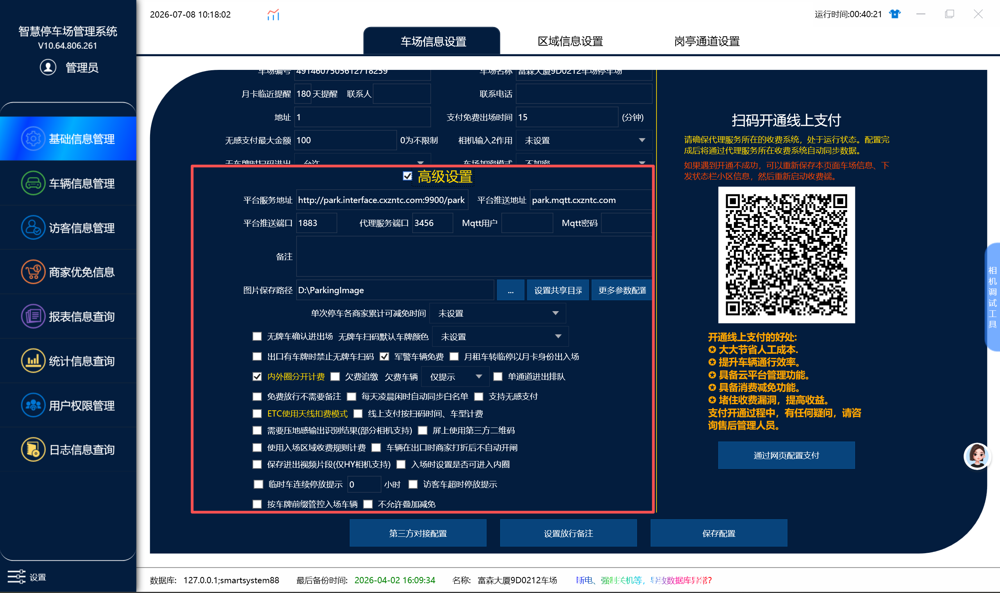
1. **Mqqt用户账号及密码**：这个不需要修改。
2. **图片保存途径**：这个路径是指管理端调取图片的路径，默认路径保存在D盘的这个文件夹里面，如果电脑没有D盘就需要改一下路径，才能存储每次进出的相机抓拍的图片到磁盘里面，这样在后面报表里面可以看到对应车辆的抓拍图片
3. **单次停车各商家累计可减免时间**：商家给车主减免的时间，累计的时间不能超过这设置的时间。（假设限制12小时，商家第一次给车主减免5小时，第二次叠加也给车主减免5小时，第三次叠加减免最多就只能减免2小时了）
4. **无牌车扫码默认车牌颜色**：假设设置绿色，那么这样扫码入场的无牌车就默认按新能源车型的收费规则计费，扫码入场的也就算是新能源无牌车。
5. **无牌车确认进出场**：勾选代表无牌车需要在收费端点击确认入场（出场）才能出入场，不勾选代表不需要确认软件就能开关闸（出入场）
6. **出口有车牌时禁止无牌车扫码**：和“3.”是配套的，因为开启了“3.”的功能后就算不是无牌车也可以扫码就能进出，但是勾选后在出口处识别到车牌时就禁止直接扫码以无牌车的身份进出了，不勾选则反之
7. **军警车免费**：在需要收费的停车场,勾选表示军警车不会计算费用，可以免费进出，不勾选军警车会和临时车一样，产生费用出口不会自动放行，需要收费放行
8. **月租车转临停以月卡身份入场**：勾选代表月卡车在车位管控的时候，会以月卡车身份进入停车场（有些车场临时车不能入场），不勾选表示月卡车在车位占用的时候会以临时车的身份进入停车场
9. **内外圈分开计费**：勾选后不同的区域分开计费，不勾选则统一计费（一般不做勾选，是个非标功能，有具体需求请联系技术员）
10. **相机接遥控器开闸有效**：相机连接了闸门的两条线后，车场管理员用遥控器手动去开关闸门，勾选则当遥控器开闸时软件会做记录，不勾选则反之
11. **欠费追缴**：有单独写这一块的说明书
12. **单通道进出排队**：车辆在一个通道进出时，进出相机识别到多辆车时，会优先显示后面识别到的车牌并且将前面的车牌覆盖掉且无论前面的车牌有没有缴费或开闸，勾选后处理完前面的车辆才会处理后面识别的车牌，不勾选则不变
13. **免费放行不需要备注**：收费端免费放行时会提示填写备注，勾选后免费放行时就不需要备注，不勾选免费放行时就需要备注
14. **每天凌晨闲时自动同步白名单**：勾选后凌晨就同步白名单，不勾选则相机则不会每天自动同步白名单
15. **支持无感支付**：勾选代表支持无感支付，不勾选代表不支持无感支付
16. **ETC使用天线扣费模式**：勾选后etc使用天线扣费模式，不勾选则不使用按照默认方式扣费
17. **线上支付按扫码时间计算**：勾选后按照扫码支付时结束停车时间（例如在10:59:00车开到出口，扫码支付时间是11:01:00勾选后就是按照11:01:00离场计算停车时间），不勾选则是车辆开到出口识别到车牌就结束停车时间（按10:59:00离场计算）
18. **需要压地感输出识别结果**（部分相机支持）：有地感时，勾选后只有地感有反应后相机才会识别结果，不勾选则不会
19. **屏上使用第三方二维码**：勾选后允许使用第三方二维码，不勾选则不允许使用第三方二维码（非标功能，一般不勾选，有具体需求请联系技术员）
20. **使用入场区域收费规则计费**：（假设设置了两个区域，一个A区域，一个B区域两个是不同的收费规则，）从A区入口进入后，在A区域停车，又从B区出口出去。不勾选时系统使用的收费规则则为B区（车辆**出去**的区域）的收费规则，勾选后则会优先选择A区域（车辆**进入**的区域）的收费规则
21. **车辆在出口时商家打折后不自动开闸**：勾选这个功能的意思是车在出口识别产生费用后，如果商家打折了车主的全部停车费用，不勾选这个功能的情况下会自动开闸离场，勾选后就还需要确认放行，不会自动开闸出场。
22. **保存进出视频片段**：目前仅VZ相机支持，勾选后 可以在图片存储的那个路径下面看到存储的进出视频。
23. **入场时设置是否可进内圈**：勾选这个功能内圈区域就不能入场。
24. **临时车连续停放提示（）小时**：假设设置10小时，临时车入场后超过10小时收费端就会发出提示和警报那些临时车停车超过了10小时
25. **访客车超时停放提醒**：勾选这个功能后，访客车入场后，在限制的结束时间内车还没有出场的话，就会在收费端右下角弹窗提示那些车超时了没有出场。
26. **使用第三方平台收费规则计费**：勾选后则允许使用第三方平台收费规则计费，不勾选反之（非标功能，一般不勾选有具体需求请联系技术员）
27. **不允许叠加减免**：默认不同的商家是支持给同一个车牌进行叠加减免的，勾选这个功能后就是显示不同商家就不允许叠加减免。
28. **按车牌前缀管控入场**：勾选后会出现下面这个画面，如图，选择车牌前缀“粤T”则这个车场不允许“粤T”为前缀的车辆禁止进出。

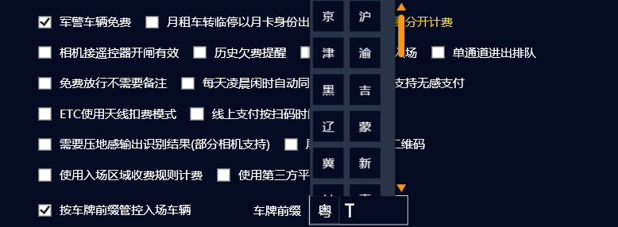

## 2.通过网页配置支付
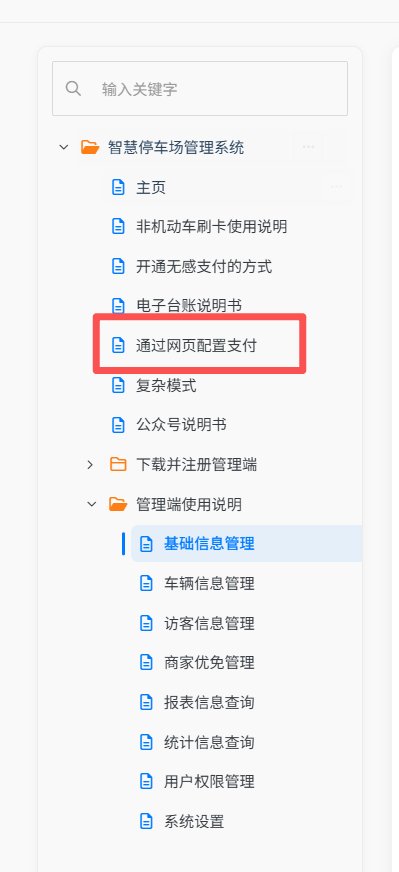
在智慧停车场管理系统文件的子页面上有详细的配置

## 3.第三方对接配置

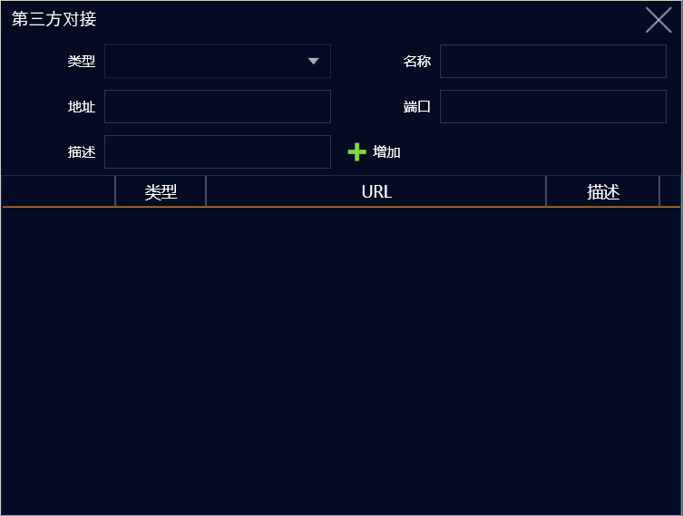

对接第三方添加的地方（非标功能，一般不需要配置）有具体需求请联系技术人员

## 4.设置放行备注

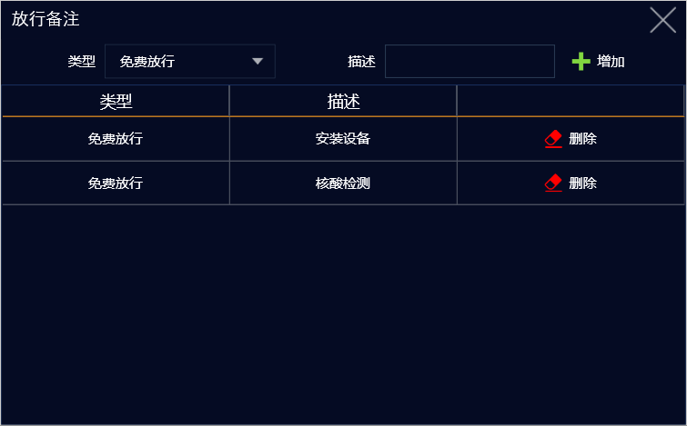

在这里根据放行的类型（免费放行，修改金额，异常放行，手动抬杠）添加备注类型，如图，选择免费放行添加一种备注类型那么

在收费端运行时有特殊车辆进出碰到添加备注的情况时可以直接选择放行原因的类型，如图。

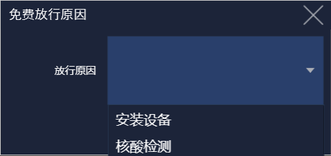

## 5.保存配置

**设置好后记得点击保存配置**

---

## B：区域信息设置

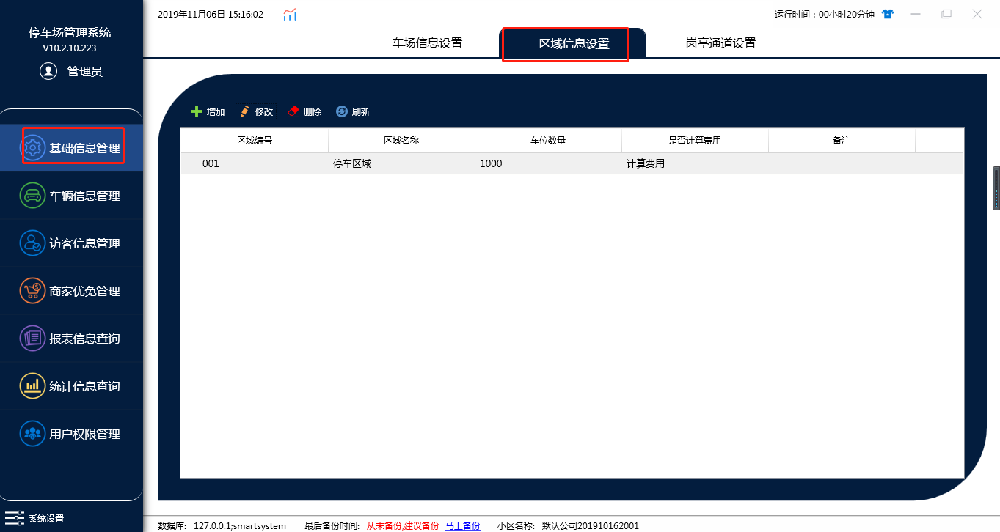

增删改查停车场对应的区域信息，在有多个区域时在这里添加，在同一个车场有地上和地下两个区域时可以在这里添加两个区域并且将地上设置为地下的上级区域，这样就可以将俩个区域连通到一起了，即只能先进入上级区域才能进入下级区域（大小停车场）

**1.大小停车场（可以套用1大N小停车场）**

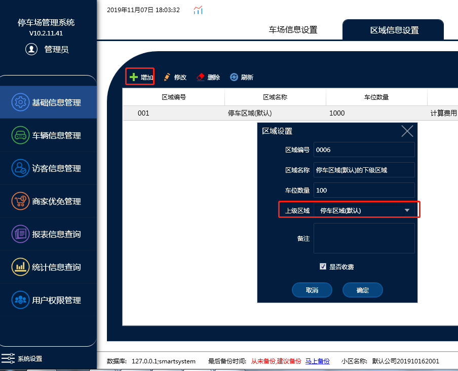

默认只有一个停车区域，点击增加，上级区域选择停车区域（默认），点击确定

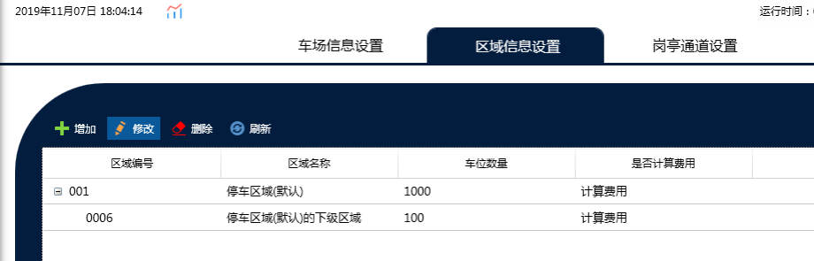

这样停车场整个区域里面就增加了对应的小区域

**注**：只有一个区域时，添加一个区域不能选择上级区域，要设置两个区域后再进行修改选择上级区域
**1.**是否计费：取消勾选这个功能的话，停车在这个区域进出就不会计费，勾选计费的话 才会按区域配置的收费规则计费

## C：岗亭通道管理：

### a.一进一出快速配置

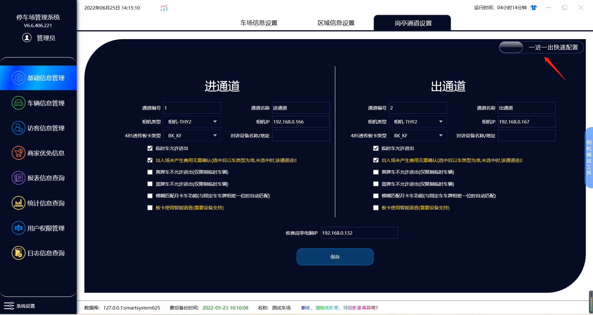

当只有**一个进通道一个出通道**时可以使用此功能**快速配置信息**

这个**快速配置**的设置标准和**标准模式**的设置**一样**，不懂的**参考**标准模式

### **b.标准配置添加岗亭**

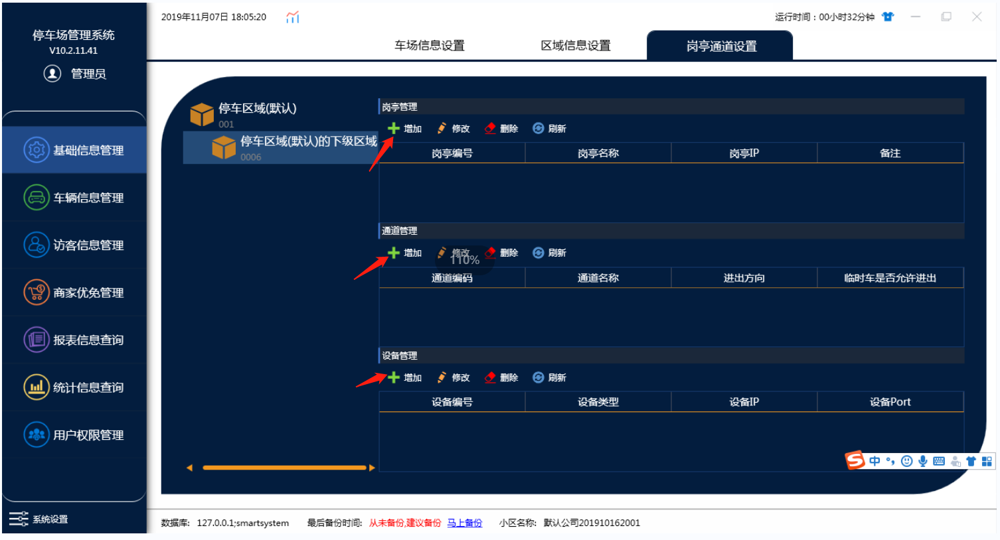

**选择对应区域就可以为这个区域添加岗亭，然后添加对应的通道，对应的设备（如果两个区域用一台电脑管理，岗亭IP设置一致即可，软件支持1电脑管理多区域）**

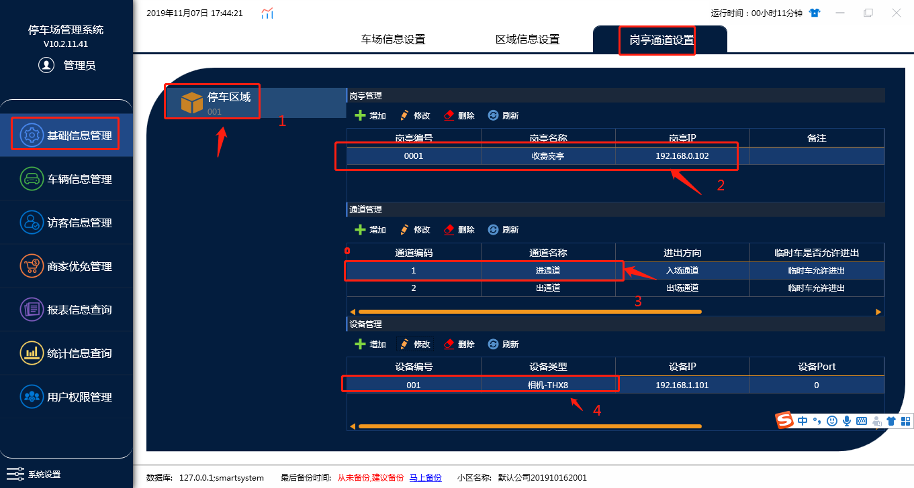

要先选择对应的岗亭，下面才会出现通道信息，选择对应的通道，下面才会出现设备信息（有些现场多岗亭多通道），按照上图1-2-3-4步骤

选择对应的设置

#### 1.岗亭设置：

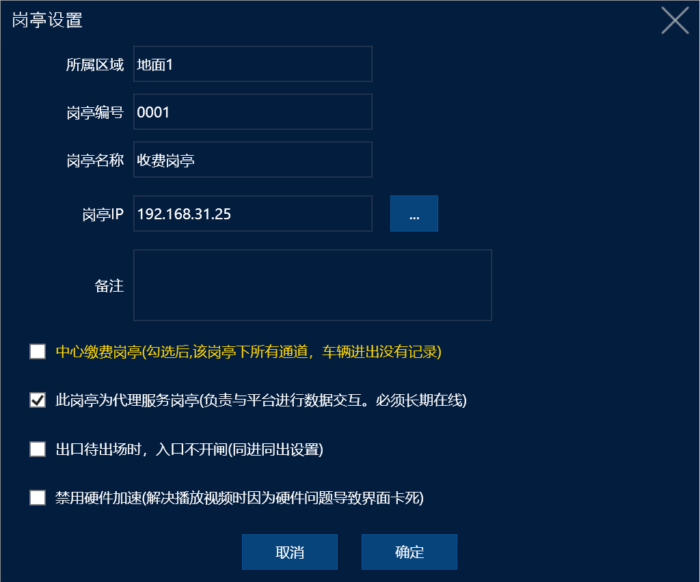
点击增加或者修改都会出场这个界面：

1. 岗亭IP：需要填写电脑的IP
2. 中心缴费岗亭：中央缴费是一个非标功能，是一些特殊项目才会使用到的功能，一般不去勾选
3. 此岗亭为代理服务岗亭：对接平台所需要的一个功能，默认勾选，不需要去取消
4. 出口待出场时，入口不开闸：一般是出口和入口为同一个地方时设置
5. 禁用硬件加速：通道多的情况下，相机画面出现卡顿，延迟的话 可以勾选这个功能

#### 2.通道设置：

点击增加或修改

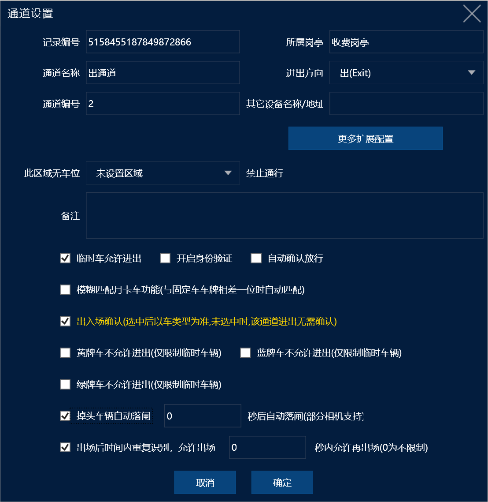

1:**临时车允许进出**：勾选表示允许临时车进出这个通道，不勾选表示临时车不允许进出这个通道

2:**开启身份验证**：与防疫一体机等信息类的机器配套的功能，开启之后需要优先在防疫一体机上识别出车主的身份后才会允许开闸

3:**模糊匹配月卡车功能**：这个功能是临时车匹配月卡车，勾选之后在进出这个通道的临时车辆会跟系统内月卡车辆对比，如果车牌只相差一位，这个临时车会按照对应的月卡车进场，不勾选表示不会去匹配

4:**出入场确认**：勾选后车辆进出时都需要人工去点击出入场确认，不勾选则不需要点击确认（默认勾选的，可以不勾选但是推荐将此功能勾选）

5:**黄（蓝）牌车不允许进出**：勾选表示允许指定车牌颜色进出，不勾选表示不允许指定车牌进出，蓝黄牌为车牌颜色

6：**绿牌车不允许进出**：勾选后表示该通道不允许临时车的新能源车牌识别入场，月租车新能源车不限制

7:**掉头车辆自动落闸**：车在通道识别后，不进出的情况下，软件可以在限制的时间内自动给相机发送一个关闸命令，相机需要接关闸线

8.**出场后时间内重复识别，允许出场**：跟车太近的情况下，前车识别出场还没关闸，相机识别了后车的车牌出场了，就会导致后车没有入场记录了，设置了这个时间后就可以在限制的时间内，相机再次识别车牌允许直接出场

**9.通道设置**：可按车类根据通道配置进出权限
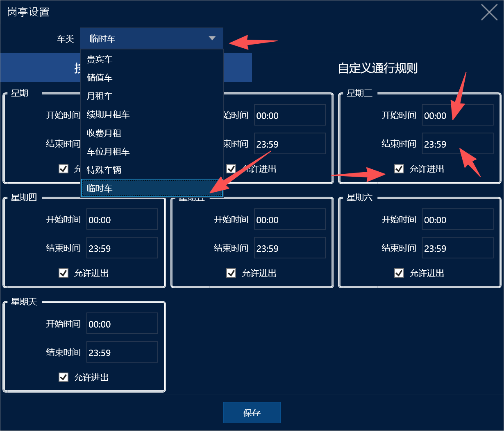
1.可以按临时车设置星期的进出权限 比如周一几点到几点不能进出，周二几点到几点不能进出
2.也可以按月租车类设置通道权限：**（可以实现单双号车牌进出的权限）**
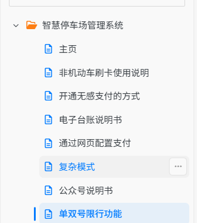
单双号限行功能配置方案可以看这个说明书

#### 2.设备设置

**点击增加修改会出现下列图片（以设备类型相机为例）**

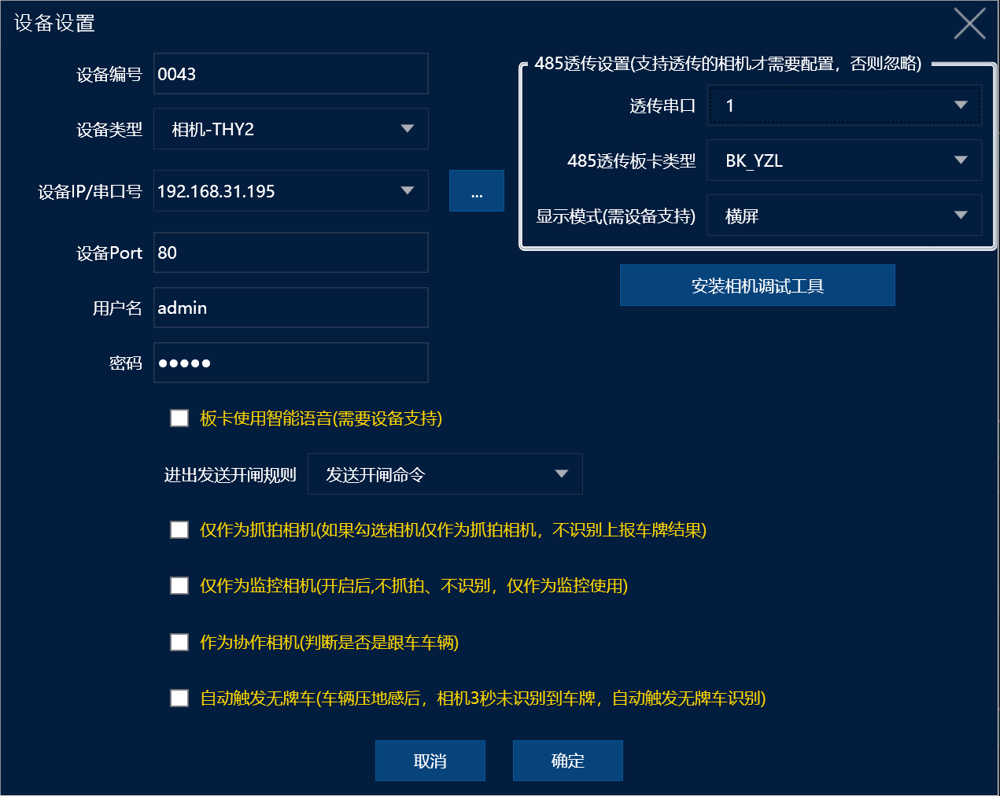
1:**透传模式**：透传模式设置1对应相机接线的485A1和B1，透传模式设置2对应相机接线485A2和B2

2:**设备类型，板卡类型**：设备的型号（具体型号需请联系技术员）

3:**显示模式**：横屏/竖屏表示显示屏的显示模式，竖屏是需要定制的，默认横屏不需要修改

4:**设备ip**：设备的ip地址，和岗亭一样，设备的ip地址要和电脑一个网段

5:**设备port ,用户名，密码**：默认的就行，千万不要修改，没有也不要去增加

6:**进出发送开闸规则**：勾选后会出现这个界面

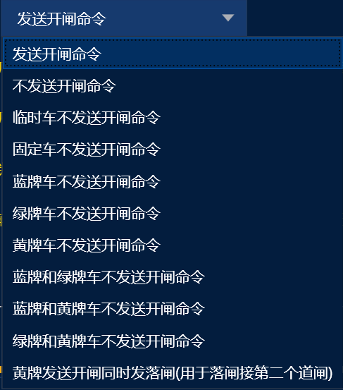
7.可以实现这些设置：假设设置临时车不发送开闸命令的情况下，相机识别入场后，车是有在场记录，但是现场是不会开闸的，这个时候可以搭配管理人员现场检查车辆合格后，用遥控器开闸直接入场。
8.黄牌车发送开闸同时发送落闸：这个功能可以实现大车黄牌车入场2个通道同时开闸，需要接关闸线到第2个道闸
系统默认发送开闸命令（一般不需要改）如果有需要在不同情况下不允许开闸就可以在这里设置

9:**板卡使用智能语音**：智能语音模板需要勾选（一般都是定制的显示屏主板），默认不勾选

10:**仅作为抓拍相机**：勾选表示这个相机只做拍照功能，会上传照片，不会去对车牌处理，一般用于物流园抓拍车身，或者抓拍司机使用，默认不勾选

11:**仅作为监控相机**：勾选表示这相机做监控使用，不做流程处理(一般用于，停车场软件装在岗亭，但是办公室需要看视频画面，使用此功能请联系技术员)

12:**自动触发无牌车**：功能在这个选项后面有详细的说明（这个是非标功能，一般不勾选）

#### 3.一键配置相机及板卡类型

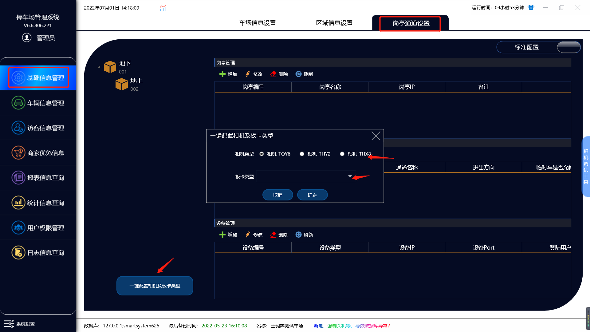

如果各个通道的相机类型和板卡类型是一样的可以再这里一键设置

---
