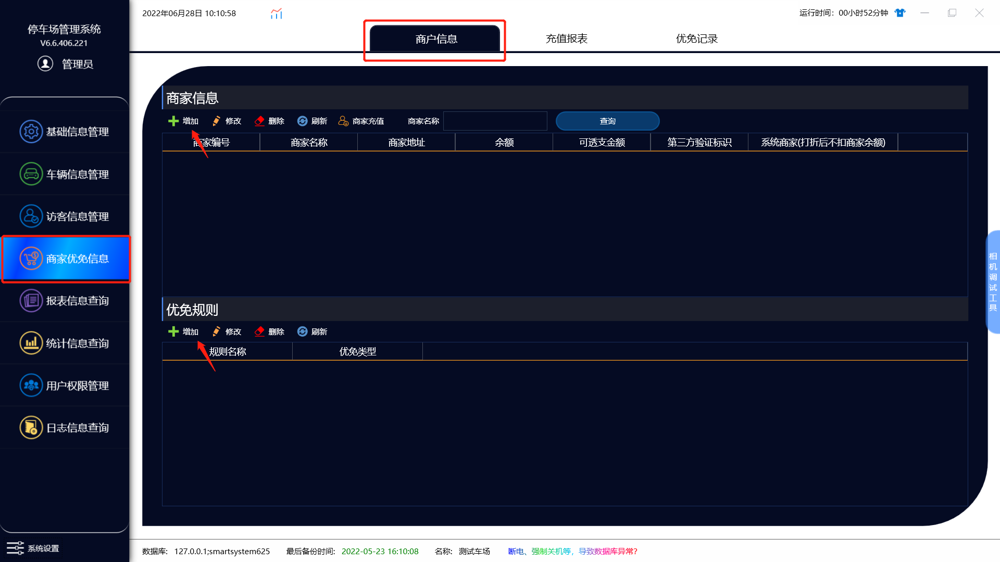
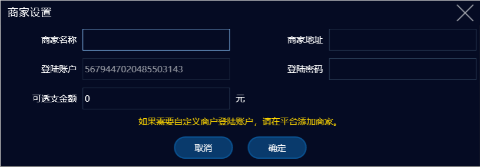
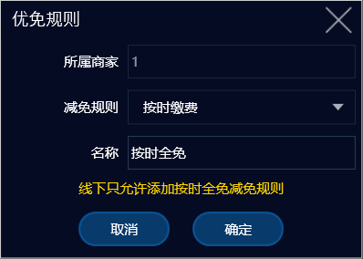
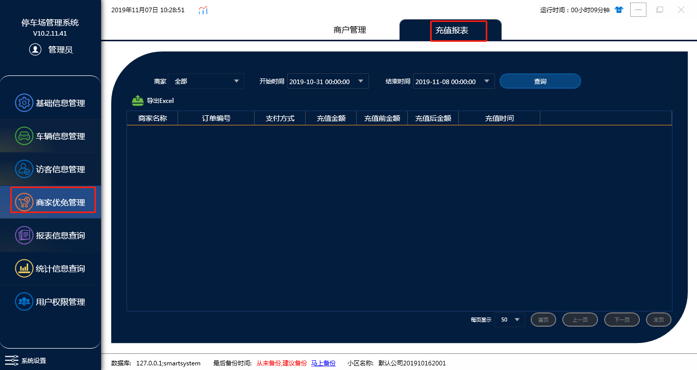
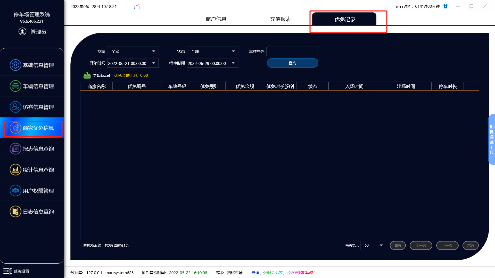

# 商家优免管理

### A：商户信息

#### 1.商家信息

点击增加后会出现这个页面

按照商家名称与地址填写，登陆账户与登录密码则为登录我们商家优免平台的账号密码，（注意黄字内容）可透支金额就是这个商家能在车场这边透支多少钱的意思

#### 2.优免规则

在软件上只能选择添加按时全免减免规则，需要添加其他的减免规则得在平台上登录我们给您的账号进行添加与修改。

### B：充值报表

根据条件查询商家的充值记录

### C：优免记录

根据条件查询商家的优免记录
