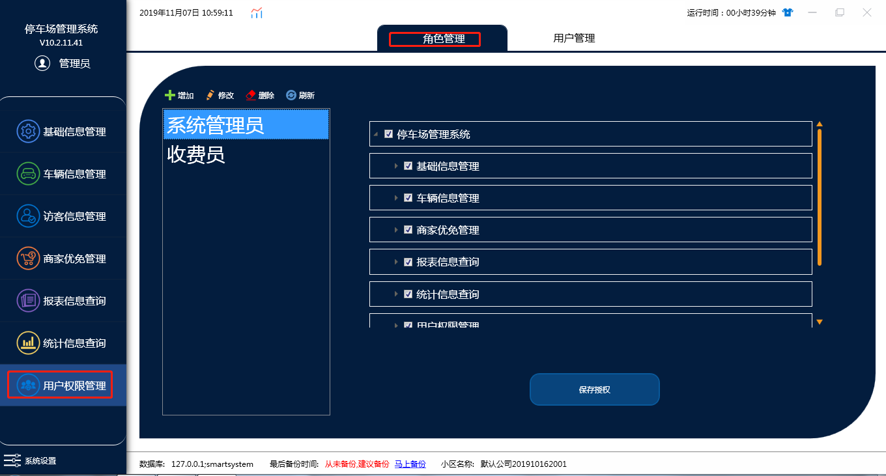
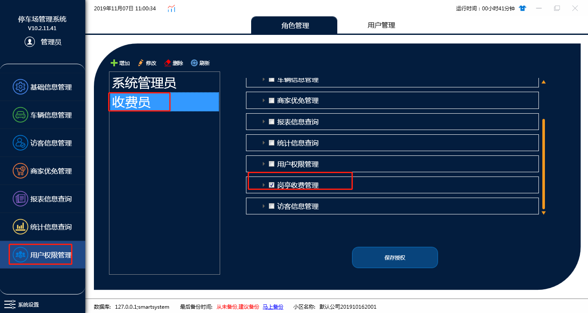
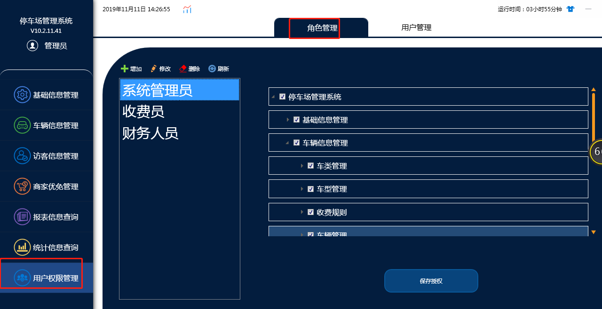
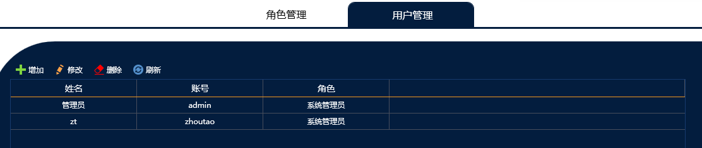
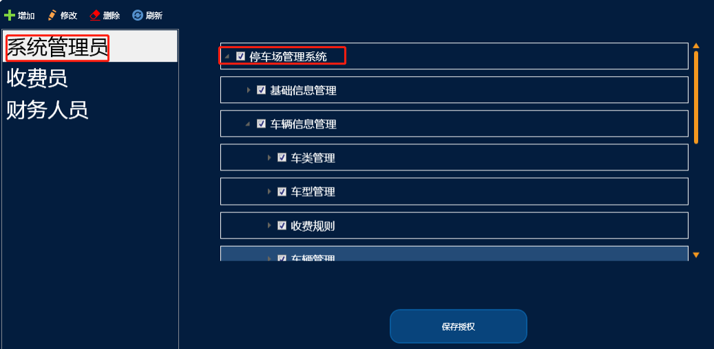
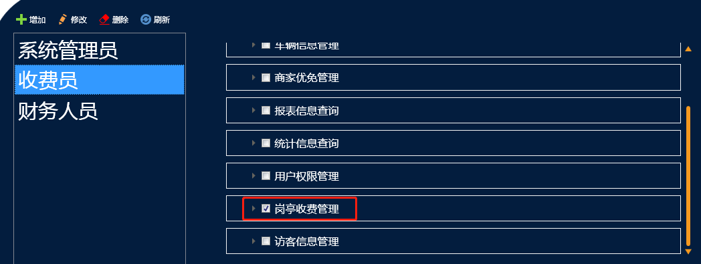
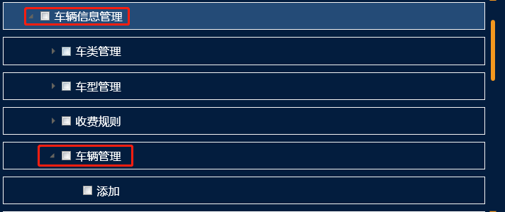
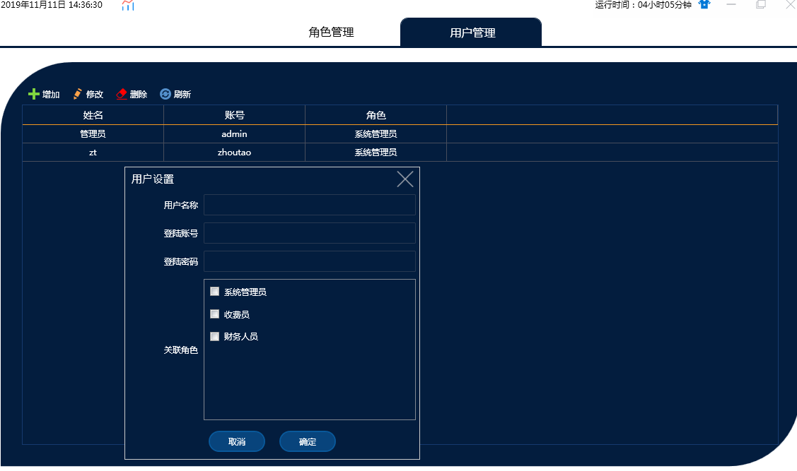
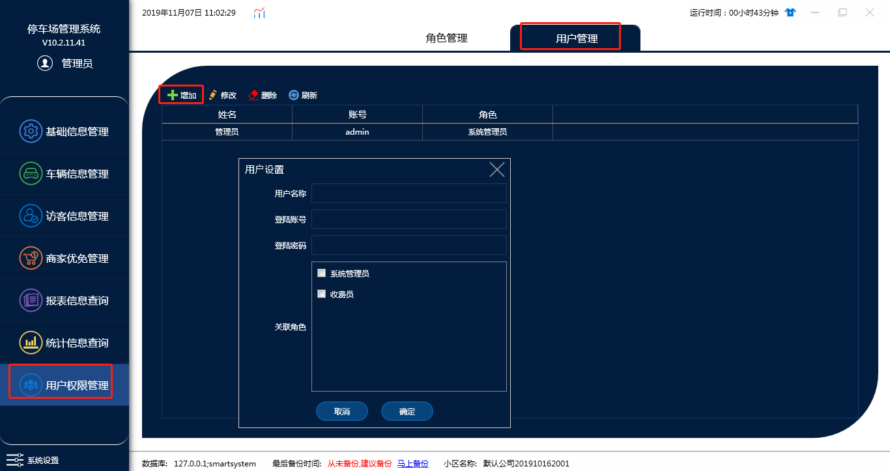

# 用户权限管理

## A：角色管理

**默认两个角色（系统管理员，收费员），这个地方是划分角色权限的地方，例如系统管理员我们是设置的所有权限，收费员只有岗亭收费权限**

我们可以在这点击增加添加其它角色，比如财务这些

### **多角色分权限管理停车场**

软件安装的时候只有一个系统管理员的账号，在实际使用过程中，需要用到财务人员账号，收费人员账号等等...

停车场用户权限管理模块分为角色管理和用户管理。

#### 1.角色管理

在这里我们可以根据现场分工不同实际需要设立不同的停车场工作人员角色

默认的为**系统管理员**（拥有停车场所有的操作权限）

**收费员**（只有岗亭收费的权限）

**财务人员**为新增角色

**注**：我们给予每个角色的权限精确到哪个按钮的控制：

例如车辆信息管理这个模块，车辆管理小模块，里面的操作按钮，添加，修改，删除，续费等等。都做了管控，没有勾选表示没有这个权限。

#### 2.用户管理

在用户管理我们可以点增加，添加账号，设定账号密码之后再选择好对应的角色（这个账号关联哪个角色，就拥有哪个角色的权限）

## B：用户管理

用户管理主要是添加账号，我们点击增加设置账号密码，选择角色，角色对应的权限已经在角色管理设置好，添加完成之后，这个账户就能使用对应权限的功能
