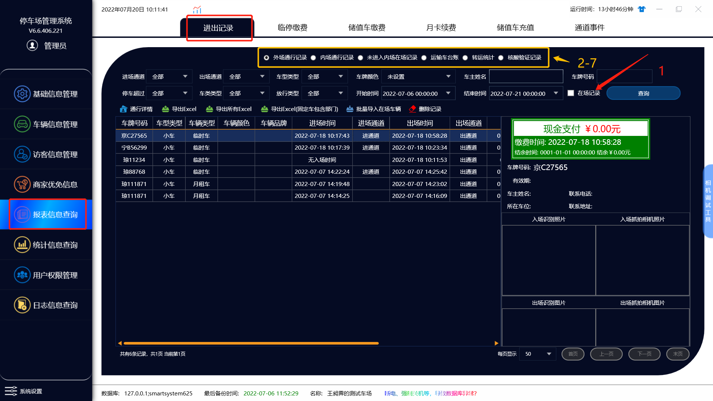
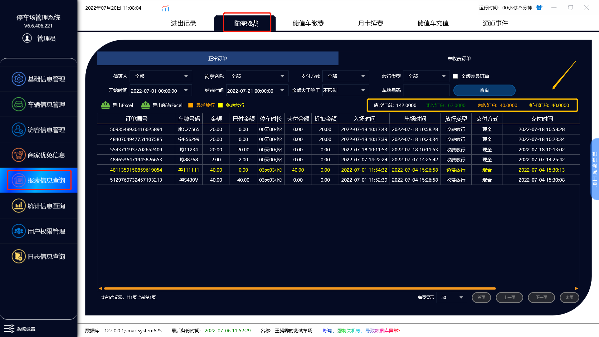
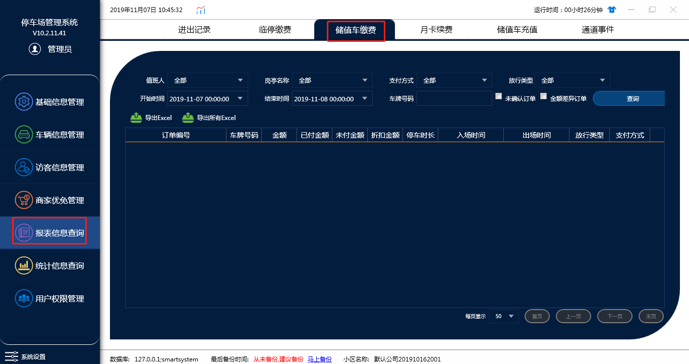
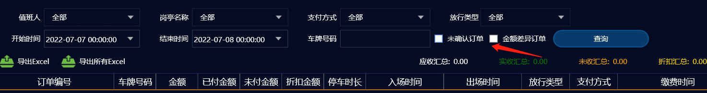
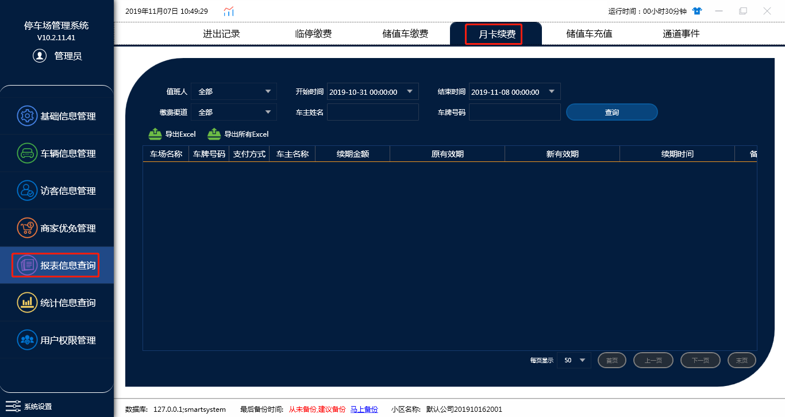
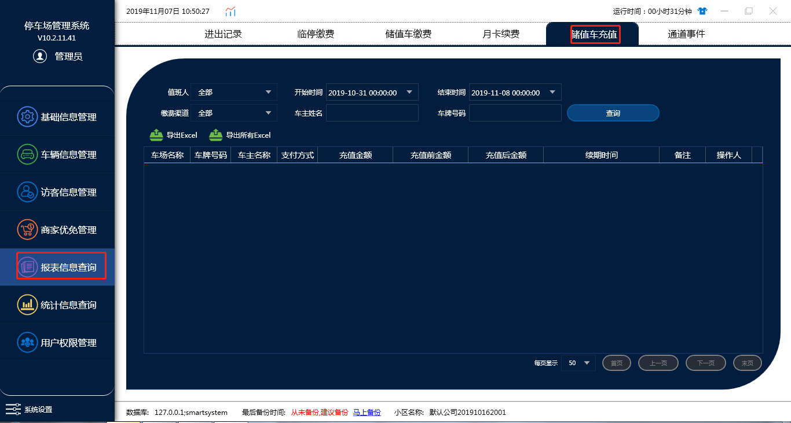
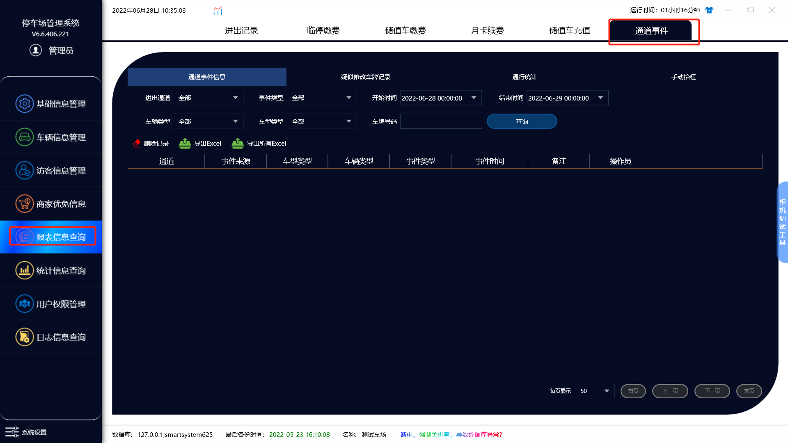
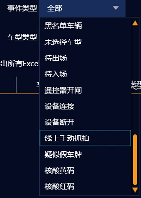
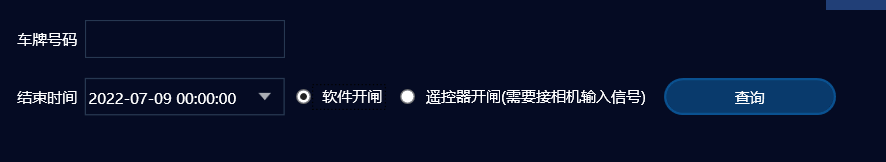

# 报表信息查询

## A：进出记录查询

主要查询在场车辆和车辆的进出记录

1. 查询在场车辆需勾选在场记录
2. 选择进出记录，点击通行详情，可以查询到这台车的缴费情况，车位占用，月卡转停，内外场停车时长
3. 外场进出记录（最外圈区域的记录），内场停车记录（内圈的停车记录（小停车场））
4. 未进入内场在场记录：没有进入内场的记录时车辆在场的情况
5. 运输车台账：车场在添加运输车时运输车台账的记录在这里查询
6. 转运统计：非标功能，一般不使用此功能
7. 核酸验证记录：添加了防疫一体机后，可以在这里查询核酸验证的记录

## B：临停缴费

临时车的缴费情况查询

### 正常订单

1. **值班人**：可自行选择查询值班人的值班时间时发生的全部订单记录
2. **岗亭名称**：可自行选择需要查询的岗亭
3. **支付方式**：可选择现金，全部，其他
4. **放行类型**：有五种类型选择，异常放行：收费软件点击异常放行出场的车辆，免费放行：车辆出场产生了费用，
   值班人员点击了免费放行按键放行的车辆，收费放行：车辆出场产生了费用，用现金或者线上的支付方式支付了费用的放行
   正常放行：正常进出的车辆，全部：即上面几种类型的总和
5. **未确认订单**：将未确认的订单统计到了这里
6. **金额差异订单**：车辆产生的停车费和实际收取的费用不一致（收费软件可以修改应收停车费用放行）
7. **应收汇总**：在输入查询条件之后，这个条件内查询的所有产生的费用（只要产生就会统计在应收汇总里面）
8. **实收汇总**：在输入查询条件之后，这个条件内查询的所有实际收到的费用（免费放行，修改应收金额等操作会导致应收实收不一致）
9. **未收汇总**：免费放行，修改收费金额产生的费用
10. **折扣汇总**：商家对车辆折扣产生的费用

### 未收费订单

这里的报表是当车辆没有收费出现的订单记录，一般来说有两种情况：1.临时车辆在出口时相机识别到了车牌但是这辆车又退了回去没有出去也没有缴费，这个时候就会导致车辆没有收费  2.当临时车到出口产生费用时，车主没有缴费，值班人员也没有点收费放行而是使用遥控开闸

## C：储值车缴费

查询储蓄车的订单详情，选择的查询条件与临时车相同

需要注意的是这里可以根据订单情况的不同来查询订单

## D：月卡续费

月租车续费的记录(根据条件查询即可)

## E：储值车充值

储值车的充值记录（根据条件查询即可）

## F：通道事件

a. **通道事件信息**：最全的查询车辆进出报表，只要被相机抓拍到，无论有没有进出场，都会有一条记录

其中事件类型可供用户多样选择：囊括了了多种事件的类型，更加快捷且高效地寻找到异常事件的时间，通道，操作员，等等

b. **疑似修改车牌记录**：进出修改过车牌号的车辆进出记录

c. **通行统计**：进出场次数的统计

e. **手动抬杠**：车辆进出手动抬杠的记录

在手动抬杠中，可选择查询是用软件手动开闸，还是用遥控器手动开闸

