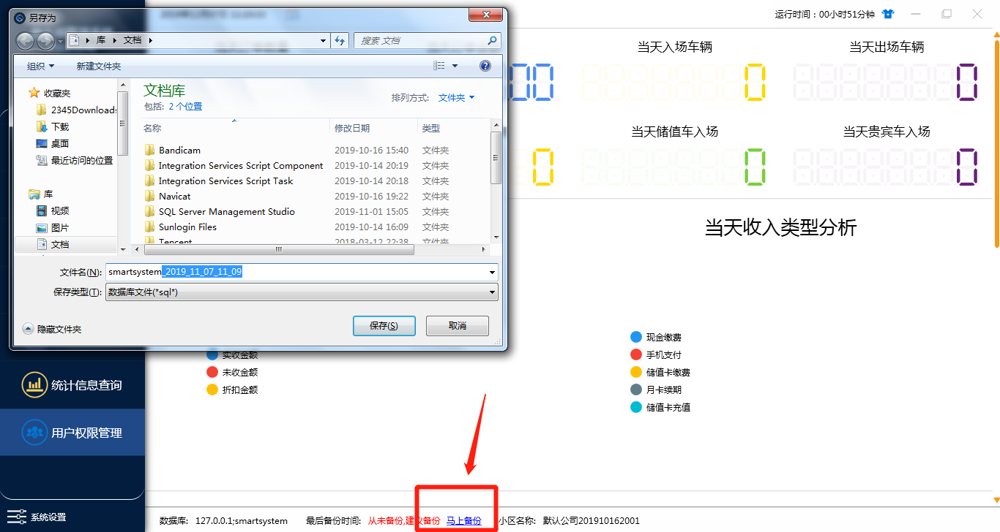
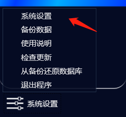
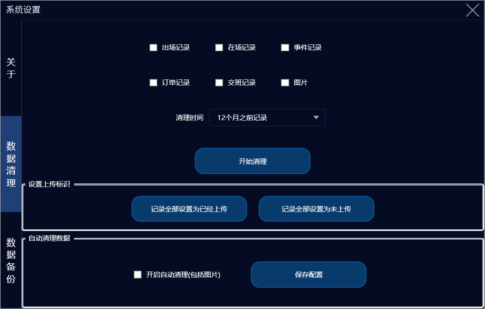
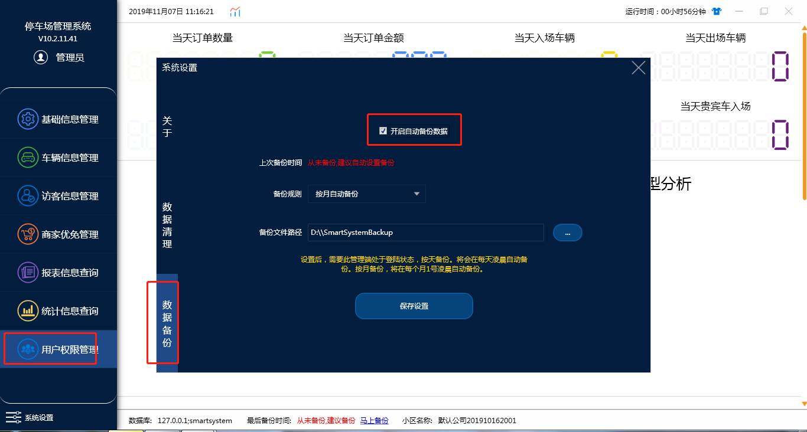

# 系统设置

> **点击箭头所指马上备份，会出现备份路径，点击保存，数据库就会备份到指定的路径（一般用于现场情况不方便远程，提供给技术员进行技术支持）**

## **系统设置：**

1. 关于：软件版本的信息
2. ***数据清理：设定清理条件，点击开始清理会清理对应的数据（不可恢复，慎重使用）***

***只有系统管理员（admin）账号有清理权限，其它所有账号都不可设置此权限***

3. 数据备份（自动备份）
   

系统设置里面数据备份勾选自动备份数据，手动的前面已经说过，自动备份开启之后，根据选择的备份时间，会自动备份到指定路径
