# 车辆信息管理

## A.车类管理

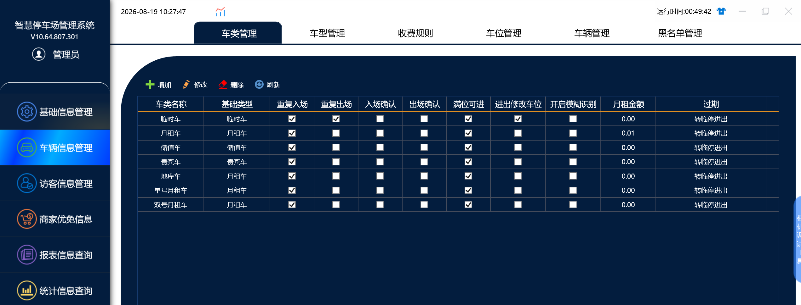

**以增加月租车为例，点击增加会出现以下界面**
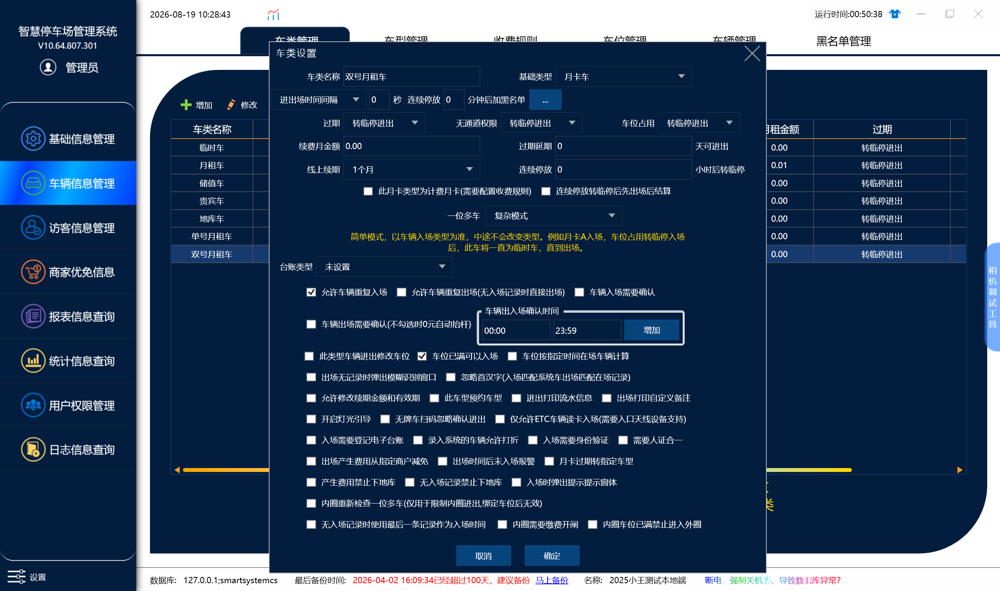
1. **车类名称**：自定义
2. **基础类型**：贵宾车，月租车，储值车，临时车（以月卡车为例）
3. **进出时间间隔**：设置30秒 就是入场后 30秒内出口识别不算出场，出场后，30秒内入口识别也不算入场
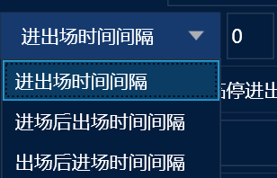
也可以单独限制入场后出场间隔或者出场后入场间隔，避免车出场后相机抓拍车尾牌入场。
4. **过期**：月租车过期之后，两个选项（1.转为临时车进出 2.禁止进出）
5. **无通道权限**：（通道权限在"D-1"里有详细的说明）
   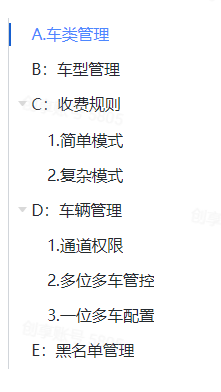，点开后有有两个选项（1.转为临时车进出 2.禁止进出），选择1.则代表月租车转临时车身份后只能进设置临时车能进的通道。选择2.则都不能进出
6. **车位占用**：有两个选项（1.转为临时车进出 2.禁止进出），默认为转为临时车进出（一般不做更改）
7. **线上续期**：在对接平台之后可以微信公众号给月卡车续期，这里可以选择弹出缴费界面的月卡车续费月数，默认一个月，可自定义设置
8. **续费月金额**：月卡车续费需要的钱（按月）
9. **过期 延迟**：月租车过期之后还能以月卡车进出场的天数，自定义，（注意：设置这个时间，月租车过期进出产生的费用系统是自动收费的）
10. **连续停放（）小时转临停**：月租车连续停放之后会变成临时车 产生费用，不需要填写（需要用到请联系技术员）（注意：这个功能设置的时间后，比如设置24小时 车停车超过24小时之后会按临时车去计费，不是从24小时之后的停车时间按临时车计费，是按照车从入场时间开始到出场时间，就是停车所有时间按临时车计费）
11. **连续停放（）分加入黑名单，配置时段**
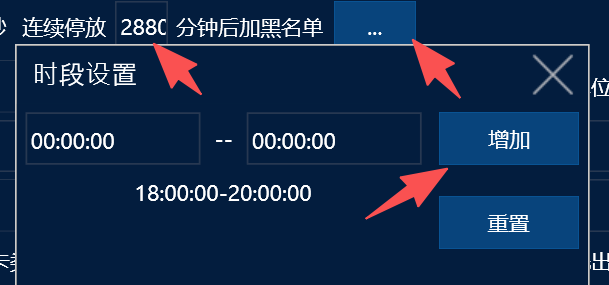
假设设置2880分钟2天，时段设置18点-20点，意思就是停车超过2天后，车还停车在这个时段内的就自动拉入黑名单，不设置时段的话，停车超过2880分钟就自动拉入黑名单
11. **此月卡类型为计费月卡**（需要配置收费规则）：勾选后此月卡类型为计费月卡且要配置一个计费月卡的收费规则 （注意：勾选计费月卡的功能，是给月租车配置收费规则，前提是月租车在有效期内，进出才会按月租车的收费规则计费）
12. **连续停放转临停后先出场后结算**：例如月卡车在场时过期了转临停后会产生费用，勾选后出场时不会收取费用且岗亭正常开闸等到月租车续费的时候才去结算欠费的钱
13. **一位多车**：一共有三种选项（**简单模式**，**复杂模式**，**单车收费模式**）
    **简单模式**：同个车位的车辆进出时，入场时是月卡身份中途也不会发生改变，入场时是临时车身份中途也不会发生改变（月租车身份进出不收费，临时车身份时进出收费）
    **复杂模式**：同个车位的车辆进出时，在场车辆有车辆已经占用月卡车身份时（同个车位的车辆），在停车时间内那辆月卡车身份的车离场时会从他出场的那一刻开始，把月卡车的身份转移到其他同车位的在场车辆上并且从那辆车获得月卡车身份那一刻起，此前以临时车身份的停车时间（及以临时车计费标准的计费）停止。
    **单车收费模式**：同个车位的车辆进出时，入场时入场时是月卡身份中途也不会发生改变，入场时是临时车身份中途也不会发生改变，但是在这个模式里月租车的身份不收费，临时车的身份也不收费
    **注**：一位多车里临时车和月租车身份转换时并不影响你（那些设置了月租车才能进出的区域）其他区域的正常进出
14. **允许车辆重复进出场**：默认勾选重复入场，重复出场，重复出入场表示，车辆进场时会把之前的记录清除掉，重复出场表示没有入场记录也能直接出
15. **入场确认，出场确认**：（勾选之后月租车不会自动开闸，需要人工放行，不勾选只要一拍照月卡车就会自动放行），出入场确定时间（在这个时间段以内表示需要确认进出场，不在时间段以内不需要确认，设置这个时间段需要勾选出入场确认）
16. **车辆进出修改车位**: 如果勾选之后，进出修改车位（进出会修改车位数量）
17. **车位已满可以入场**：没有车位了也能进场
17.1 **车位按指定时间在场车辆计算在场记录：**

假设设置30天，意思是只统计30天内的在场的车，算占用了车位，设置0就统计所有时间在场的车，算占用车位
18. **出场无记录时弹出模糊识别窗口**：模糊识别的时候会弹出识别窗口，一般不勾选
19. **忽略首汉字匹配通行记录**：进场会匹配车场在场车辆，如果和在场车辆除了首汉字不一样，这个车进场会按在场车辆算，清除前一台车的记录
20. **允许修改续期金额和有效期**：勾选后可以在录入和查看月租车时修改，不勾选则反之
21. **此车型预约车型**：设置后这个车型就可以选择预约车位
22. **进出打印流水信息**：顾名思义进出将自动打印出流水信息
23. **出场打印自定义备注**：出场时可以自定义备注勾选后将自动打印自定义备注
24. **开启灯光引导**：非标功能（不需要勾选，如有需要联系售后）
25. **无牌车扫码忽略确认进出：** 录入了无牌车的这类月租车 假设车类设置了入场确认，勾选了这个功能后，扫码也是直接入场不需要确认
26. **允许ETC车辆读卡入场**（需要入口天线设备支持）：勾选后入口就支持etc车辆读卡进入
27. **入场需要登记电子台账**：管理端使用说明子页面有写此功能
28. **录入系统的车辆允许打折**：勾选后在系统内的车辆也允许享受打折，如，过期的月租车，储值车等
29. **入场需要身份验证**：勾选后就得验证身份后才允许入场，一般搭配防疫一体机使用（没有此需求不勾选）
30. **需要人证合一**：非标功能，有需要用到联系售后
30. **出场产生费用从指定商户减免**：勾选后优先从指定商户那扣除减免费用
31. **出场时间后未入场报警**：一般运用在单通道进出时，如有此需求联系售后（不要勾选）
31. **月卡过期转指定车型：**
   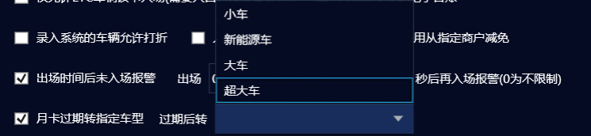
    勾选后可以选择转指定车型，（一般默认转小车车型）选哪个就按哪种车型的临时车收费规则收费

## B：车型管理

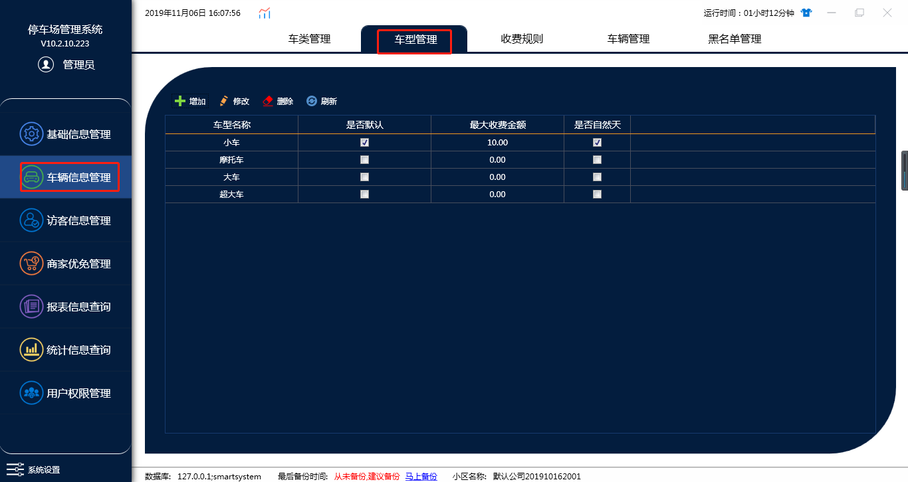

以增加车型为例，点增加会出现下列图片

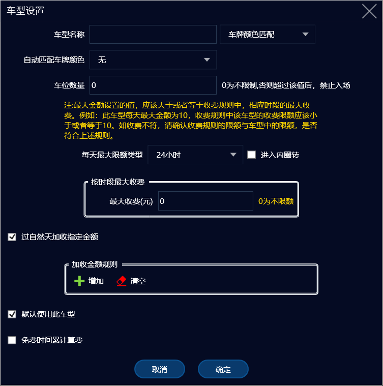
1. **车型名称**：车型名字，自定义
2. **车牌颜色匹配**
 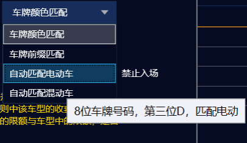																	可自行选择匹配内容
3. **自动匹配车牌颜色**：不勾选代表不需要匹配，蓝黄绿代表车牌的颜色，只要相机支持，我们软件在大小车型可以选择对应的蓝黄牌，这样就可以自动区分蓝牌车和黄牌车，做到设置不同的收费
4. **车位数量**：可定义数量但是要注意设置了数量后，超过这个数量时禁止入场（一般设为“0”即不限制）
5. **每天最大限制类型**：

   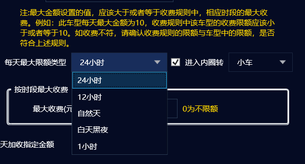											这按照配置这个车型的收费规则来设置，在下面还能设置此车型的最大收费金额												进入内圈装这个就不需要勾选了，如果停车场有内圈和外圈，就可以设置，具体设置请联系售后
6. **过自然天加收指定金额**

   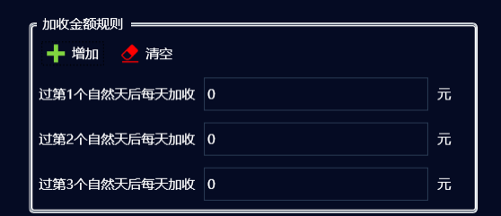																	可以任意添加"n"个自然天的收费，一般用在收费规则设置了收费上限后有车一直在停车区域，就可以使用此功能去加收金额
7. **默认使用此车型**：系统默认小车为默认车型，这个不用去改
8. **免费时间累计计算**：未勾选车辆免费时间可以循环（即任何时间任何次数进出）使用，勾选后则按照选择的周期（周期为你选择的时间类型）累计计算免费时间，如，选择了按天，那免费时间为每辆车一天只有一次免费次数，

  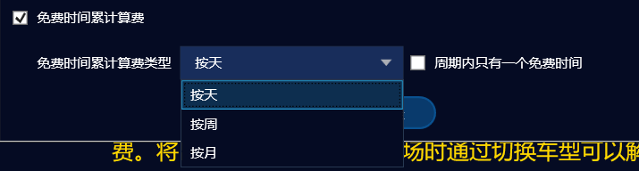
9. **周期内只有一个免费时间**：意思是在你选择的周期内，列如免费时间设置的为60min，那这个车辆停了40min离开后，**不勾选**则这个车辆在这个周期内没有免费时间了，**勾选**则在这个周期内这个车辆的免费时间还剩余20min，即这个周期内这辆车还能停20min的免费时间。（min为分钟）

**如果想软件自动区分黄蓝牌收费 （此功能需要相机支持识别车牌颜色）**

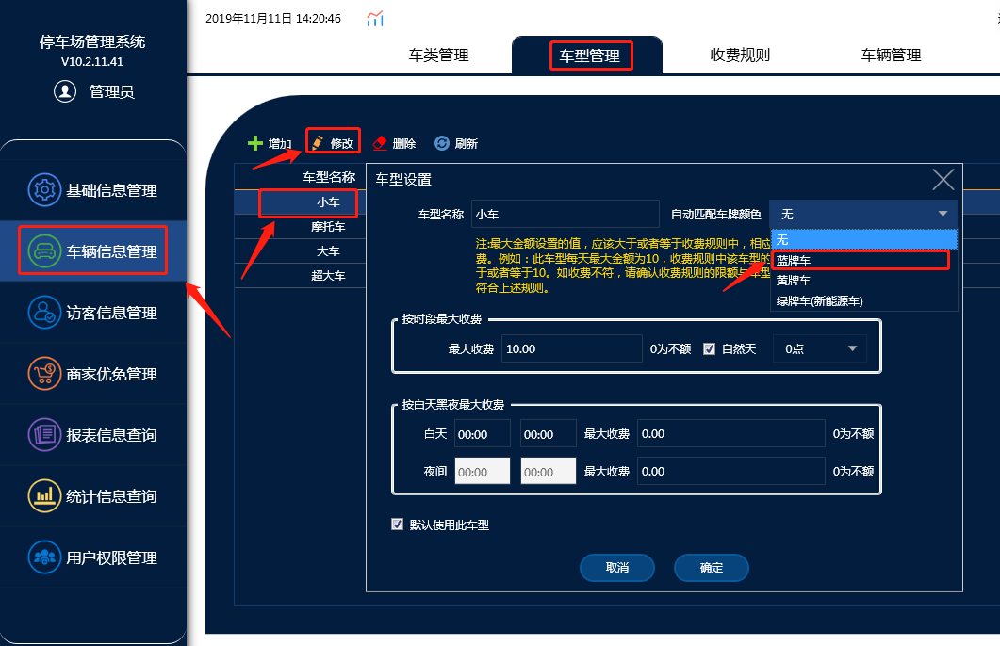

1. **自动匹配车牌颜色**：在软件车型管理里面设置自动匹配车牌的颜色，小车设置成蓝牌车，大车设置成黄牌车，然后确定保存，再在收费规则里面根据两种车型添加不同的收费规则即可实现此功能
2. **按时段最大收费**：这里设置的最大收费表示24小时内的最高收费，假如设置A元 表示小车入场之后，24小时最高收A元，如果车子5个小时已经产生A元费用，出场缴纳之后，在入场时间开始的24小时内可以重复进出 不会再产生费用，自燃天（勾选为自然天，不勾选为24小时）
3. **白天夜间最高收费**：白天夜间收费规则的最大收费设置，设置金额之后，功能同上
4. **是否默认车型**：在不需要匹配车牌颜色和车牌颜色没有对应车型时，这个车牌会划分到默认车型处理，系统默认设置是勾选到小车上的。

## C：收费规则

收费规则分为两种模式一种为复杂模式，一种为简单模式

### 1.简单模式

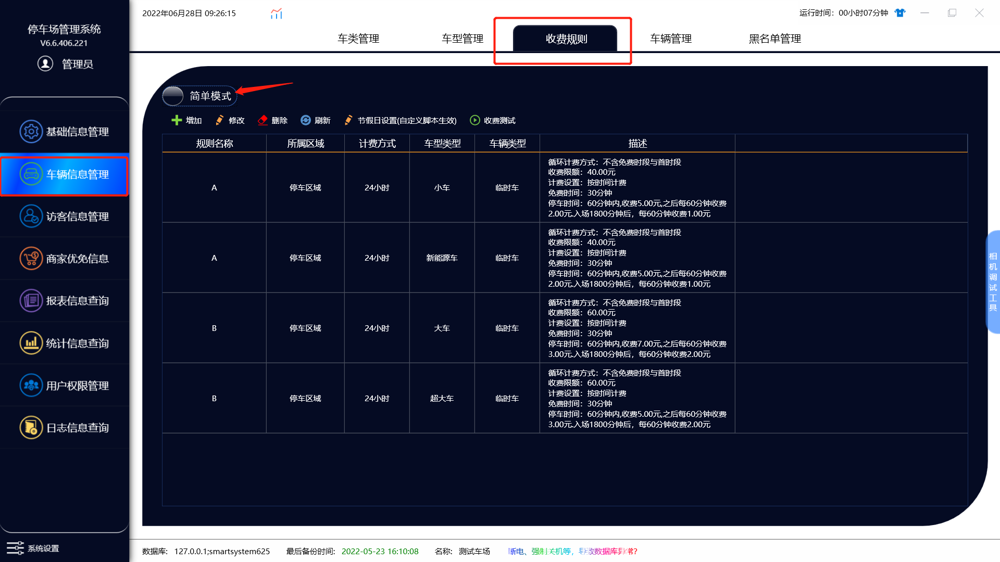

点击增加后会出现这个界面（这里用24小时的循环计费为标准）

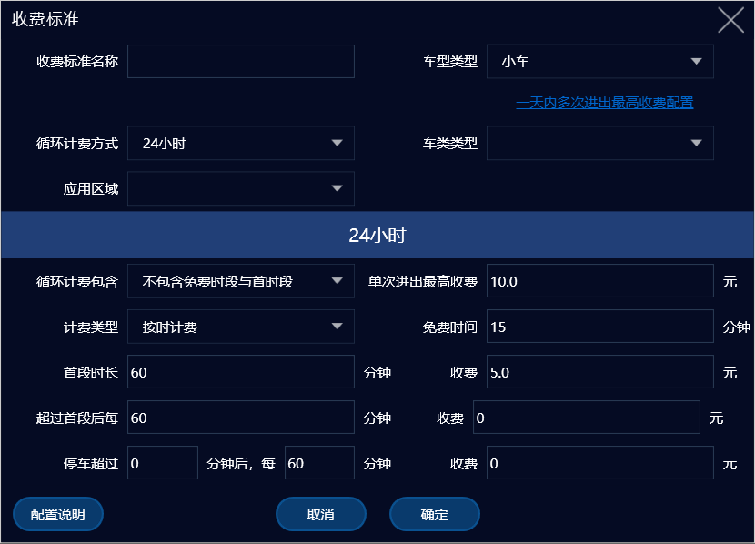

1. **收费标准名称**：自定义名称
2. **车型类型**：选择你要配置的车类型，有四个选项，小车，新能源车，大车，和超大车，自行选择
3. **循环计费方式**：也是自己选择，有5个选项，24小时，12小时，白天黑夜，自然天，还有自定义。这里以24小时的循环计费为标准来讲解，其他三个选项都是大同小异，需要注意的是自定义这个选项是在软件实现不了你想要的收费规则时使用，需要的话请联系我们的技术员帮你配置收费脚本方能使用。
4. **车类类型**：两种选项临时车和储值车，自行选择（也可自己在车类管理里添加一个或多个不同类型）
5. **应用区域**：自行选择即可
6. **循环计费包含**：有三个选项，不包含免费时段与首时段，包含首时段不包含免费时段，包含免费时段不包含首时段。这里的**首时段**意思是：（如图）首段60分钟收费5元，免费时段为15分钟，首时段就为60分钟收费5元。这三个选项就是在**循环计费**时**是否**包含免费时段或者首时段（一般选择**不包含免费时段与首时段**就好了，系统默认的）跟据车场需要来更改即可。
7. **单次进出最高收费**：进出最高收费就是40元，在他出入这个停车场是**单次进出**的最高收费为40元
8. **计费类型**：有两个选项，按时收费和按次收费，按时就是在车辆进出时按照你设置的时间来计费，按次就是在车辆进出时车辆进出为一次并按次数来收费（在设设置按次收费时需要将首时段下面的时间和收费全部设为0）
9. **免费时间**：即停车场给进出车辆的免费时间
10. **首段时长**，**收费**：即停车（包括免费时间）的第一段的时长收费设置
11. **超过首段后每**（）**分钟收费**（）**元**：即停车时间超过首段设置的时长后每多少分钟收费多少元，
12. **停车超过**（）**分钟后**，**每**（）**分钟收费**（）**元**：即停车超过多少分钟后，每多少分钟收费多少元

    ---

    **循环计费方式：**

    1. 24小时：上面就是以24小时循环计费的标准讲解的
    2. 12小时：配置与24小时相同，不同的地方在于循环计费的时间不同，一个是12小时循环一次，一个则为24小时循环一次。
    3. 白天黑夜：这个地方可以设置白天和黑夜两种不同的收费规则，并且可以自己设置时间的划分，需要注意的是关于白天和黑夜跨时段的问题在这里我们做了一个选项即**[跨段是否补时]**，这个补时的意思是：白天跨段到晚上  收费时段不到1小时 跨段到晚上 晚上需要补时间给白天来达到1小时  比如白天入场停了40分钟跨段到晚上  晚上需要补20分钟给白天 才开始计算晚上时段的费用。（补时只能往后面的时段补，不能往前面的时段补）（非标功能一般不做选择）
    4. 自然天：与24小时计费设置相似，不同的是这个以一个自然天为单位。
    5. 自定义：在选择自定义时需要自己配置脚本规则或者联系售后的技术人员帮你配置（一般用于我们的软件无法配置所需要的收费规则时使用）

### 2.复杂模式

复杂模式说明较多

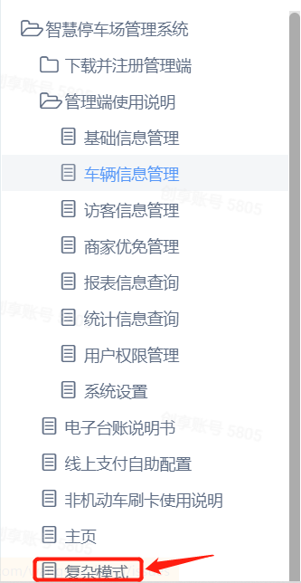

在智慧停车场管理系统中的子页面中有专门的说明

## D：车辆管理

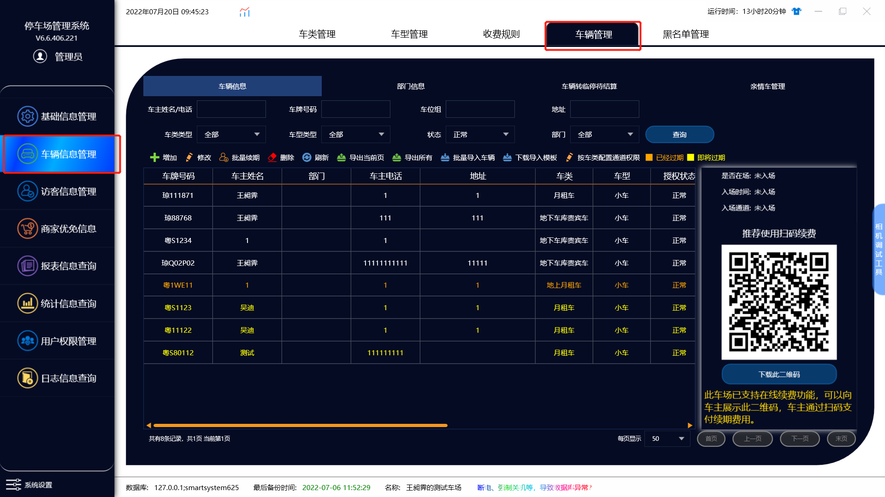

这里可以添加删除修改长期车辆，可以给月卡续期，也可以导出车辆信息。都有对应的按键，批量导入车辆需下载导入模板，然后再按照模板进行修改再将修改好的信息导入进来，还可以根据各种条件去查询车辆信息

#### 1.通道权限

在我们单独添加或者导入月租车的时候都可以对对应月租车的通道权限进行管控

**例如：**一个小区有地面停车场，内部有个地下停车场，小区有两种月租车，地面月租车和地下月租车，地面的月租车不能进入地下，地下的月租车不能在地面停留

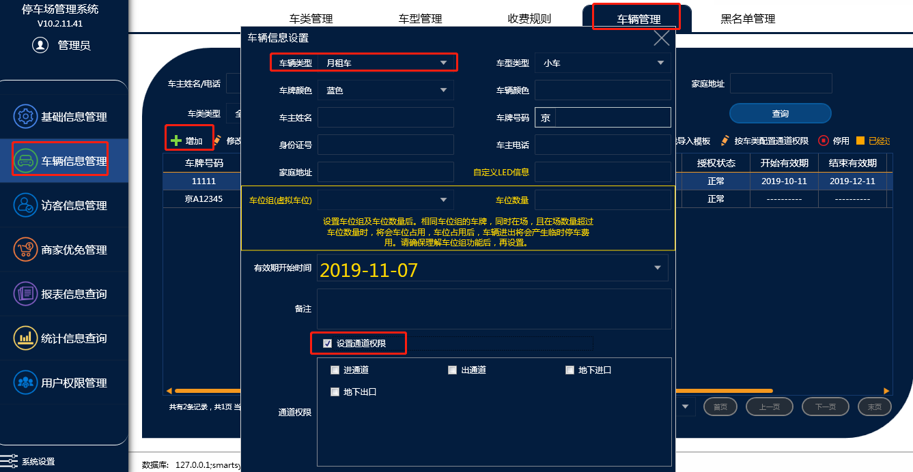

我们进入到月卡添加界面，勾选设置通道权限，**地面月租车**勾选地面的权限，**地下月租车**勾选地下通道的权限

在这种情况下，如果地面停车场**不允许**临时车进，那么**地下月租车**进入不了地面，**允许**临时车进，**地下月租车**就会变成**临时车**进场，会开始计算费用，如果超出地面停车场免费时间就会产生费用，出场会需要交费

当地下月租车进入地下停车场时，停止计算在地面停车场的时间，这样就能做到的地下地面月租车的管控

#### 2.多位多车管控

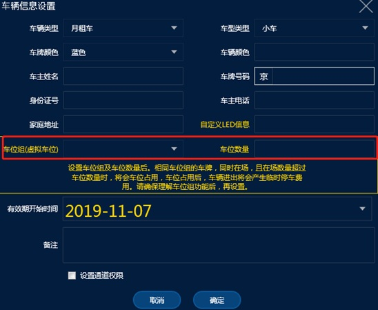

在我们添加月卡车的时候，里面有个虚拟车位组和车位数量

首先，我们给每个业主一个编号，例如张三（A），李四（B），业主张三，两台车一个车位，业主李四，五台车三个车位

在给业主张三车位进行管控的时候，在添加张三的两个车牌时，我们可以在虚拟车位组填A，车位数量填1，两台车都是这个车位组，和车位数量，添加好之后就表示，业主张三，一个车位，两台车，在进去一台车之后，另外一台车我们就会做出管控（1.禁止进出 2.转临停车进出（临时车收费的话这个车也会产生费用）具体管控按照你设置的车位占用来）

在给业主李四车位进行管控的时候，在添加李四的两个车牌时，我们可以在虚拟车位组填B，车位数量填3，五台车都是这个车位组，和车位数量，添加好之后就表示，业主李四，3个车位， 5台车，在进去3台车之后，另外2台车我们就会做出管控（1.禁止进出 2.转临停车进出（临时车收费的话这个车也会产生费用）具体管控按照你设置的车位占用来）

**在车类管理里面，选择月租车，点击修改我们可以找到车位占用时软件的处理方式**

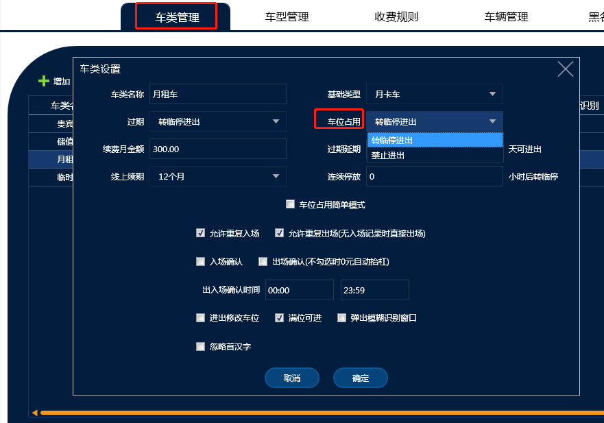

### 3.一位多车配置

比如一位业主2台车：粤BD1111和 粤BD2222

添加第一台车粤BD1111 **车位组设置**：A栋6楼  车位数：1

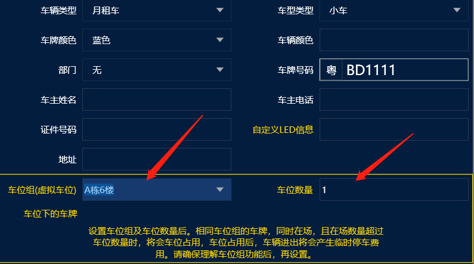

---

添加第二台车粤BD2222 **车位组选择**：A栋6楼  车位数：1

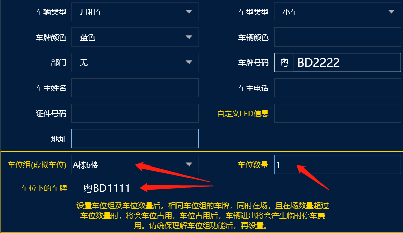

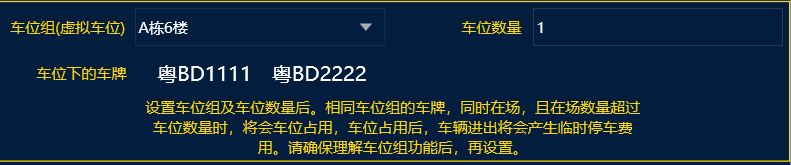

这样就是一位**2车**设置  可以查到车位组下面的车辆信息

**车位组**相当于一个虚拟名称随便定义一个名称

**车位数量**就是有多少个车位

如果上面车位数设置成**2个** 这样就**相当于**2位**2车**

如果**3车**1位的话 **在添加一台车粤BD3333** 车位组就选择：A栋6楼 车位数量就设置 **1个**

---

## E：黑名单管理

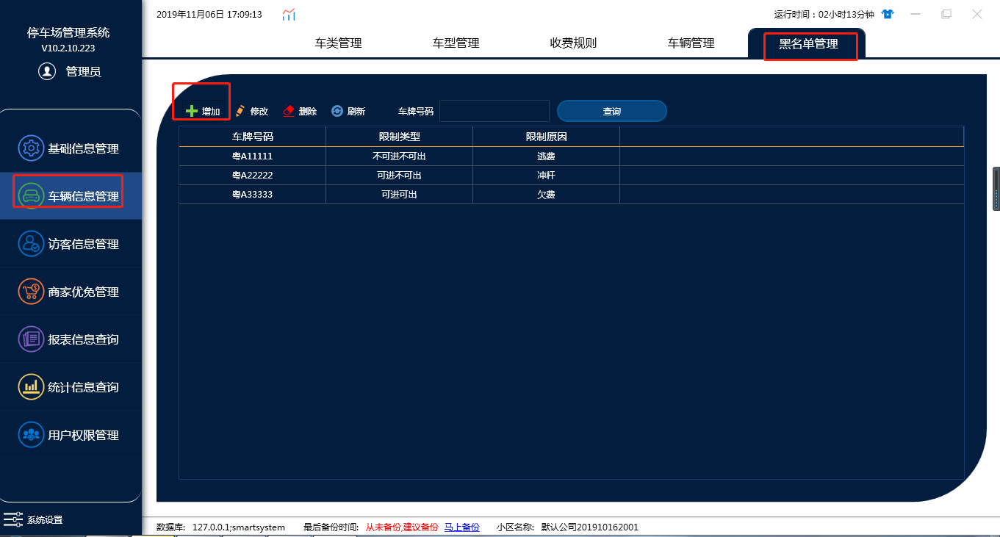

可以通过添加修改删除来对黑名单车辆进行管理，增加修改可以选择限制类型，还有添加限制的远程，添加的黑名单车辆在进出时收费软件都会有提示，也可以查询到记录

注：**黑名单管理，这里面我们可以添加黑名单车辆，可选的限制类型三种，限制原因则为自定义**

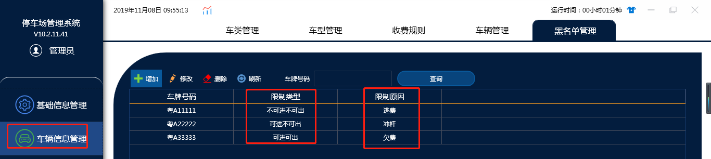

