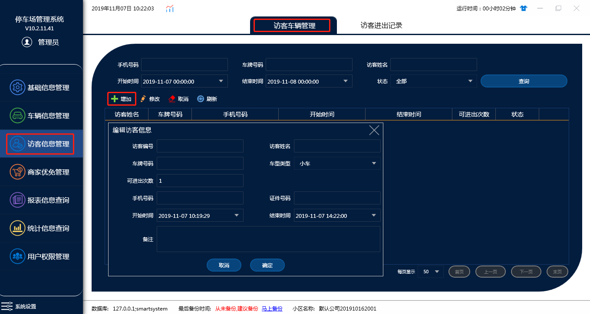
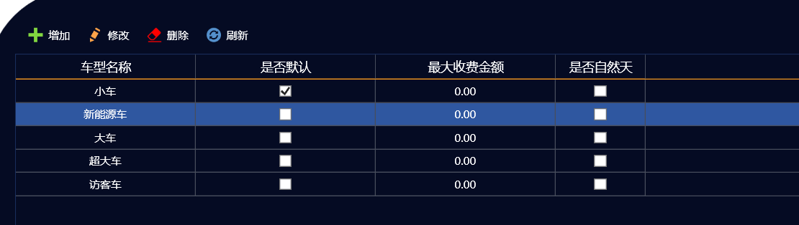
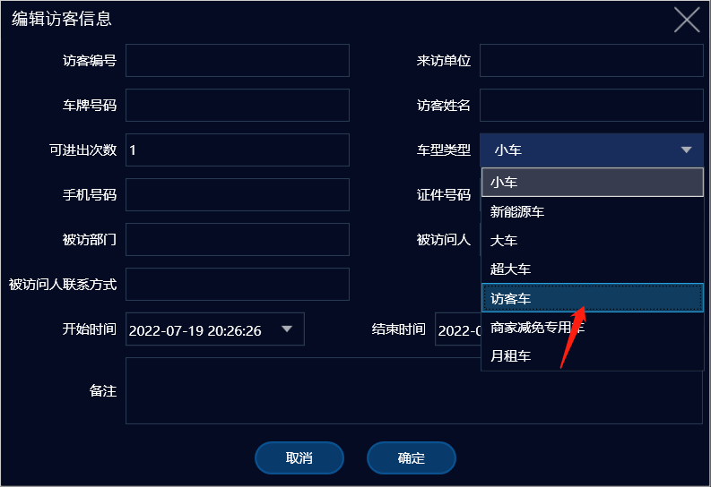
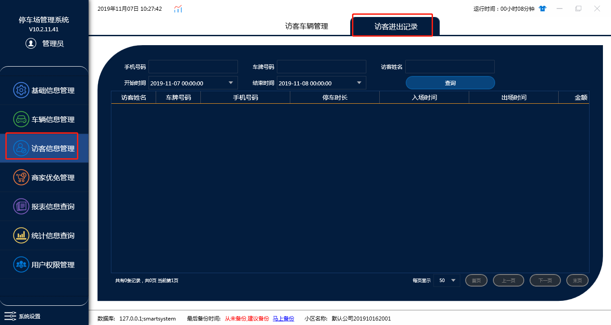

# 访客信息管理

## A：访客车辆管理

**注意**：访客车辆是以临时车的计费规则进出的，所以要想设置访客免费：

1.在车辆信息管理的车型管理中添加一个访客车如图

2.在车辆信息管理的收费规则模块中添加一个访客车车型的免费临时车收费规则

3.编辑访客信息时在车型类型上选择访客车

车型类型设置好后访客就能免费进出了

## B：访客进出记录

根据条件来进行搜索访客车的车辆来访信息
