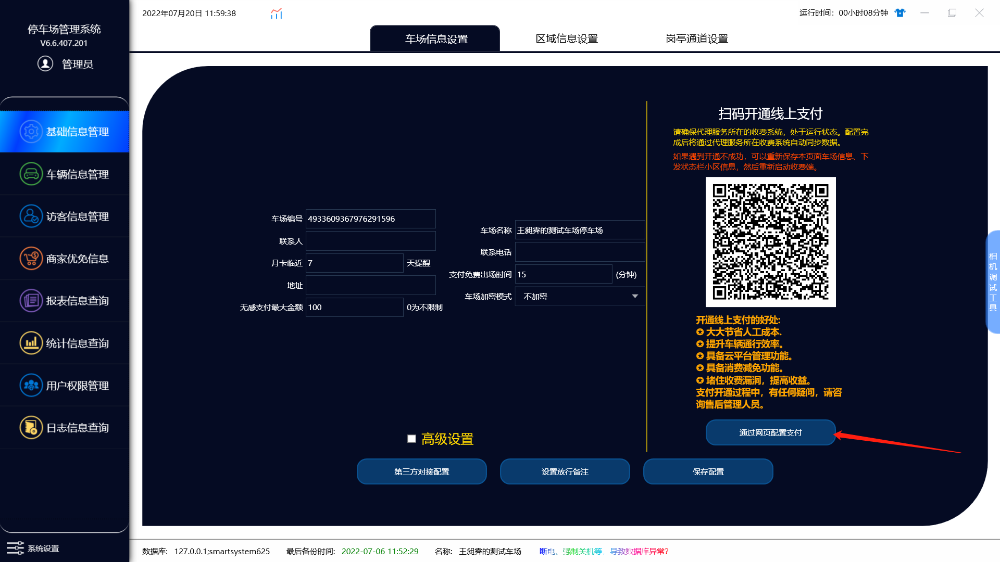
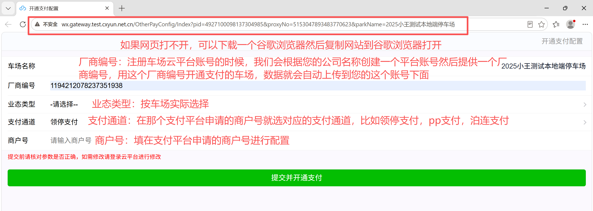
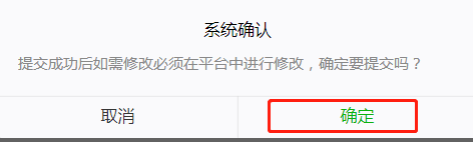
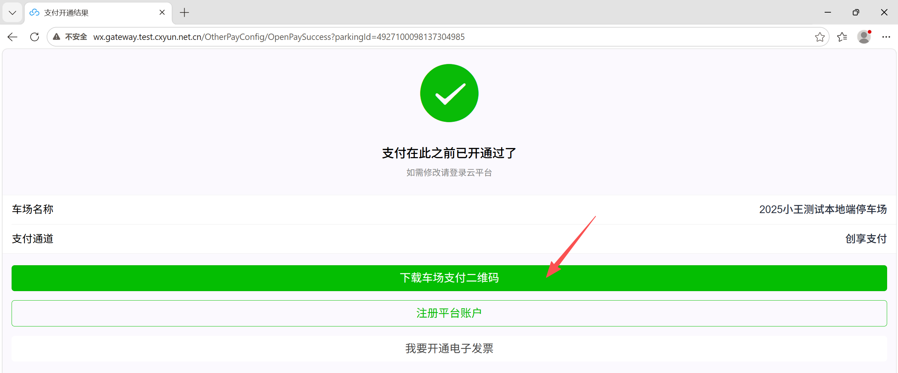
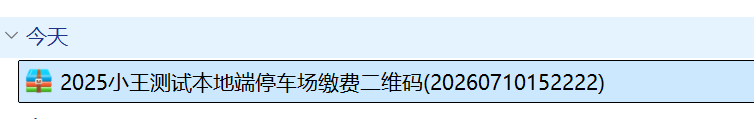
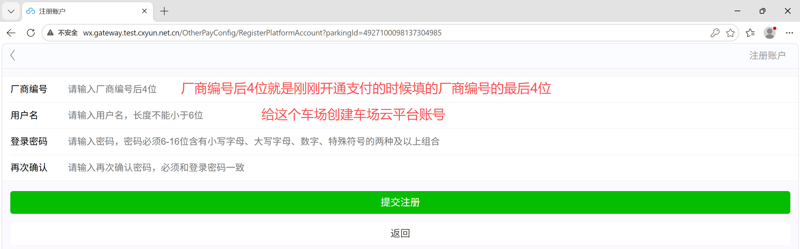

# 通过网页配置支付

**请使用最新软件！！！**

最新软件下载链接：http://document.cxyun.net.cn/

**管理端** → **基础信息管理** → **车场信息设置 → 通过网页配置支付**

**注意：IE浏览器由于兼容性问题显示会有问题，请使用谷歌浏览器**

**填写好**厂商编号和商户号之后，**点击提交**并开通支付

---
**点击确定**就配置成功了

耐心等待1分钟内

 ##### 一：开通成功之后再点击**下载车场支付二维码**

下载好了  进到目录里面去找是以**压缩包**的形式下载的

**解压**即可，如果解压报错或者解压只有一张图片的，可以换一个压缩软件（好压压缩软件下载：https://haozip.2345.cc/）

#### 二：注册平台账户

输入好后提交，就算创建成功，可以用来登入车场云平台管理车场

#### 三：我要开通电子发票
**联系售后或者商务协助**

---
