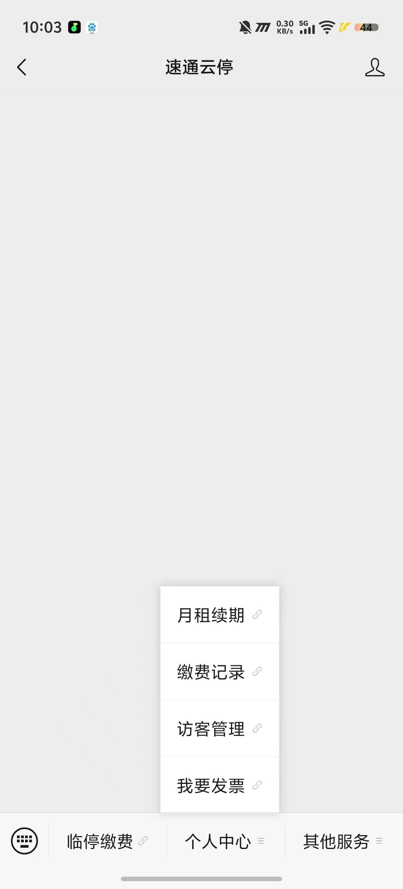
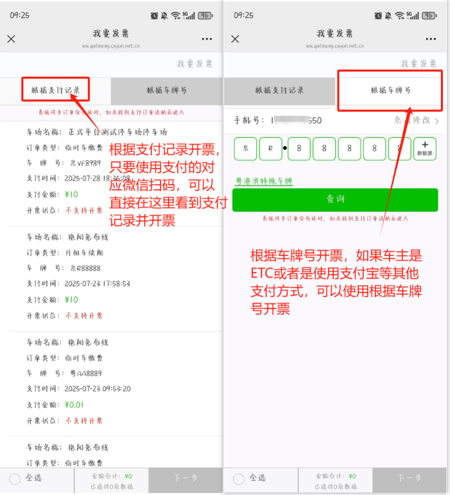
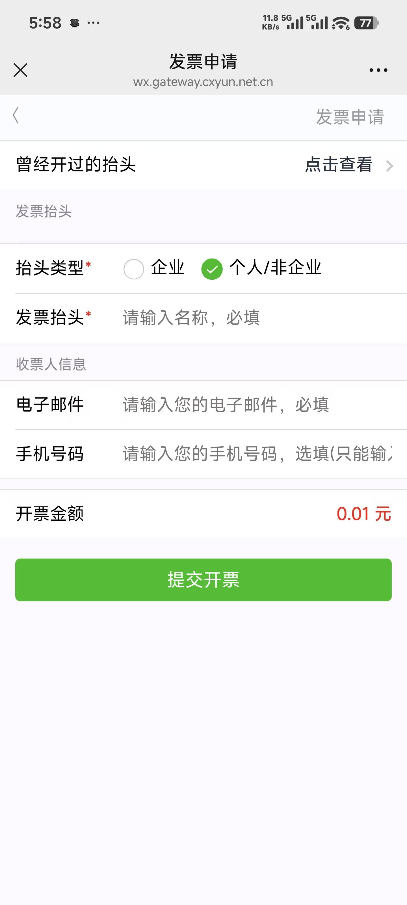
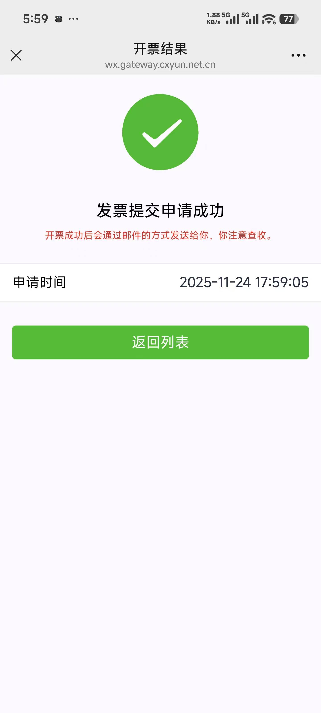
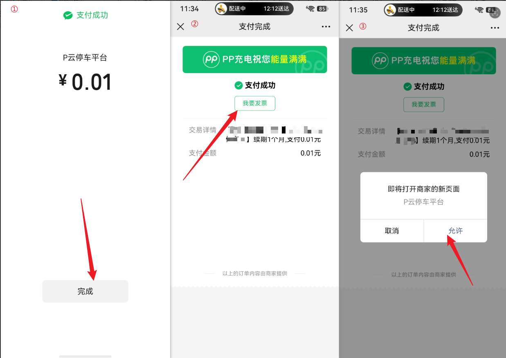
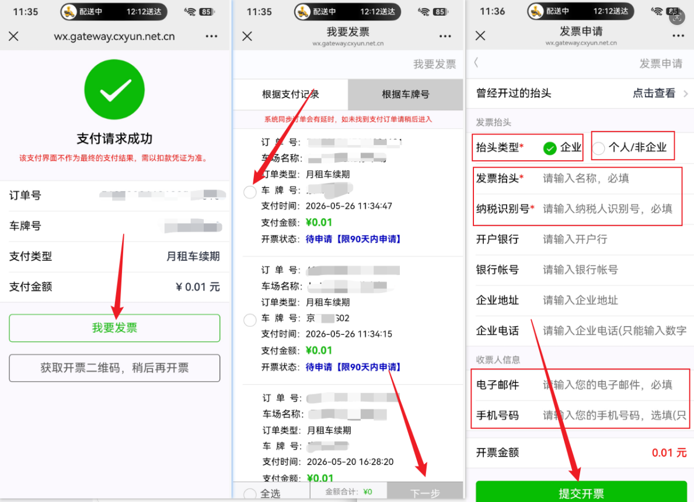
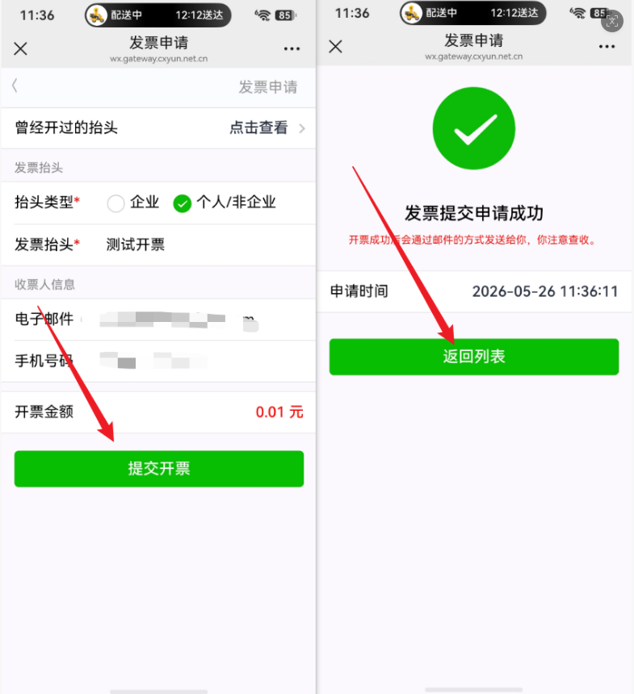
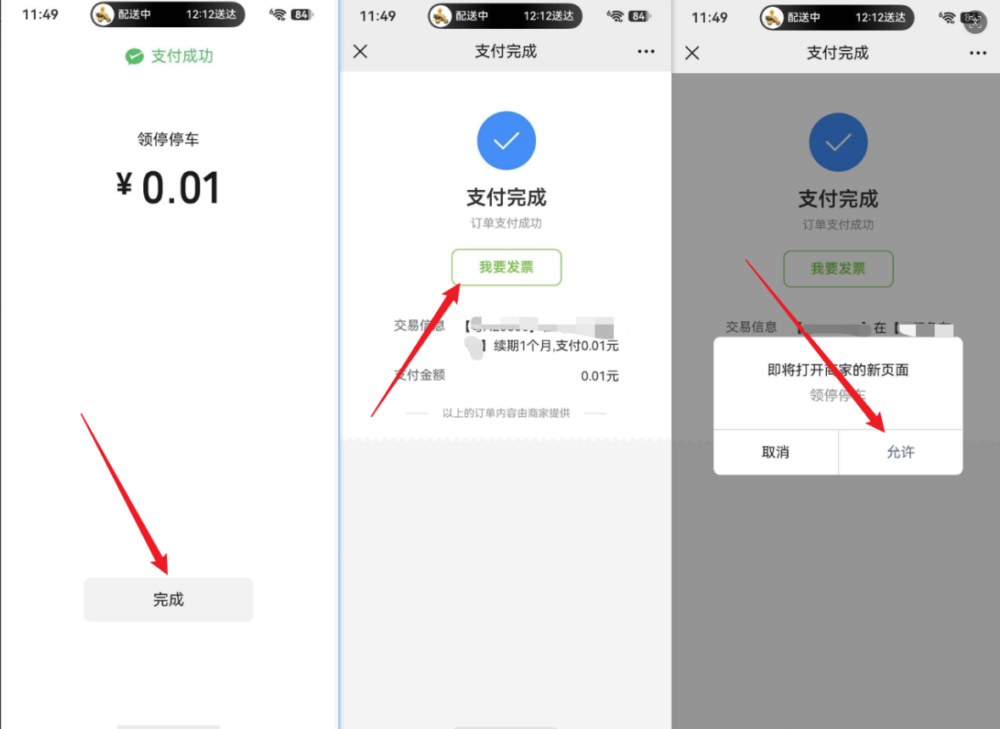
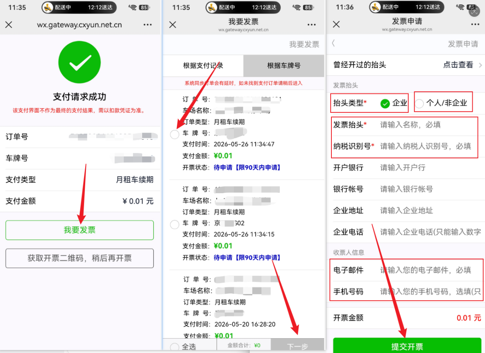
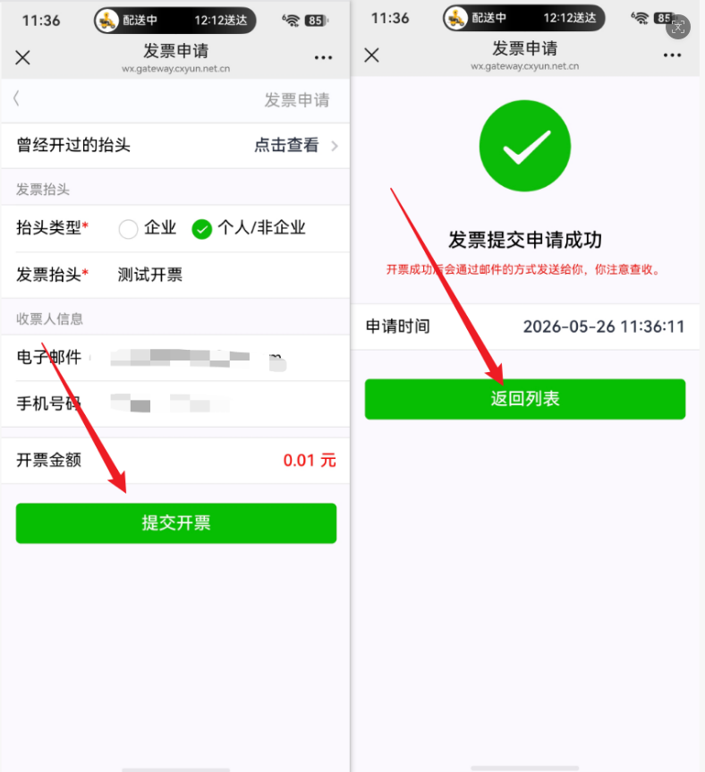

车主支付停车费用后申请电子发票步骤
## 1 关注公众号 领停停车 下面附有公众号二维码

2进入公众号后点击个人中心，里面有我要发票这个功能点击进去

3进去后有两种方式去选择开票
第一种：根据车牌号
根据车牌号开票，如果车主是ETC或者是使用支付宝等其他支付方式，可以使用根据车牌号开票
第二种：根据支付记录
根据支付记录：只要使用支付的对应微信扫码，可以直接在这里看到支付记录并开票

4选择好对���的订单后，点击下一步，把开票信息填写好

5提示开票申请成功就可以了

## 2.支付完成后直接申请开票
#### 1.p云支付完成后，申请发票流程

#### 2.领停支付支付完成后，申请发票流程

