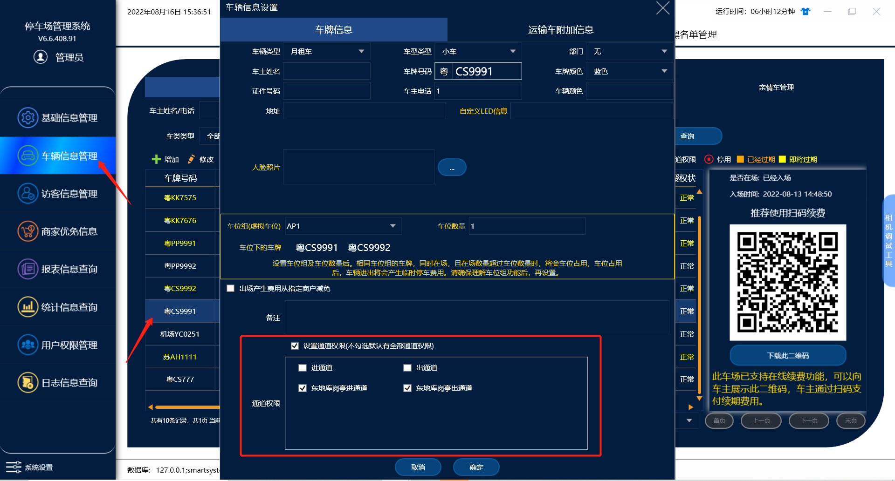
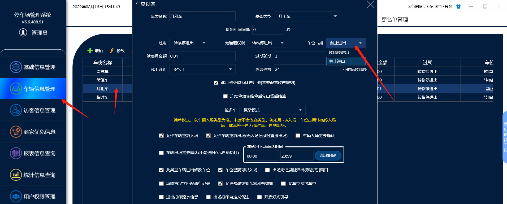
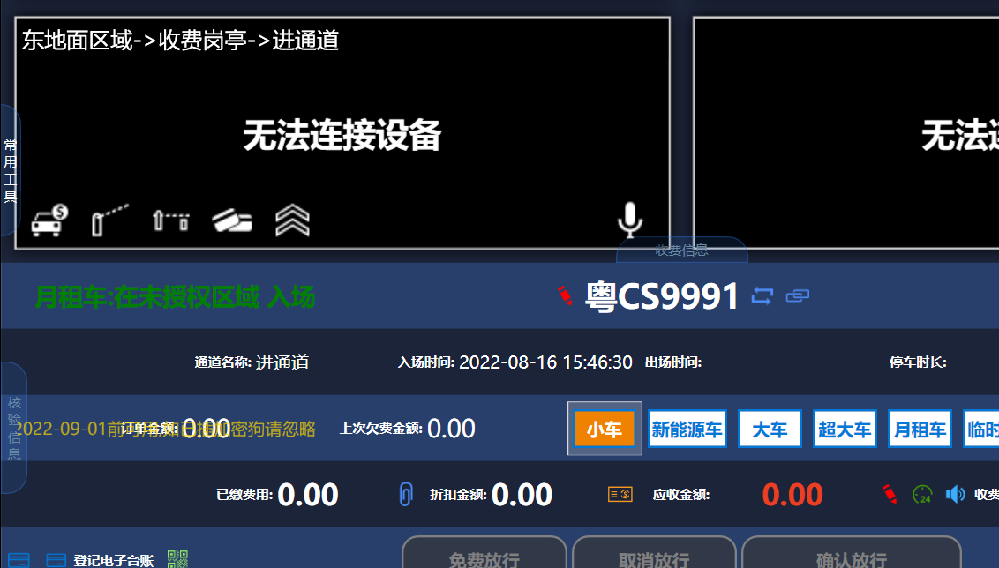
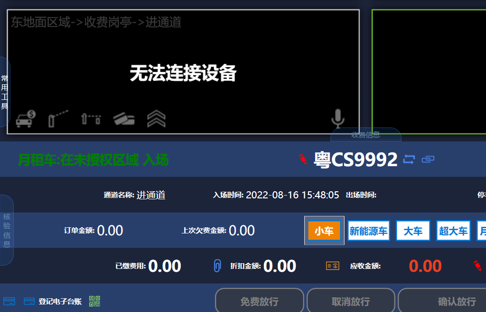
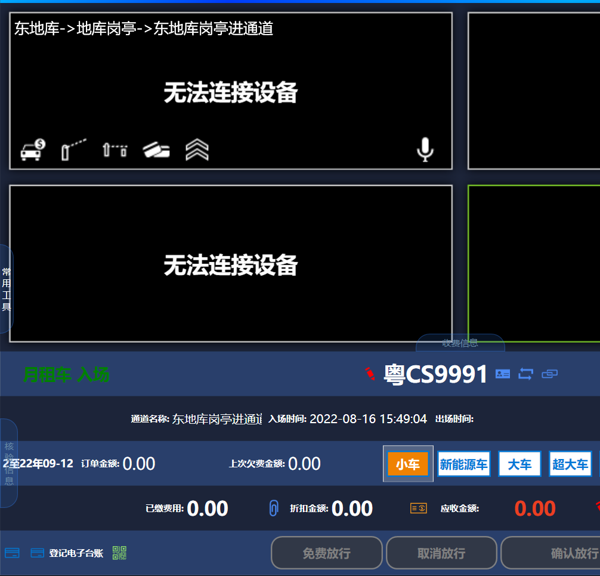
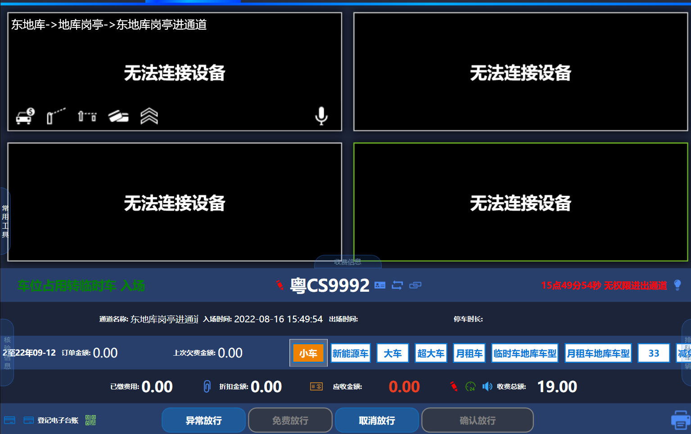

软件默认一位多车是针对于整个车场，不区分区域的，也可以通过特殊的方式设置地面不限制一位多车，地库限制一位多车。

目前2个车牌为粤CS9991和粤CS9992 设置的是一位多车。

首先在车辆信息里面，找到车牌后给车辆信息设置通道权限，2台车只勾选地库的通道权限，不勾选地面的通道权限，之后2台车入场地面都算月租车，其中一台入场地库后会已月租车的收费入场，另外一台车就可以设置允许入场地库转临停或者是不允许入场地库，提示车位占用禁止进出（设置方法如下图）。

测试用例：

第一��车入场地面在没有通道权限的情况下是转临停的

第2台车入场地面也是转临停入场

第一台车入场地库后就是月租车身份入场

第2台车在入场地库就会提示车位占用，无权限入场
