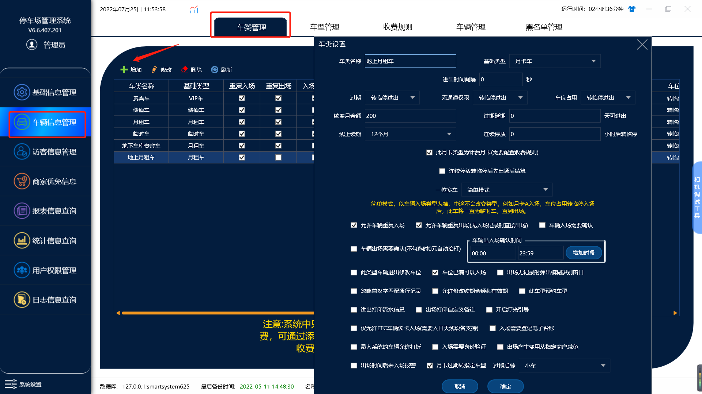
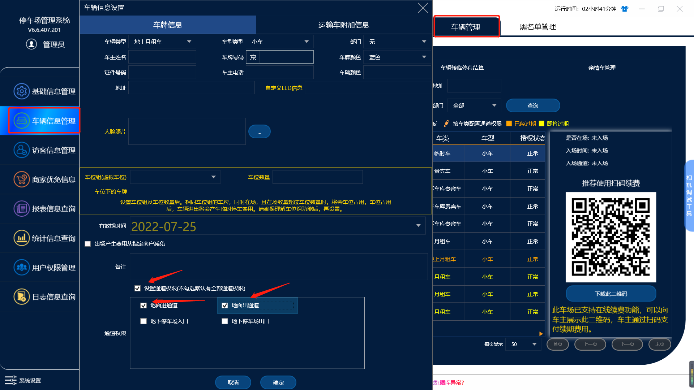
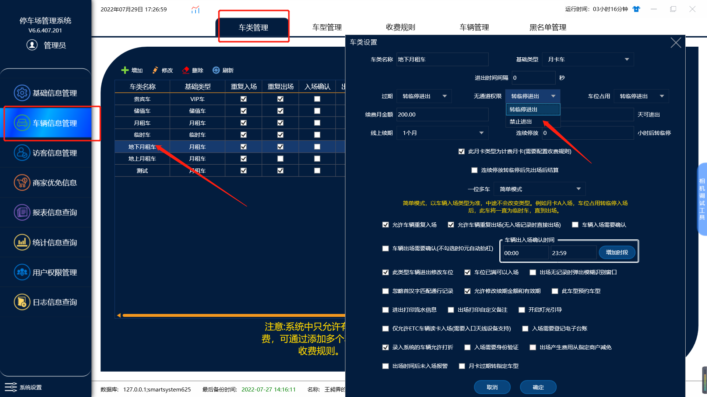
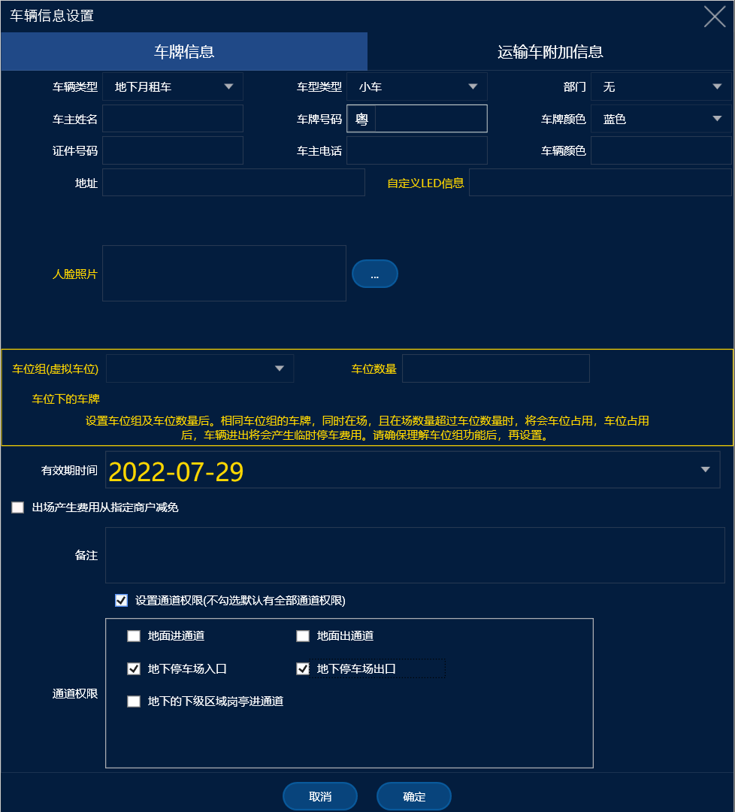

在一个车场分为地上地下两个停车区域（或者其他区域）时

需要设置两种甚至多种月卡车类型（下面按照车场为地上和地下讲解）

## A.地上月租车

要求：地上月租车停地上不收费，不允许进入地下

1.添加地上月租车

2.添加车辆

添加车辆时需要勾选通道权限，将地面的出入口勾上

设置好后就能做到车辆在地面停车免费，且不允许进入地库

## B.地下月租车

要求：地下月租车停地下时免费，停地上时按照临时车收费

1.添加地下月租车

2.设置通道权限

将地下的通道权限勾选上，地面的不勾选

设置完成后就可以做到车辆在地面时时临时车收费，地下时不收费
