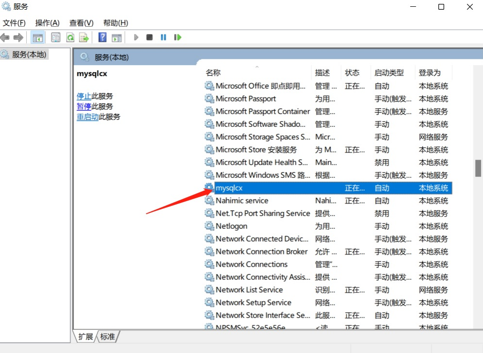

数据库没有启动提示连接错误

解决方法:快捷键win+R 输入services.msc 找到mysql点击启动，然后把防火墙关了，如果启动不成功重新安装下勾选强制安装数据库或者安装Mysql56数据库.

1. 下载MySQL5.6数据库服务地址

https://zbytparkimg.oss-cn-shenzhen.aliyuncs.com/mysql-installer-community-5.6.10.1.rar

