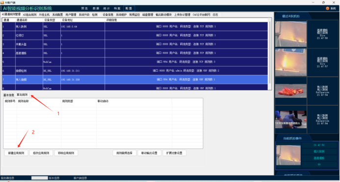
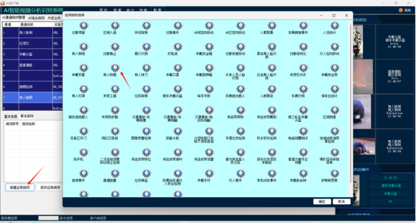
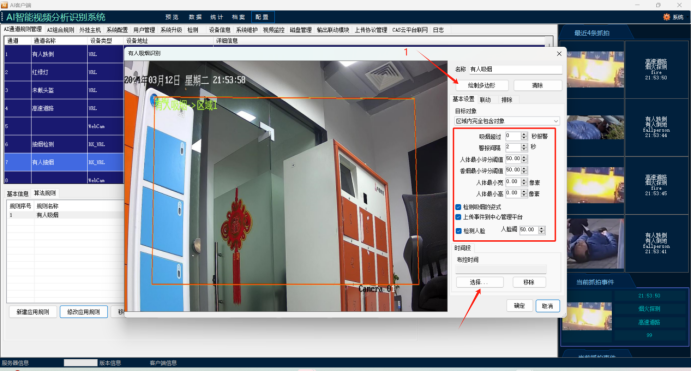
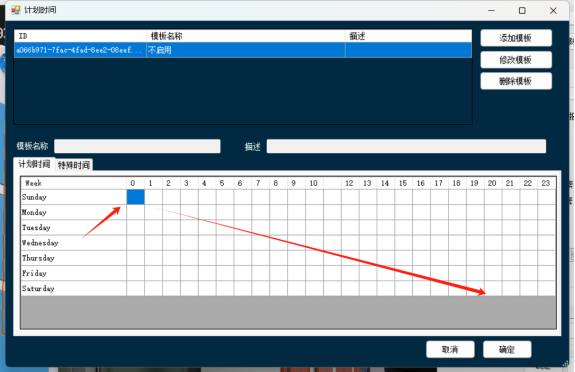
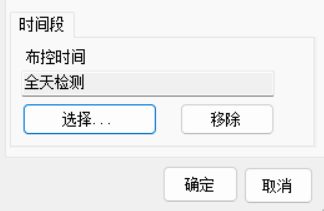
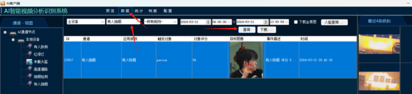
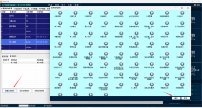

## 相机绑定好之后就可以设置算法

## 1.点击算法规则

## 2.然后新建应用规则，选择视频算法触发的行为，比如有人吸烟。

* 弹出这个有人吸烟识别窗口后。
* 首先需要点击绘制多边型把视频中的检测区域画出来。
* 基本设置里面设置检测的参数。
* 时间段：布控时间，点击选择。

  这个是英文的，需要从0开始鼠标拉到最后面，然后点击确定。

布控时间的意思就是设置检测时间，从0拉到最后面就是全天检测的意思，添加完成后点击确定。
这样算法就添加完成了，如果有人在视频检测区域抽烟，就会提示有人抽烟并且抓拍图片，在数据里面也可以查询抓拍图片的记录。

## 3.有人抽烟的算法添加完成后也可以在这个地方添加其他的算法，然后画出检测的区域设置对应的基本参数和布控时间

