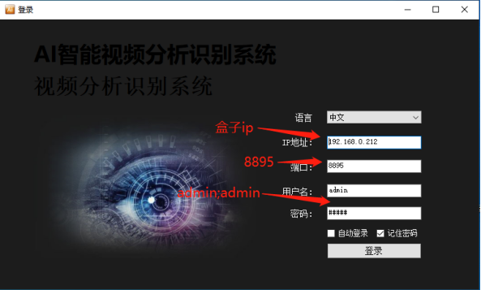
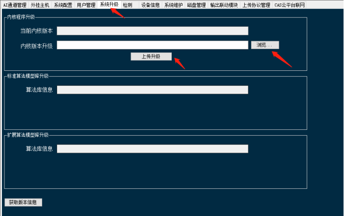

## 1. 客户端升级服务端补丁

登录客户端之后，选择配置-&gt; 系统升级-&gt; 内核程序升级-&gt; 浏览选择升级包 aibox_sp.bin（需要提前准备好）-&gt; 点击上传升级:::caution
图片缺失：
:::

升级提示上传成功之后-&gt; 在配置界面里面选择系统维护-&gt; 重启程序

操作完成后关闭客户端，盒子会自动重启服务，需要等待大概 15-30 秒，重新登录客户端即可
