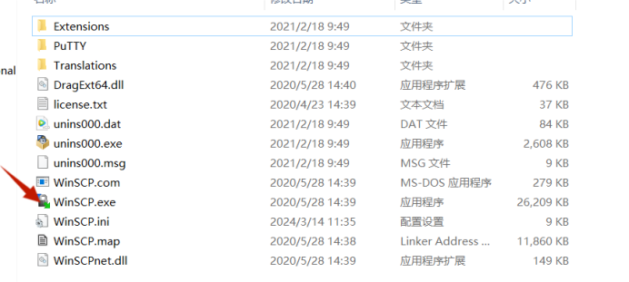
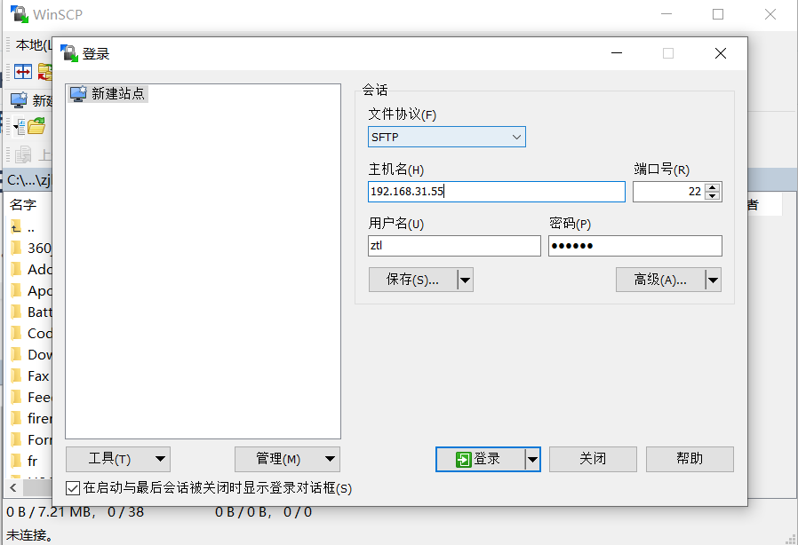
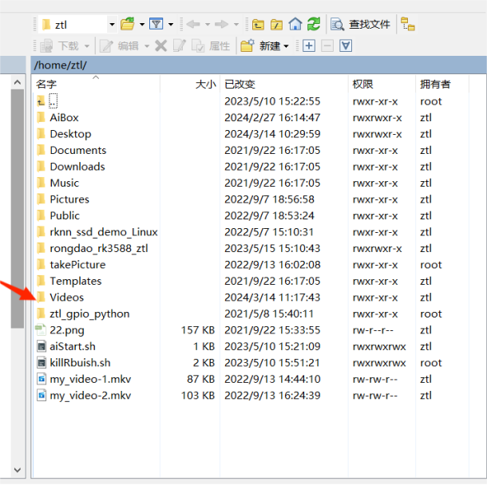
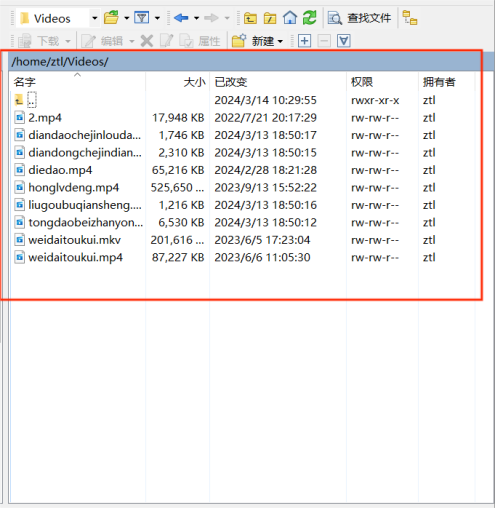
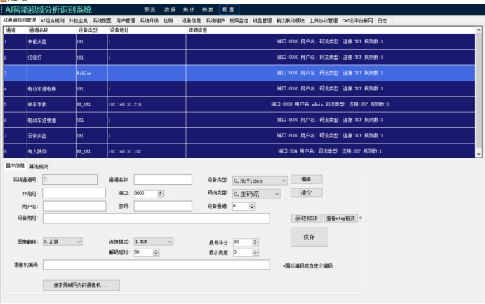
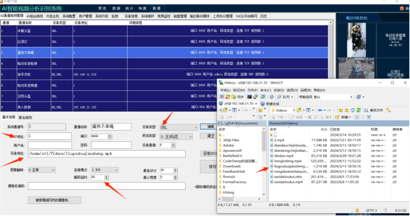
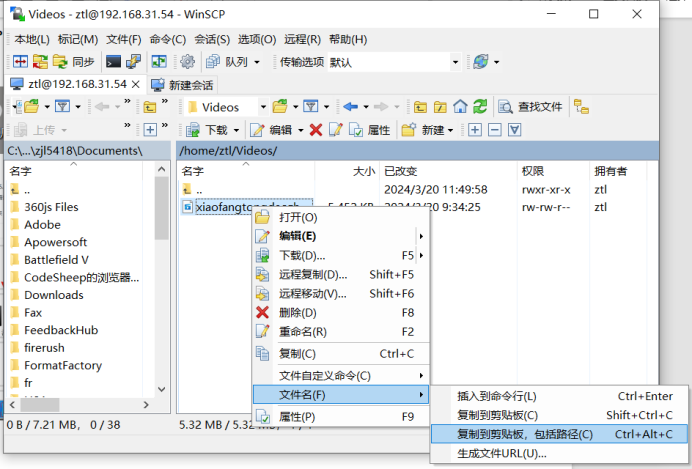

## 一.打开工具WinSCP.exe（工具找售后要）

### 二、登录工具
#### 主机名是AI盒子的IP地址，端口号默认为22
#### 盒子一般就两种，边缘是蓝色的用户名密码是linaro，其余的用户名都是ztl
#### 用户名：ztl    密码：123456
#### 用户名：linaro     密码：linaro

### 三、找到文件目录存放视频资源
#### 1.登录完成后右窗口会有以下文件，进入**  **/home/ztl/Videos/** **目录下

将所要放置的视频移动到该目录下，之后就能进行视频替换操作
#### 注意：(视频文件名称不能带有中文和空格）��频分辨率至少要720P，达不到需要使用格式工厂进行修改。

### 四、视频替换等功能操作
#### 1.登录AI盒子

ip地址：AI盒子的设备IP
端口：8895
用户名：admin
密码：admin
##### 进入配置界面，以通道三为例，添加一个遛狗不牵绳的视频案例

点击编辑，填写好通道名称，IP地址随意，设备类型设置为URL，解码延时50填好对应视频的设备地址
###### 设备地址的获取方法

##### 设备地址：为该视频在AI盒子内的绝对路径，路径名称可以任意，但不能带有空格和中文。