1. 将设备插上电源，网线连接好，要确认一下连接的网口的灯是不是闪烁。(闪的话就是代表网络正常)
2. 打开工具parrot-man，若没有此工具，可以联系售后
3. 点击parrot-man工具，然后点击搜索设备，他就会把ip音响的设备以及ip全部搜索出来。

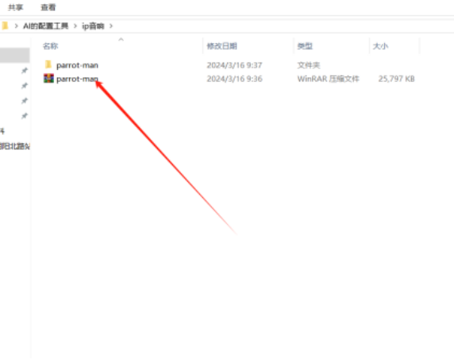

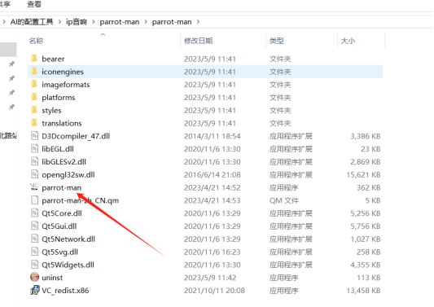

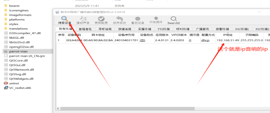

4. 打开AI配置系统.登陆系统，点击配置找到输出联动模块.直接点击添加，设备设备名字。设备类型选择 **HongYi。** ip地址填上面用工具搜索到的音响的 **ip** 然后直接点击保存就可以。 **配置完后要重启一下程序要(记住不要忘记了)** ，重启后点击AI通道规则管理选中���应的通道来给他添加设备，选中通道后点击算法规则，选中该算法，点击修改，然后再点击联动，勾选终端语音输出，在设备那里选择你创建好的音响设备，最后就可以在语音文本那里设置要播报的语音， **声音的话是1到10.1最小.10最大** 。具体操作的话如下图操作。

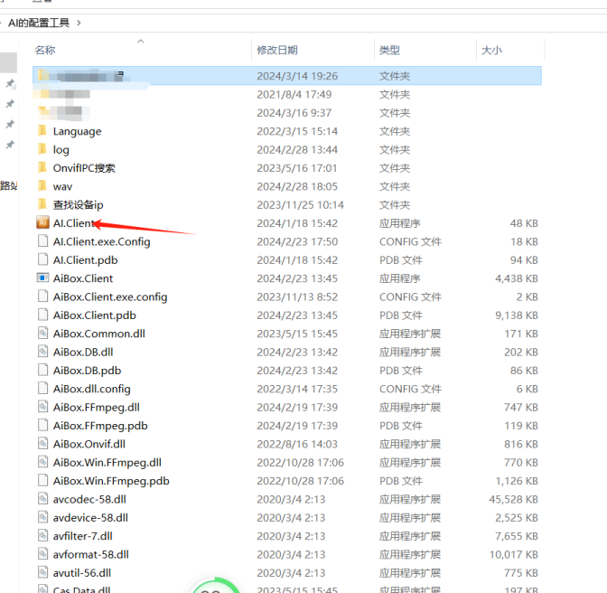

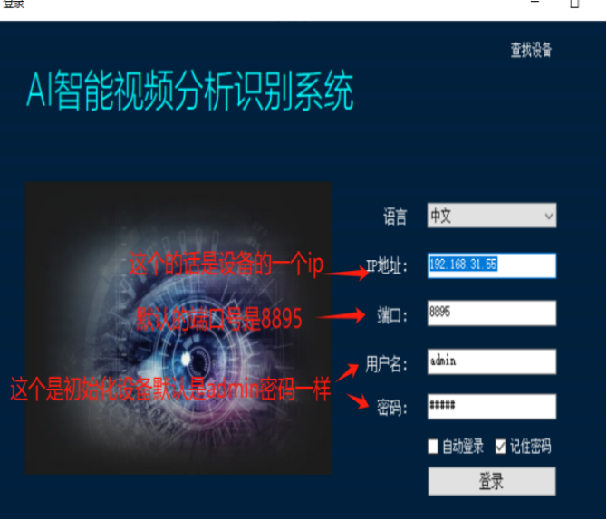

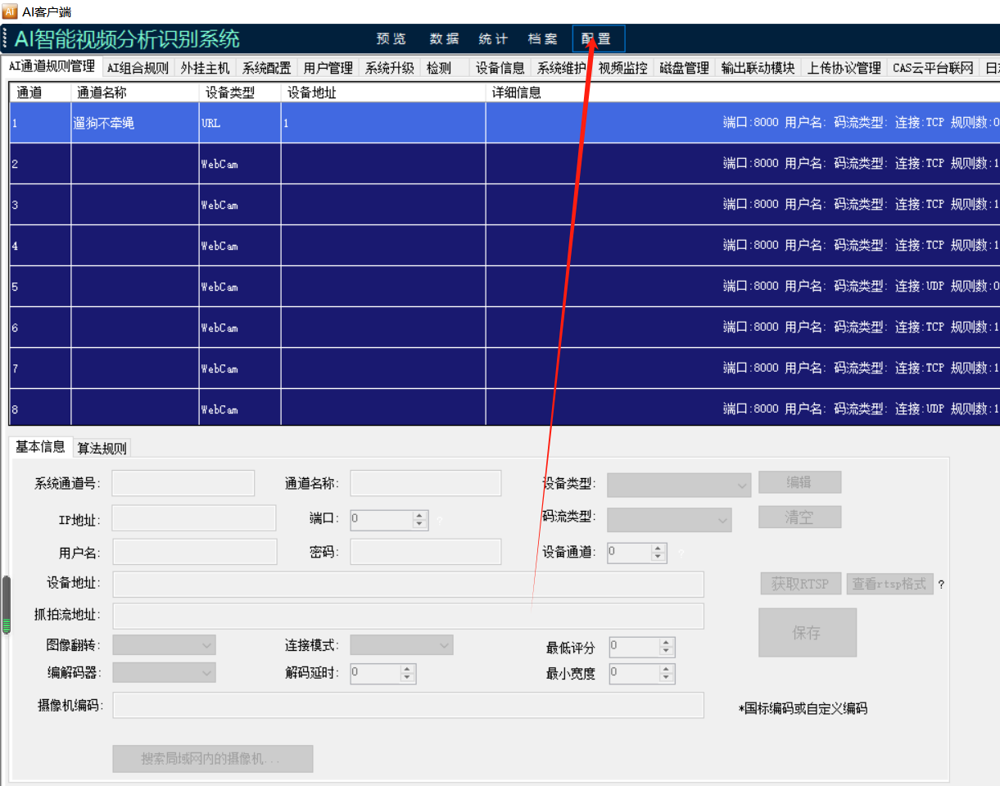

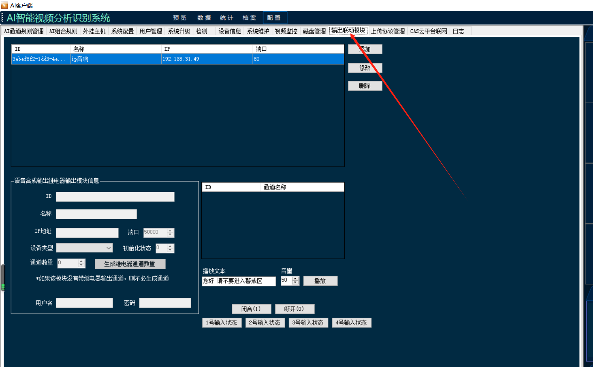

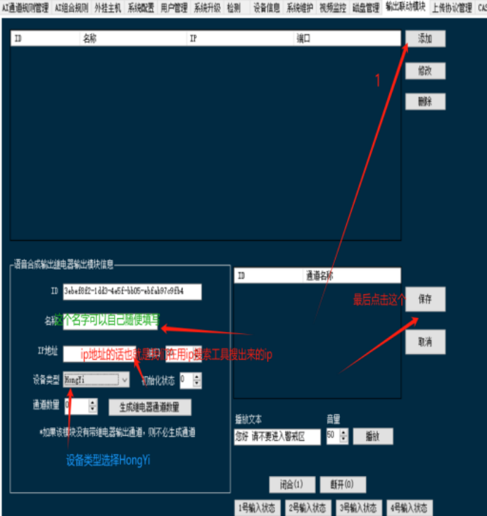

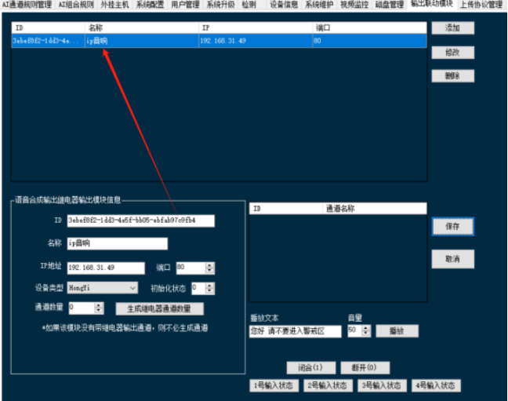

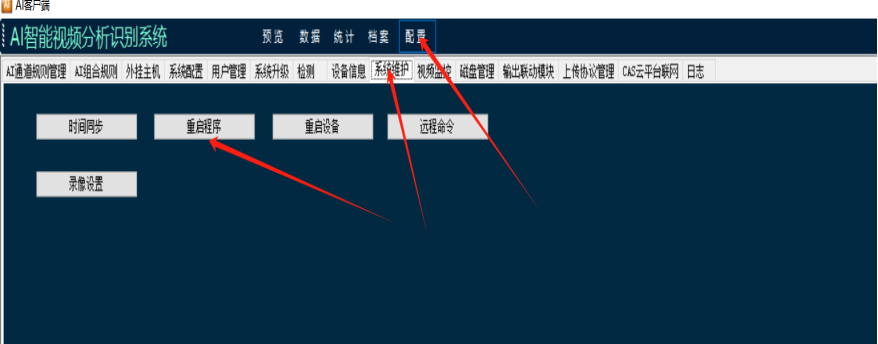

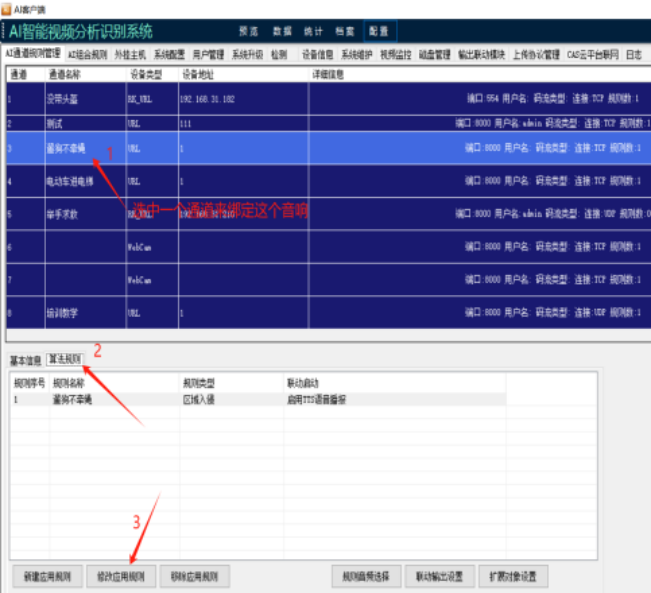

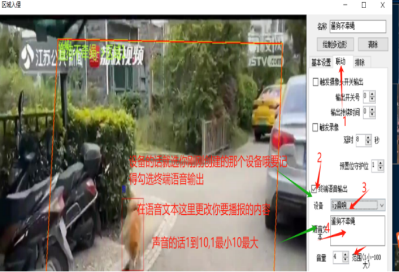

