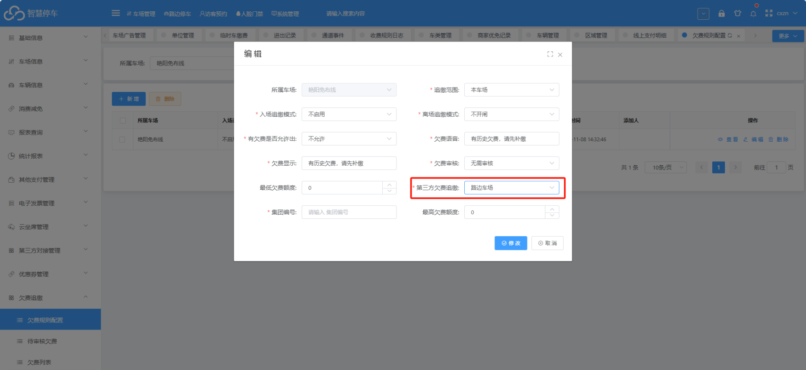
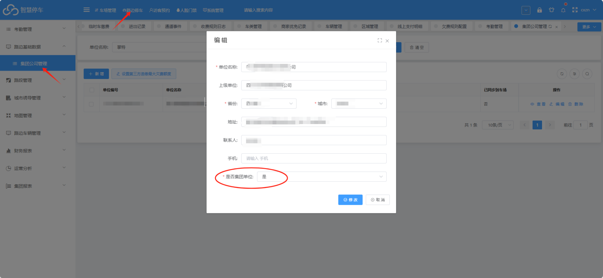
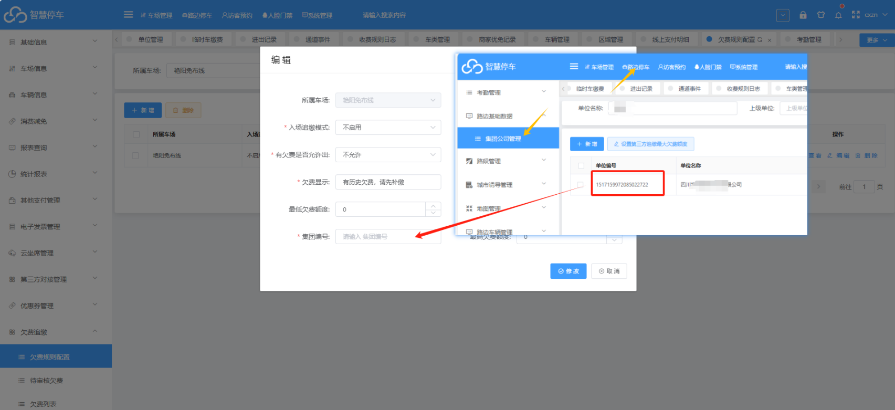
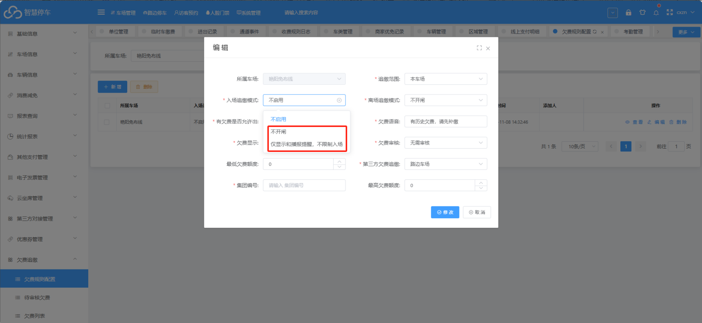
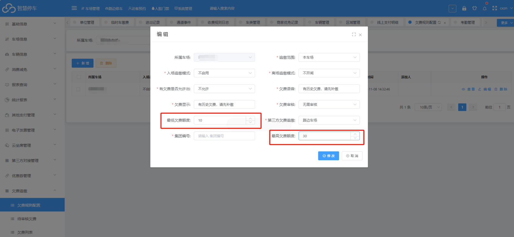

免布线车场需要追缴路边车场的一些特殊配置项如下：

## * 第三方欠费追缴选择  路边车场

## * 填写集团编号

（注意：需要追缴那个集团单位下面的路边车场，就将改集团单位设置为  是 ）

然后将单位编号填写到欠费追缴规则的集团编号设置项中

## * 如果出口需要直接扫描出口缴费码追缴路边车场的费用，那么入场追缴模式必须设置为不开闸或者仅显示播报（扫描出口通道码支付时，不管时本车场的补缴订单，还是路边车场的补缴订单，都统一补缴到本车场）

## * 最低欠费额度和最高欠费额度

最低欠费额度：累计欠费金额&lt; 设置的金额数，不进行追缴（设置为0则不限制）

最高欠费额度：累计欠费金额&gt; 设置的金额数，不进行追缴（设置为0则不限制）

注意：设置时  最低欠费额度&lt;最高欠费额度

如图所示：

最低欠费金额  设置为  10；最高欠费金额设置为30

表示  如果累计欠费金额累计欠费额度&lt;10  或者  累计欠费额度&gt;30   则不追缴

