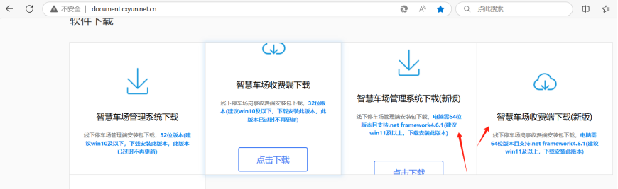
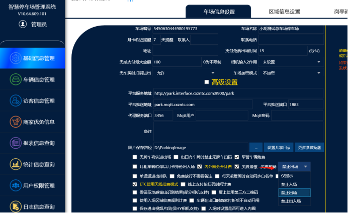
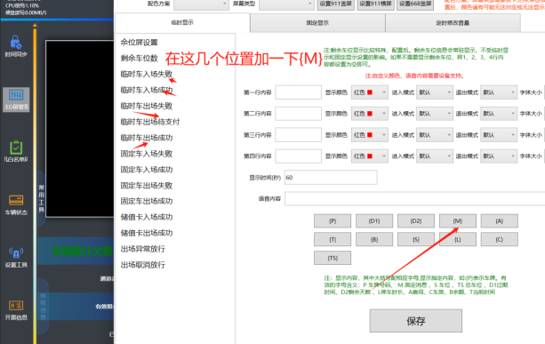
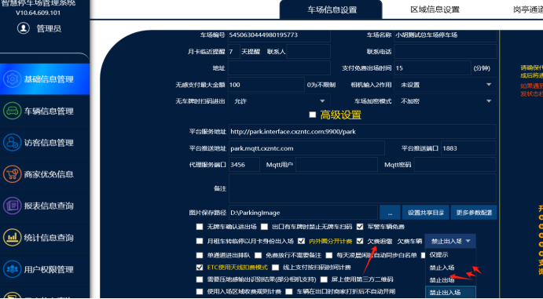
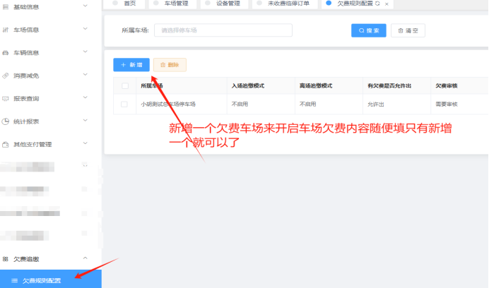
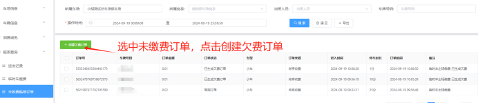
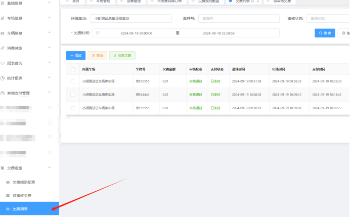

本地软件要更新最新版或者是从平台上直接下载64位的软件哈
打开管理端软件 → 在基础信息管理勾选欠费追缴欠费车辆在这个位置选择补缴的类型
1仅提示：产生未缴费订单后，车辆在出口入口会正常播报显示，如果要提示欠费要在软件LED管理那里显示和语言+(M)
2禁止入场：入口补缴：产生欠费订单后，车辆在入口识别到了会显示和语言播报 车牌号+车辆累计欠费多少元。必须扫补缴二维码进行补缴后，在重新识别才能进出
3禁止出场：出口补缴：产生欠费订单后，车辆在出口识别到了会显示和语言播报车牌号+车辆累计欠费多少元。必须扫补缴二维码进行补缴后出场（本次进出产生了费用则需要支付本次的费用才能出场，没有产生的可以直接重新识别直接出场）
4禁止出入场：出口入口都需要补缴。产生欠费订单后，车辆在入口识别到了会显示和语言播报 车牌号+车辆累计欠费多少元。必须扫补缴二维码进行补缴后，才能进，出口识别到了会显示和语言播报车牌号+车辆累计欠费多少元。必须扫补缴二维码进行补缴后，才能出场（本次进出产生了费用则需要支付本次的费用才能出场，没有产生的可以直接重新识别直接出场）

## 欠费功能配置方法：
1软件升级到最新版本
2基础信息管理勾选欠费追缴，并选择追缴的模式
3在平台上欠费追缴配置一个欠费车场（没有权限的话记得联系收费人员添加权限哦）
4本地产生的未缴费订单，需在平台上未缴费订单那里由车场管理人员审核成欠费订单

在这个欠费列表这里就可以看到该车场的一个欠费订单状态了

