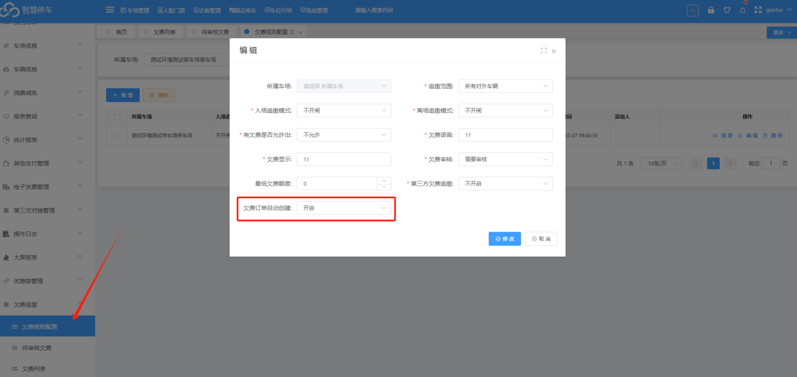
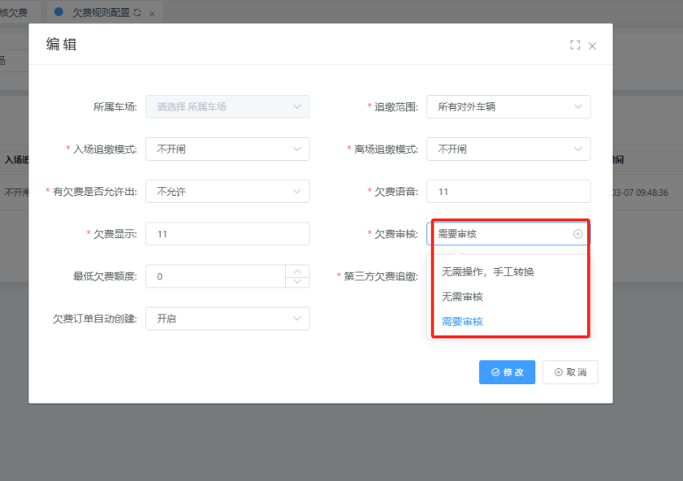

## 1  开启欠费订单自动创建功能，就能够自动创建本地车场的欠费订单，不需要手动生成

注意：此功能开启之后，每日凌晨一点自动将前一天未缴费临停订单创建为欠费订单

例如  6月30号  产生的未缴费临停订单   开启这个功能之后，7月1号的凌晨1点就会自动将6月30号的未缴费临停订单创建为欠费订单

## 2  此外，我们还需要注意开启欠费订单自动创建之后，欠费审核，无论设置成需要审核还是不需要审核，都是不需要审核，直接创建成欠费订单

