## 点击欠费追缴功能：


1. **点击新增欠费车场** ：

在这里选择对应���车场来启用欠费功能

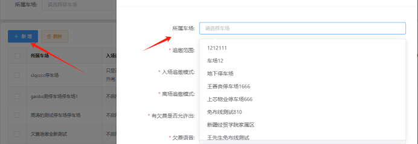

2 追缴范围： 可以这里选择是对本车场还是单位下面的所有的车场进行欠费补缴(目前只能是针对于本车场进行补缴)。

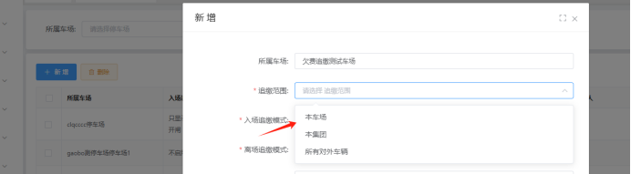

## 入场追缴模式分别三种模式 ：

不启用：(选择这个模式后，将不会启用入场补缴功能)
不开闸：(选择这模式后，有欠费车辆在入口识别的时候就会进行追缴，车主必需要支付完上次欠费金额才能入本车场)
只显示播报，不追缴，开闸：(选择这个模式后，车辆在入场的时候���会提示车辆欠费，但是不会去进行追缴哦。会开闸)

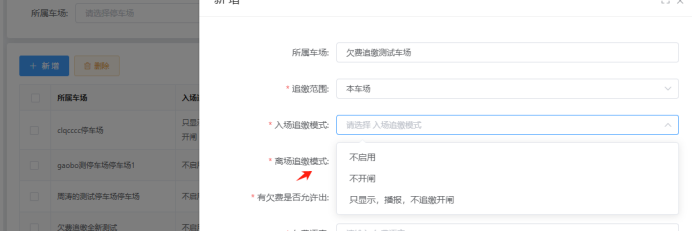

#### * 离场追缴模式一共分为三种模式：

不启用：(选择这个模式后出口将不会启用出口补缴的功能)
不开闸：(选择这个模式后有欠费车辆在出口时产生费用的时候，会播报临时车和他本次在车场产生的费用，扫出口二维码码缴费时会出现本次在车场产生的费用和可选择上次欠费订单是否进行补缴，未产生费用的时候，会播报欠费车辆信息并进行补缴)
仅显示播报欠费信息：(选择这个功能车辆在出口没产生费用的时候，会播报欠费车辆，但是会开闸出去，当车辆产生费用的时候，需要支付了本次在车场产生的费用才能出去)

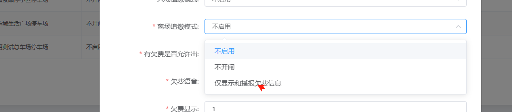

## * 有欠费是否允许出：一共是两种模式
允许出:(选择了这个模式后，出口有车需要补缴的时候，车主可以自己选择是否补缴上次的欠费金额)
不允许:(选择了这个模式后，出口有车需要补缴的时候，车主必须要补缴完上次欠费的订单和本地订单才允许出)

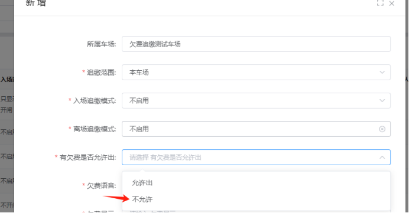

6 欠费语言和欠费显示
在这里设置的语言内容和显示不得低于6个字，
超过：    6个字就会按照设置的欠费和语言内容来进行显示和播报
不超过：6个字就会按照系统默认的来显示和播报\{目前只有进口支持哦\}

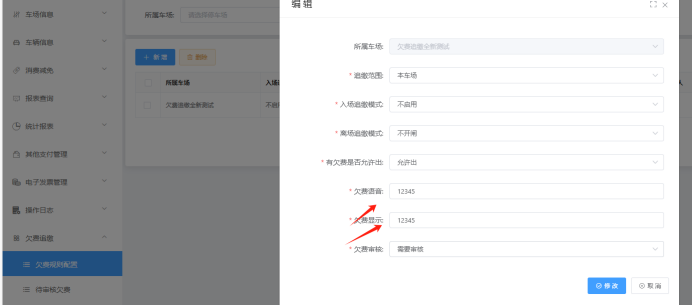

欠费审核：一共有3种模式
无需操作，手工审核:(这个模式选择了之后，车辆有了未缴费订单后必须要操作人员在后台操作审核是否为欠费车辆)
无需审核：(这个模式选择了之后，车辆有未缴费订单之后，直接会当成欠费车辆)
需要审核：(这个模式选择了之后，车辆有了未缴费订单后必须要操作人员在后台操作审核是否为欠费车辆)

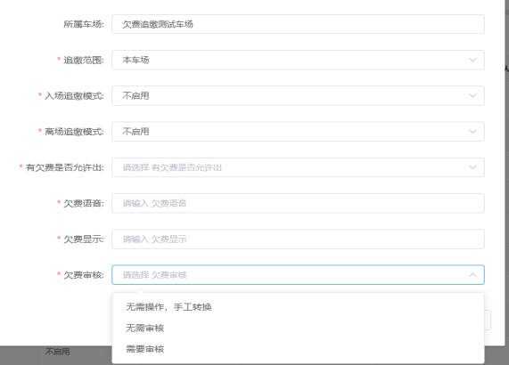

## 欠费审核：

在车场欠费功能那里勾选了需要审核的时候可以这个去给未缴费订单去进行审核。审核通过的就会自动加入欠费订单

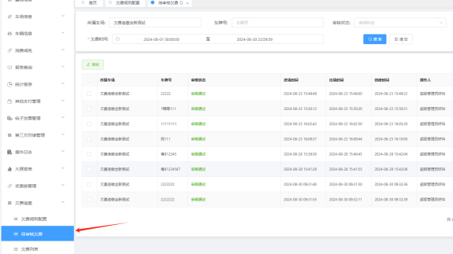

##### 欠费列表:
在这里可以看到本车场所有的欠费车辆的信息包括\{已补缴完和未补缴\}
添加:可以手动添加欠费车辆信息
取消：可以取消车辆的欠费信息。
收取欠费：车主采用补缴现金的方式来支付

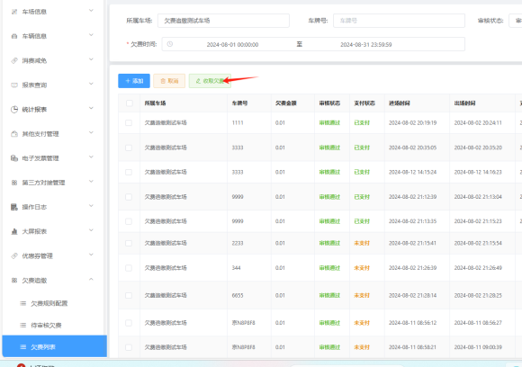

#### 欠费追缴的配置方法

出场追缴的配置方法:
1在欠费规则配置新增本车场的欠费规则
2在出场追缴模式那里设置好补缴的类型规则
3设置好后车辆在出口的时候，产生费用了之后扫出口二维码支付历史欠费订单和本次产生费用订单才能出场
4操作如下：

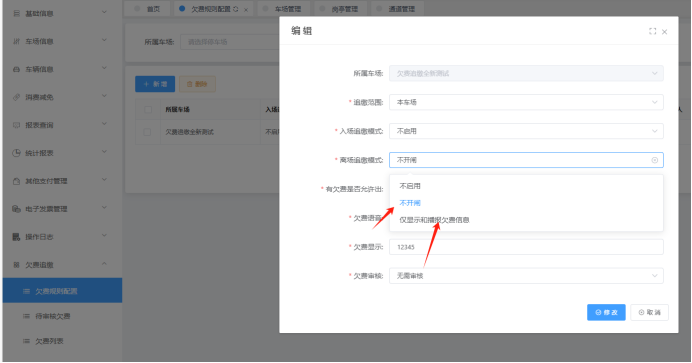


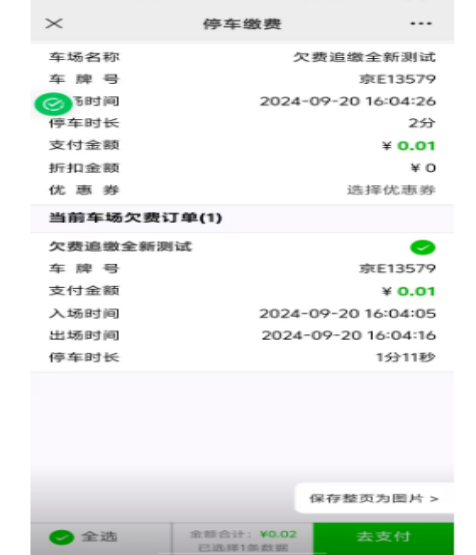

## 入口欠费补缴的设置方法：

1在欠费规则配置新增本车场的欠费规则
2在入场追缴模式那里设置好补缴的类型规则
3车辆在出口产生费用的时候就必须扫补缴二维码支付历史欠费订单完后才能重新识别进场
4配置方法步骤如下图：

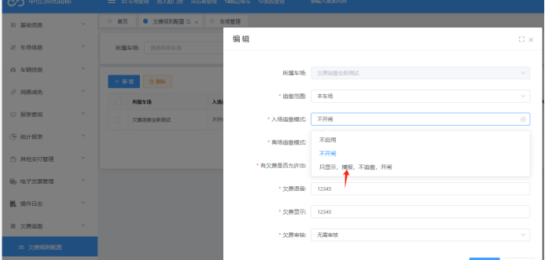

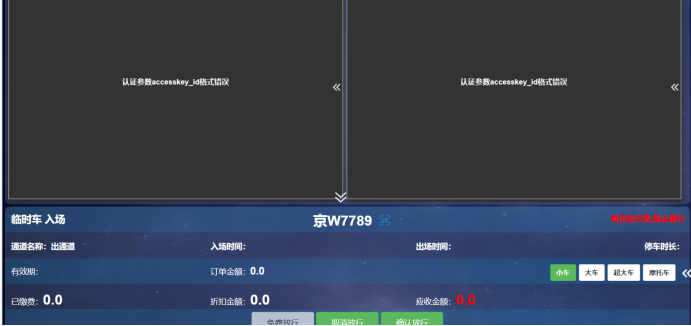

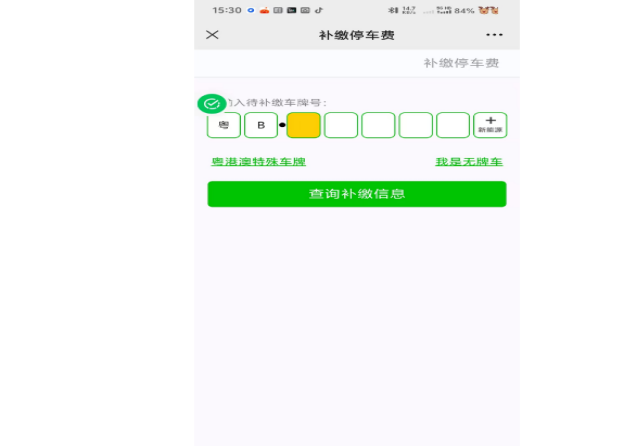

```

```

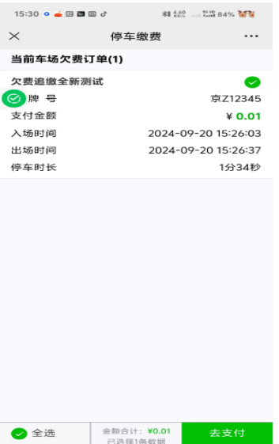

## 审核功能配置方法：

1. 在欠费规则配置：欠费审核设置成无需操作手工转换需要审核
2. 产生了欠费订单之后，需要在欠费审核功能这里去给车辆进行一个审核，点击审核才会产生欠费订单
3. 审核好后就可以在欠费订单那里去查找欠费车辆订单的情况

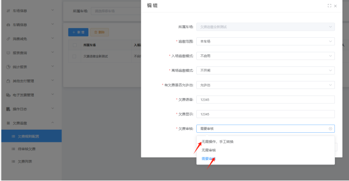

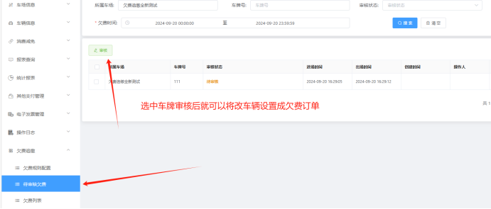

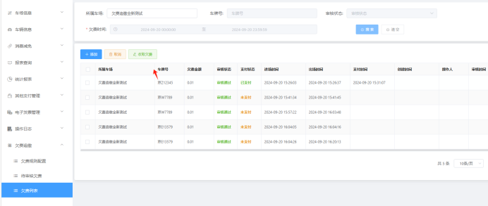

