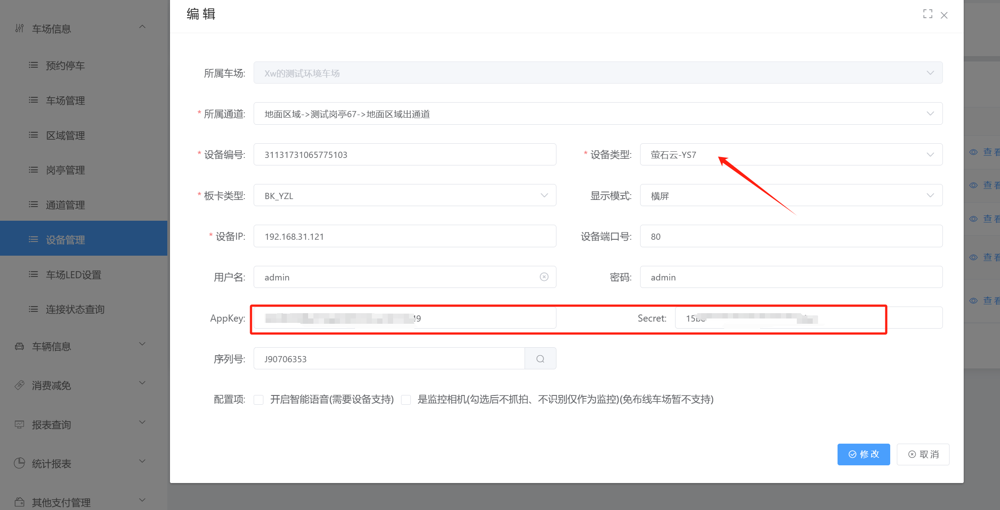
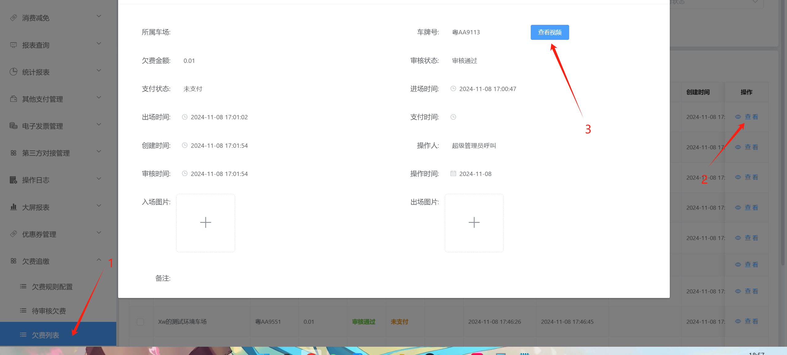
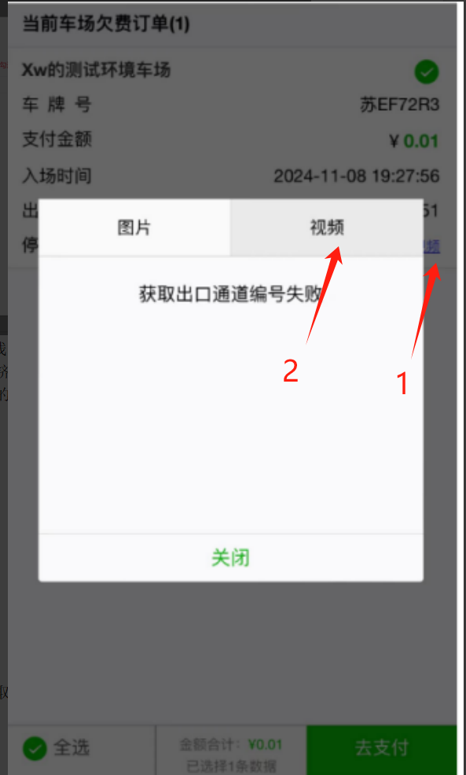

## 添加萤石云相机之后，可以在欠费列表里面和扫码补缴欠费金额的时候查看到进出的视频

### 1.设备的话只需要添加萤石云的相机然后在萤石云平台获取参数，在设备管理里面绑定参数，使相机能在平台上看到视频就行

### 2.添加设备

设备类型：萤石云-YS7
设备ip：XXX  （端口，用户名和密码都是默认的不需要修改）
Appkey：和  Secret：这2个参数在萤石云相机后台获取：绑定这2个参数相机才能在平台上看视频，

### 2.查看视频的2种方式：

#### 2.1 在欠费列表里面搜索到对应车牌然后点击查看，然后点击视频

#### 2.2 扫欠费补缴二维码补缴欠费金额的时候可以点击查看视频

