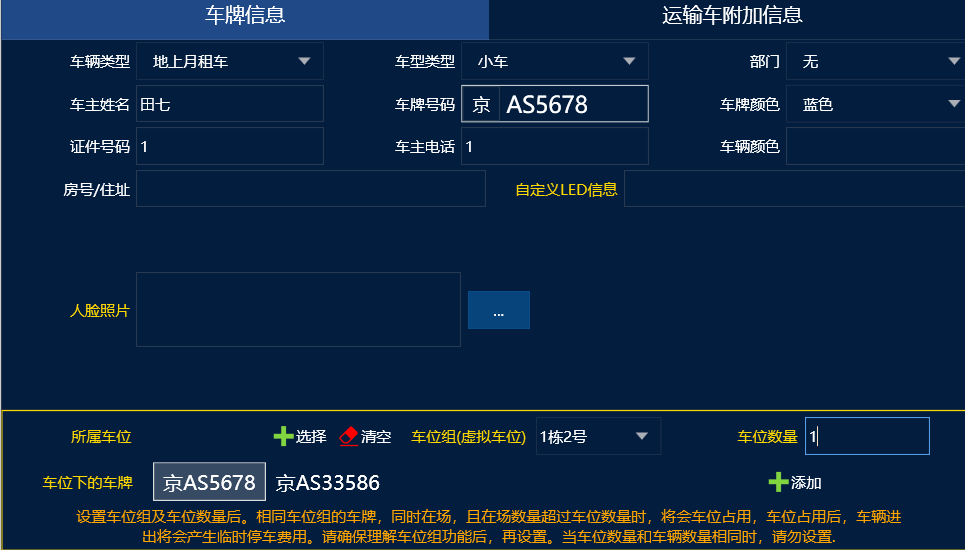
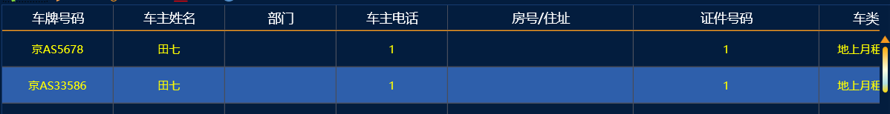

## 一位多车说明书配置
比如一位业主2台车：京AS5678和 京AS33586，我们可以直接

添加第一台车京AS5678 车位组设置：1栋2号  车位数：1

如果两台车通道权限相同

就可以直接点添加，再添加一个车牌京AS33586

然后再车辆管理中就会自动添加两条同一个业主不同车牌的月租车信息

这样就是一位2车设置  可以查到车位组下面的车辆信息

车位组相当于一个虚拟名称随便定义一个名称

车位数量就是有多少个车位

如果上面车位数设置成2个 这样就相当于2位2车

如果3车1位的话 在添加一台车京BD3333 车位组就选择：1栋2号 车位数量就设置1个

## 一位多车三种模式（车位被占用三种模式）

简单模式：
管理端车类管理里面，勾选车位占用简单模式的。假如AB两车一位，A车进来是月卡 B车进来是临时  A车出去了 B车还是临时车会一直计费，B没出场的时候，A车再进来 还是月卡车，B车出场的时候 会收取从入场时间到出场时间的全部费用

复杂模式：
同样的AB两车，A进场月卡，B进场临时，A出场的时候B就会转换成月卡，A再进场时候A就是临时，这种模式下可能会出现两个车都收费的情况，但是 只会计算同时在场的费用，只有一台车在场的时候肯定是月卡车不会计费的

单车牌收费模式：
AB两车一位，当A车进入车库以月卡身份入场，B车入场时是临时车身份；但是当A车出库时，B车还是以临时车身份停在车库，但是不再计费；当A车再次入场,A车还是以月卡身份，B车就会再次计费（简单来说，就是只计算两台车同时在场时，其中一台车的费用；如果有一台车出场，那么就不再计费）
