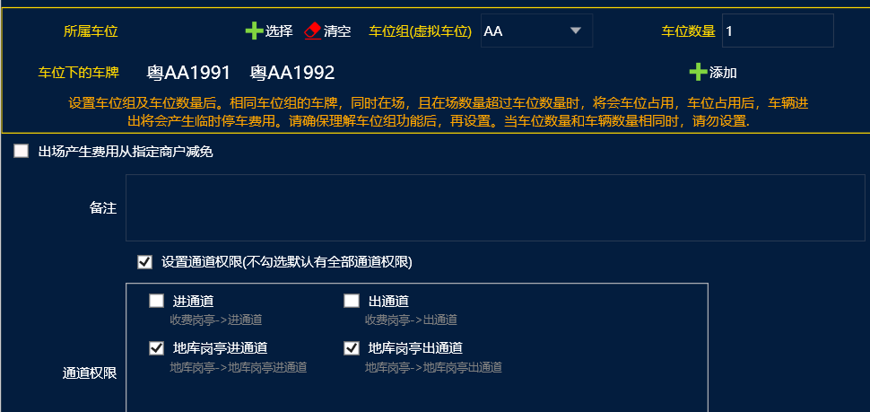
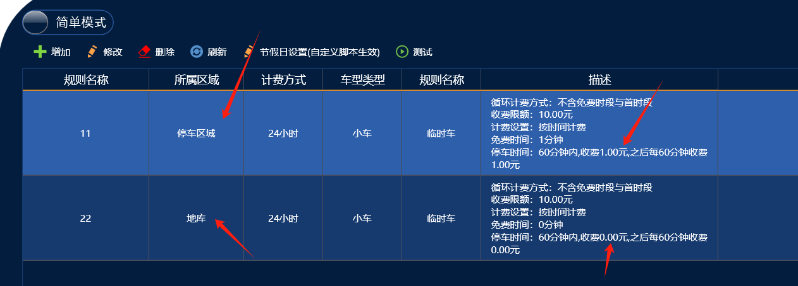

地库一位多车功能可以实现，只在地库限制一位多车，地面区域不限制。

设置方案：

车牌：粤AA1991 和 粤AA1992

2台车都需要取消勾选地面的通道权限，之后2台车入场地面都是转临停的，先入场地库的第一台车就判断为月租车，然后在车类里面设置车位占用禁止进出，第2台车就禁止进地库了，收费规则配置地面区域配置计费，地库区域添加一个收费0元的收费规则。

如果地面不允许临时车入场的话，我们需要在车场管理里面勾选：月租转临停已月卡的身份入场，这样2台车才能正常进地面。

（如果2台车都停车在地面区域转临停也不计费的话，可以单独添加1个月租车型，然后给这个月租车型在地面区域配置临时车的免费的收费规则，然后车辆信息里面月租车在绑定这个车型，这样月租车在入场地面转临停的时候 就会按月租车型的收费规则计费，因为收费规则配置的是免费的，所以就能实现停车在地面也是免费的）
