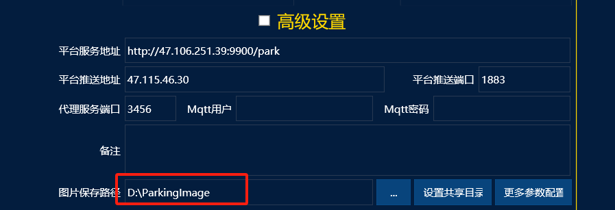
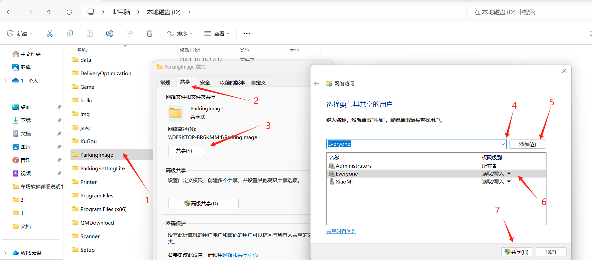
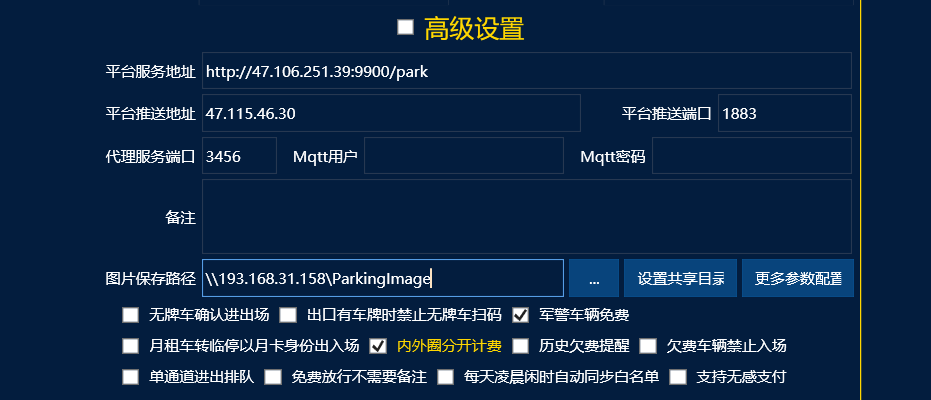
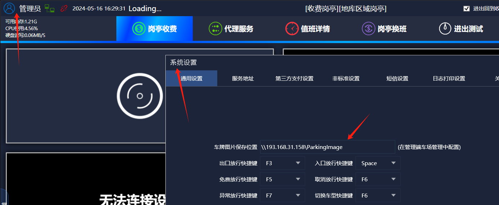
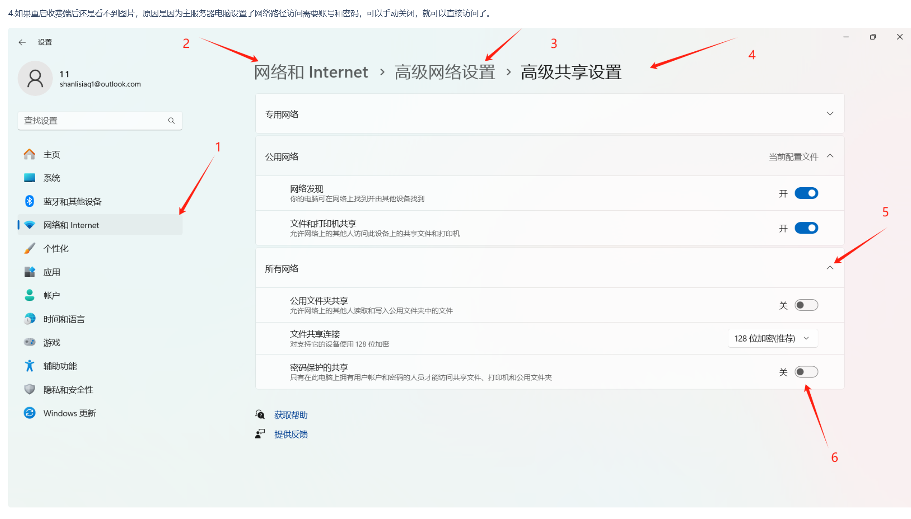

如果车场有多个台电脑，一台服务器，多个岗亭的情况下，默认车辆进出相机抓拍的图片是存在当前电脑的D盘里面

所以在管理端查询进出记录的时候是看不到相机抓拍的图片的，所以我们需要在服务器管理端电脑上把图片存储路径的文件夹改成共享文件夹。

操作流程：

1.在电脑桌面我的电脑上 D 盘里面找到这个文件夹，

2.找到路径，设置共享文件夹，

3.文件夹共享后，在管理端修改图片存储路径：路径改成\\\服务器电脑的ip\\共享文件夹名称

4.管理端路径修改完成后，把所有收费端都重启一下，看收费端的路径是否和管理端相同，相同就没问题了。

