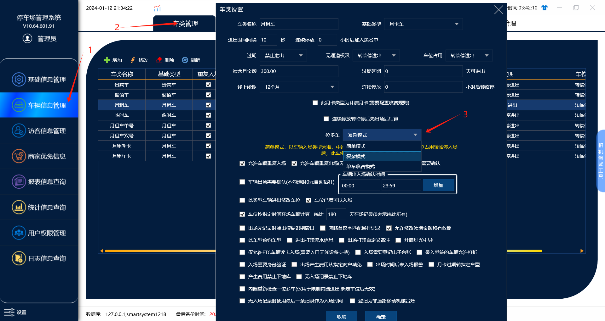

月租车，车位占用有三种循环模式方案，一般常用的是复杂模式

在管理端，车类管理里面修改月租车，选择模式

一：复杂模式

A车进去了月租车，B车进去了临时车，A车出去之后，B车会自动转换为月租车，然后A车再进来，A车就变成临时车了，这种情况下有可能会出现两台车出厂都要收费的情况。

二：简单模式

第一台月租车入场后第二台车转临停入场，第一台月租车出场后，第二台转临停的车牌不转成月租车还是以临时车的身份停继续计费,如果第一台车在入场还是月租车入场。

三：单车计费模式

第一台月租车入场后第二台车转临停入场，第一台月租车出场后，第二台转临停的车牌不转成月租车还是以临时车的身份停,但是也停止计费,等第一台车在已月租车身份入场后第二台转临停的车才会继续计费。
