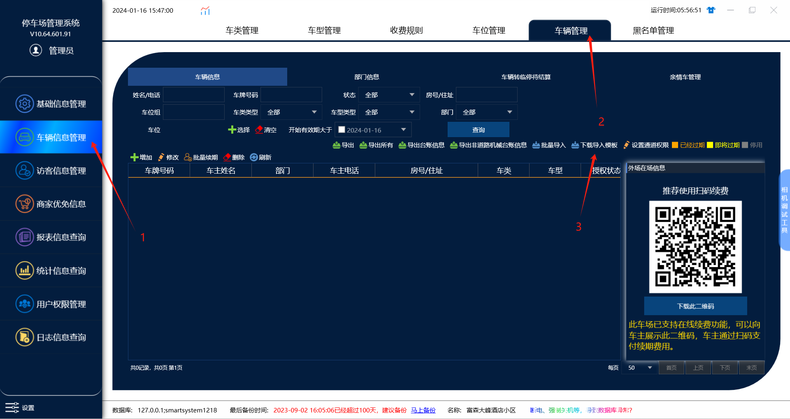
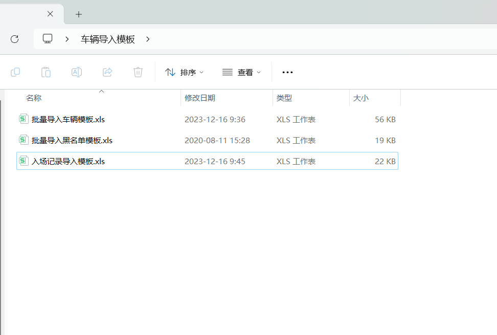
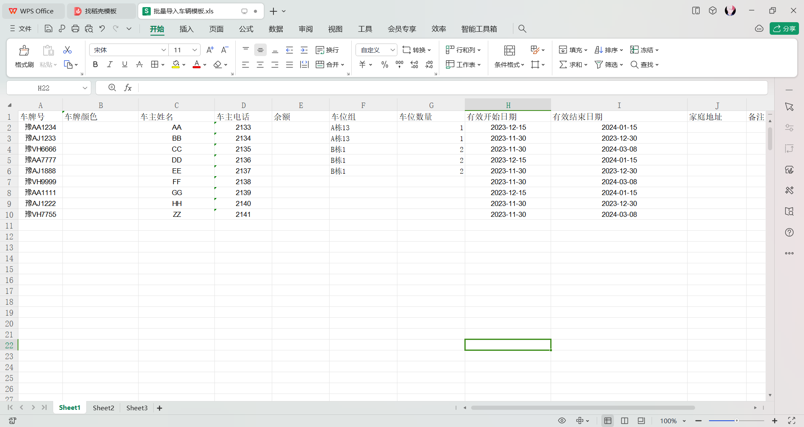
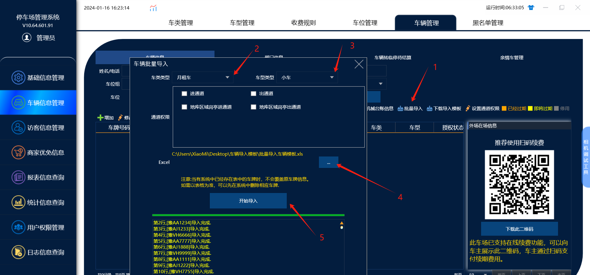
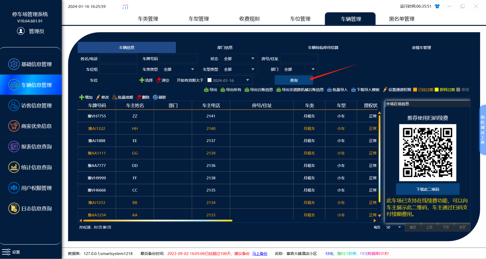
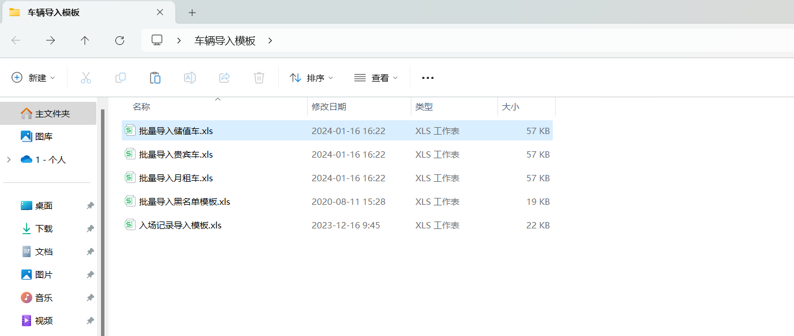
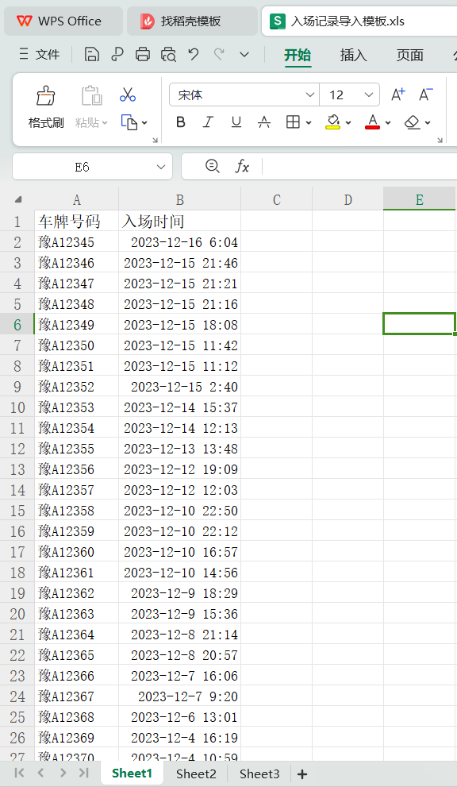
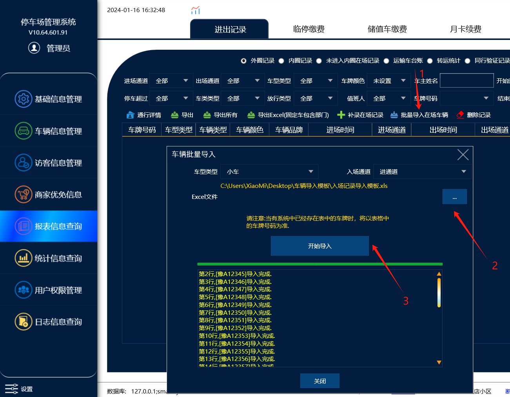
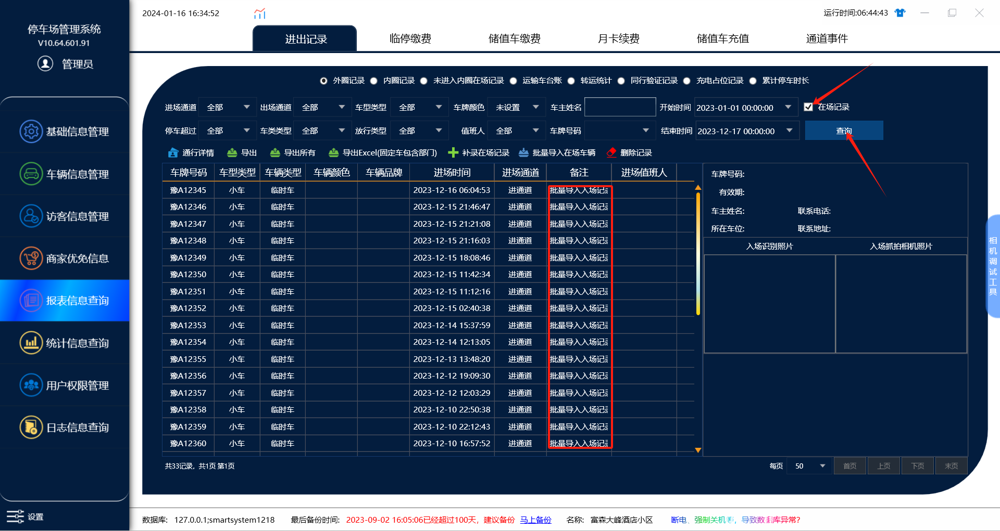

同步模板导入车辆信息，月租车，贵宾车，储值车，或者其他类型的车

首先先要在管理端下载导入模板，下载到电脑上的文件夹里面，模板里面默认有 车辆信息，在场记录，黑名单 这3个模板

车辆信息模板：

导入贵宾车，月租车，储值车，或其他类型的车就需要用到车辆信息模板，然后因为下载的车辆信息模板只有一个，如果贵宾车，月租车，储值车都要导入的话，我们需要把车辆信息模板

复制粘贴3份，然后把不同的车牌填到对应的模板里面，因为导入车辆信息的时候是根据车类去导入的，所以不能车牌全部放到一个模板里面。

注意：车辆信息月租车导入模板里面，车牌，姓名，电话，有效期都要填才能导入，如果不知道填什么内容，填1就行了

在场记录模板：

导入在场记录的话是在��表信息里面导入，模板里面只需要填车牌号和入场时间，导入的时候可以选择对应导入的通道。

注意：如果是月租车导入的在场记录，虽然导入后在场记录里面车类显示的是临时车，但是这个是不影响月租车出场的，因为月租车的有效期在进出时间内。

黑名单模板：

导入黑名单模板直接填车牌和原因在黑名单菜单里面导入车牌就行了。

注意：在导入任何模板的时候，都需要先把模板给关闭，在进行导入
操作流程：

一。导入车辆信息
1.在管理端下载导入模板，下载到电脑上的文件夹里面，模板里面默认有 车辆信息，在场记录，黑名单 这 3 个模板。

2.月租车在模板里面填入车牌，电话，姓名，有效期，如果有车位组的话也可以填写车位组

3.模板填写号之后，在车辆信息里面，导入车辆信息，然后选择对应的车类和模板进行导入

注意：导入月租车的话也可以在导入的设置通道权限，默认全部不勾选的话就是有全部的同步到权限，勾选了对应的通道的话，那么不勾选的通道就没有通道权限，月租车在没有通道权限进出的通道是转临停的。

4.导入完成后点击查询，就能查询到导入的车牌

5.如果需要月租车，贵宾车，储值车三种不同的车类，就需要复制粘贴3个模板，然后模板里面填对应需要导入的车牌，然后在导入的时候选对应的车类进行导入

二。导入在场记录
1.模板里面只需要填写车牌号和入场时间

2.模板填写好后，在报表信息，进出记录里面导入在场记录

3.导入完成后，勾选在场记录，然后点击查询

