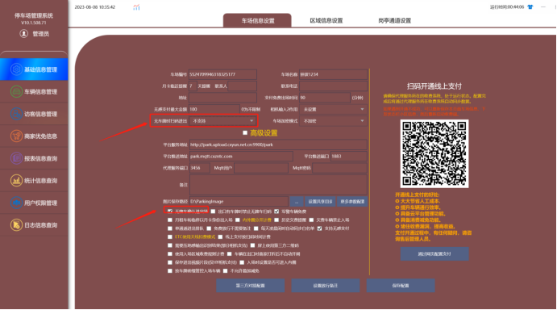
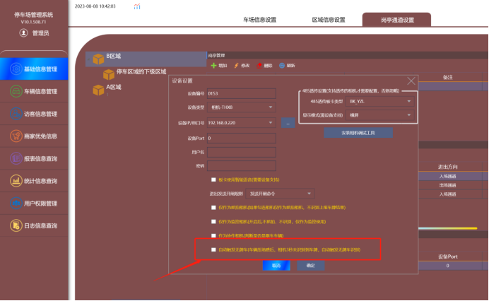

无牌车压地感确认放行设置

一、无牌车确认放行必须要相机能触发识别无牌车。

目前触发条件有俩种：1、相机做压地感识别，在相机里面有个IN1的端口就是接地感的。 2.  相机直接视频触发（这个不建议用）。

二、软件里面设置，登录管理系统-基础信息管理-车场信息管理-高级设置

把无牌车时扫码进出选择不支持，这样车主就不能直接扫无牌码了，

然后把“无牌车确认放行勾选”这样压地感或者视频触发无牌车，收费端就会显示无牌车进场的信息，这时候车主在去扫码无牌车码就可以直接开闸进去了，

注：部分相机可以在通道管理-设备管理，设置压地感后3秒没有识别车牌自动触发无牌车。

这样就可以实现，车压地感相机没有触发无牌车的情况下，3秒内相机没有识别到车牌的情况下，软件自动给相机触发一个无牌车的入场记录，然后车主在扫码入场。
