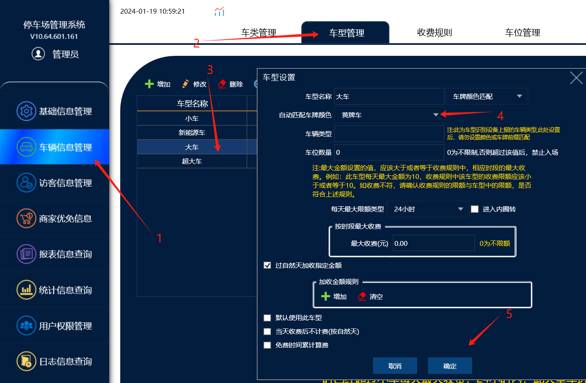
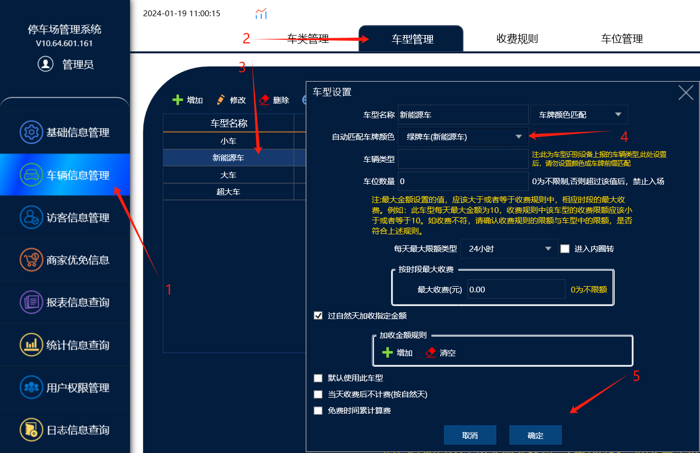
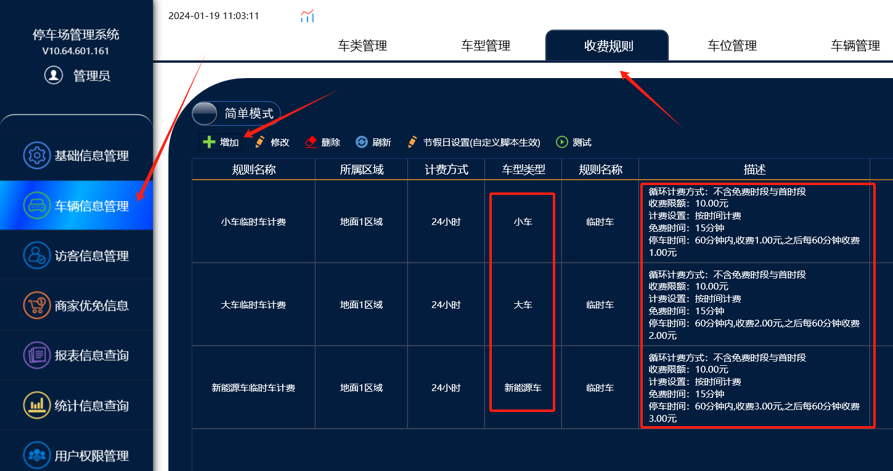

1 . 车型里面：小车=蓝牌（注：小车一般为默认车型），大车=黄牌，新能源车=绿牌，新能源大车=黄绿牌

2 . 收费规则是根据区域，车类，车型为基础而添加的 ，相同的区域，车类，车型只能设置一个收费标准

只有区域，车类，车型中如果添加的时候不相同，那才能添加的上

比如添加一个临时车类小车车型的收费规则，那么这个相同的就不能在添加了，可以设置其他的车型的收费规则，**如临时车类大车车型的收费规则，临时车类新能源车型的收费规则**。

3.如果需要小车，大车，新能源车需要设置不同的收费规则，首先需要在车型里面改一下自动匹配车牌颜色，小车是默认车型可以不需要修改，大车改成黄牌，新能源车改成绿牌。

操作流程：

一。首先先在车型里面改自动��配车牌颜色，小车默认车型不需要改，大车改成黄牌，新能源车改成绿牌

车型里面自动匹配车牌颜色完成后，相机识别的对应颜色的车牌进出，才会匹配对应的车型，并且按对应的收费规则计费。

二。车型添加收费规则

在收费规则里面添加，相同的车类，然后不同的车型，和对应车型添加的收费金额。
