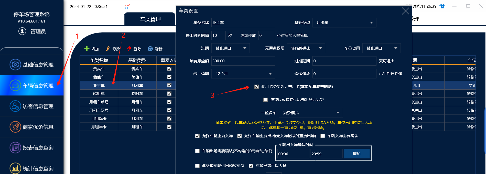
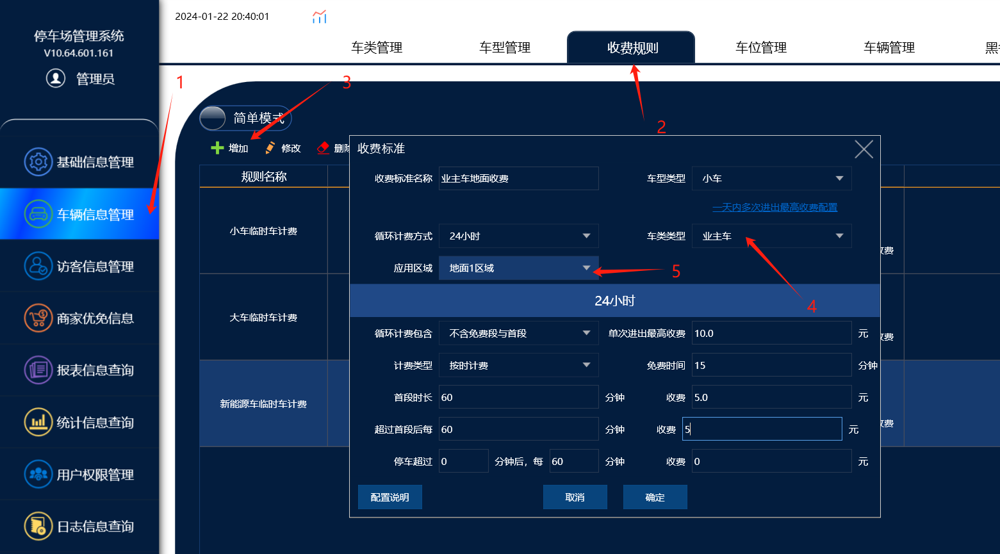
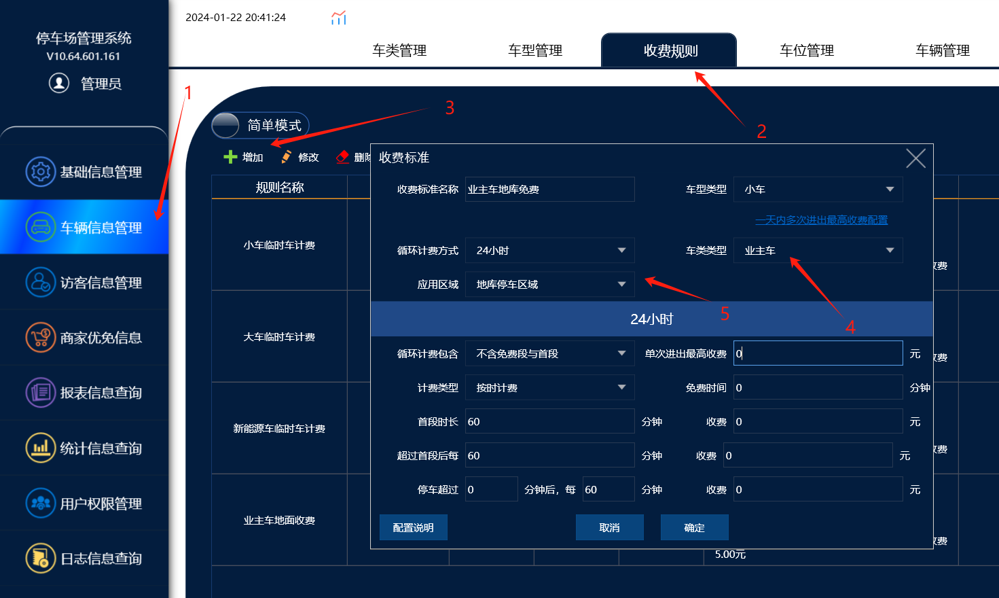

在车位紧张的情况下，月租车停车在地面占用车位，实现月租车停车在地面收费，只有下地库才免费停车

在软件上车类管理里面，勾选【计费月卡】的功能便可以实现给月租车配置收费规则

配置地面区域收费，地库区域免费，这样之后月租车停车在地面就会按照地面的收费规则计费，停车在地库才不会计费

注意：只有勾选【计费月卡】的功能，才能给月租车配置算费规则，没有勾选的情况下，在添加收费规则的时候，车类是无法选择月租车类的

设置流程：

一。在管理端，车类管理里面勾选【计费月卡】

二。在算费规则里面给被勾选了计费月卡的业主车类配置收费规则

配置地面区域收费：

配置地库区域免费：

三。收费规则添加完成后，月租车停车在地面不下地库的话就会产生临停费用。
