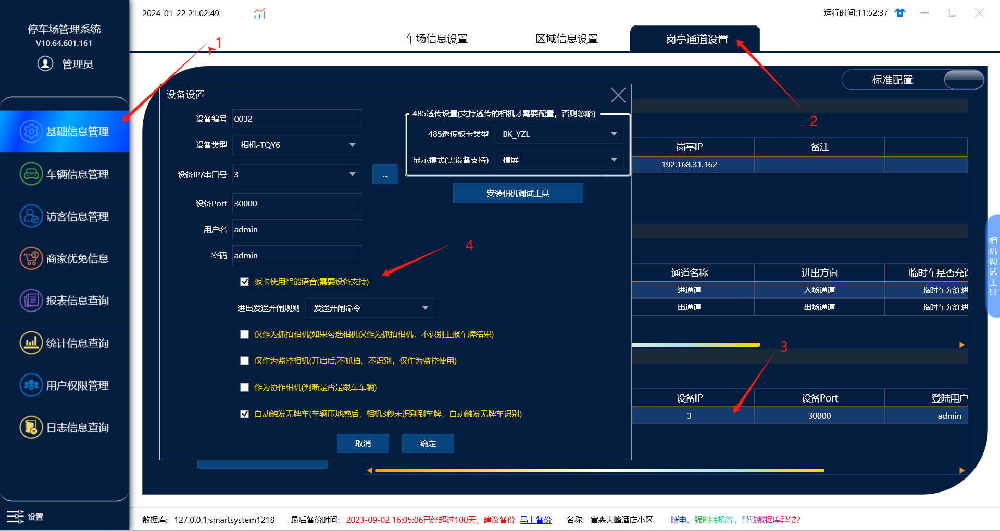
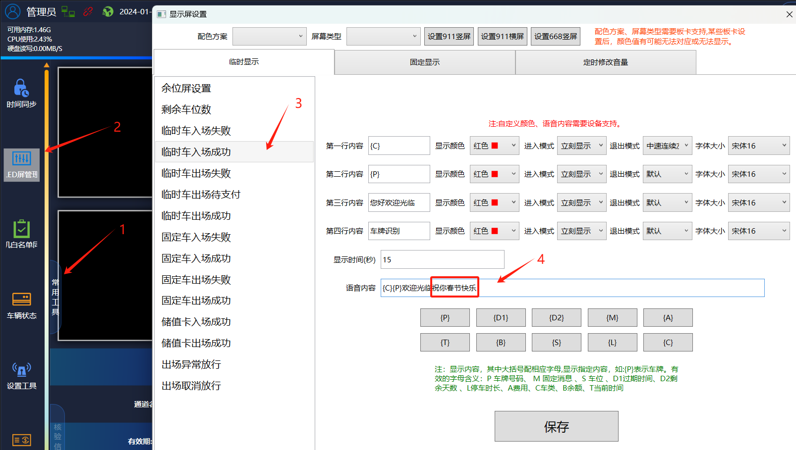
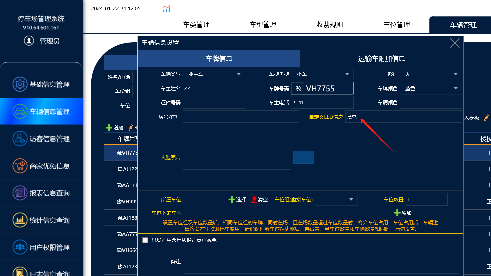
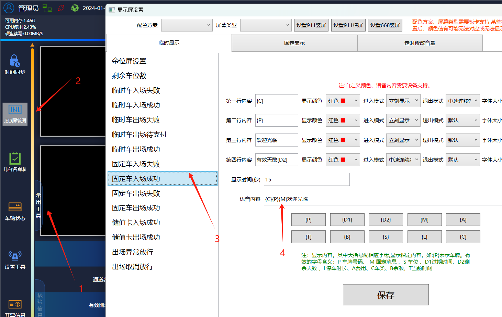

普通的车牌识别主板是无法修改语音播报内容的，只有在主板上加上智能语音模块

加上之后才能修改语音的播报内容，可以实现在特殊场景下播报特殊内容

设置流程：

一。在管理端设备管理里面勾选智能语音的功能

【注意：没有加智能语音模块的主板如果勾选智能语音的功能，会导致车辆进出无法播报喇叭就没有反应,所以普通主板不需要勾选】

二。在收费端，常用工具--led屏设置--临时显示里面修改语音类容

临时车入场成功：默认是播报\{C\}\{P\}欢迎光临=就是播报临时车京A12345欢迎光临

如果是智能语音板卡就可以修改播报的内容：加上了祝你春节快乐，这样就会播报 临时车京A12345欢迎光临祝你春节快乐

三。固定车的话可以加上在车辆信息里面设置一个播报的内容

1. 先在车辆信息里面设置自定义led信息：张总

2.在固定车入场成功的播报内容里面加上一个\{M\}

这样这台固定车入场后，就会播报：月租车豫VH7755张总欢迎光临。
