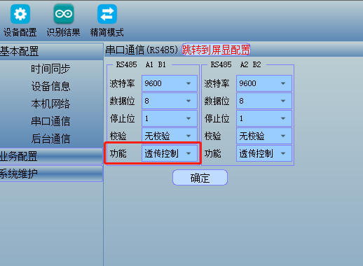
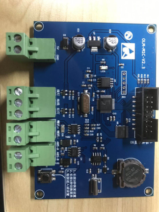
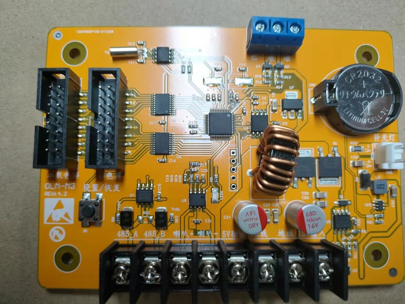
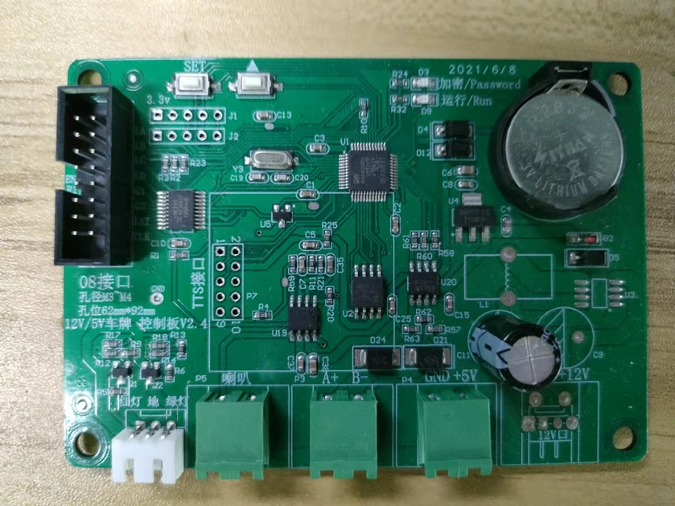
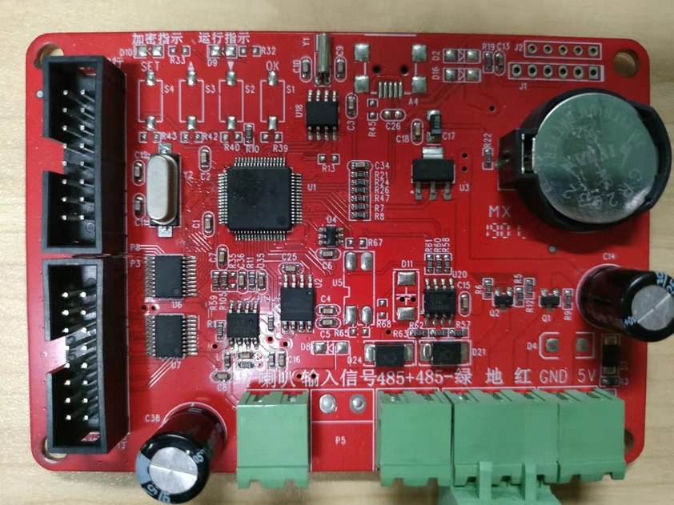
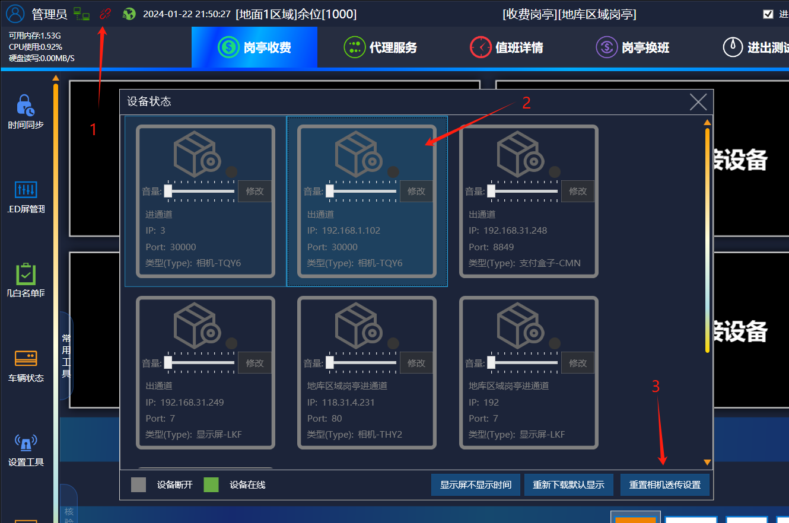

一。检测相机的设备类型和主板的类型是否选错

二。检测相机的波特率是否正确

常用主板：BK-YZL 波特率19200，BK-KF 波特率19200，BK-RTK 波特率9600，BK-FK9600

三。HX相机和芊熠相机的话：485串口工作模式需要改成透传控制

四。如果不是万能语音板卡的话，设备管理里面必要勾选智能语音的功能

五。检查控制卡接线的是否是相机的 485-1，并且 485A 和控制卡的 485A 对应

六。对应主板选择类型

1。设备类型：BK-YZL

2。设备类型：BK-RTK

3。设备类型：BK-FK

4。设备类型：BK-ZDZN

七。在不知道相机的波特率的情况下，在收费端设备连接状态里面可以选择相机然后点击重置相机透传，可以把相机的波特率改成对应主板的

