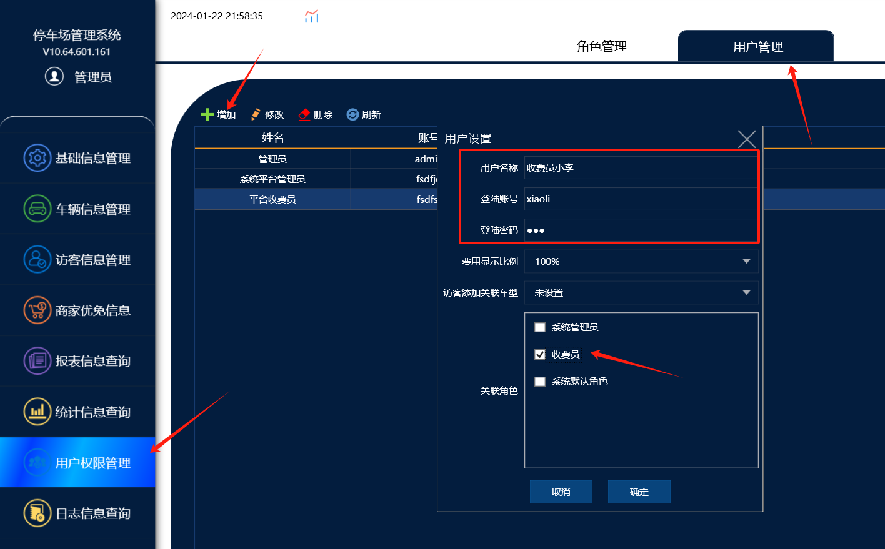
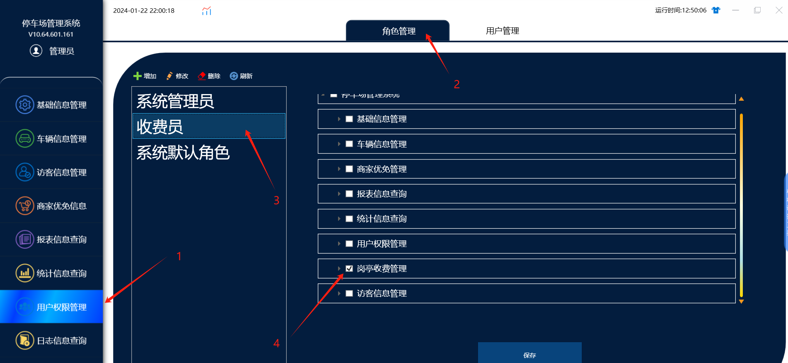
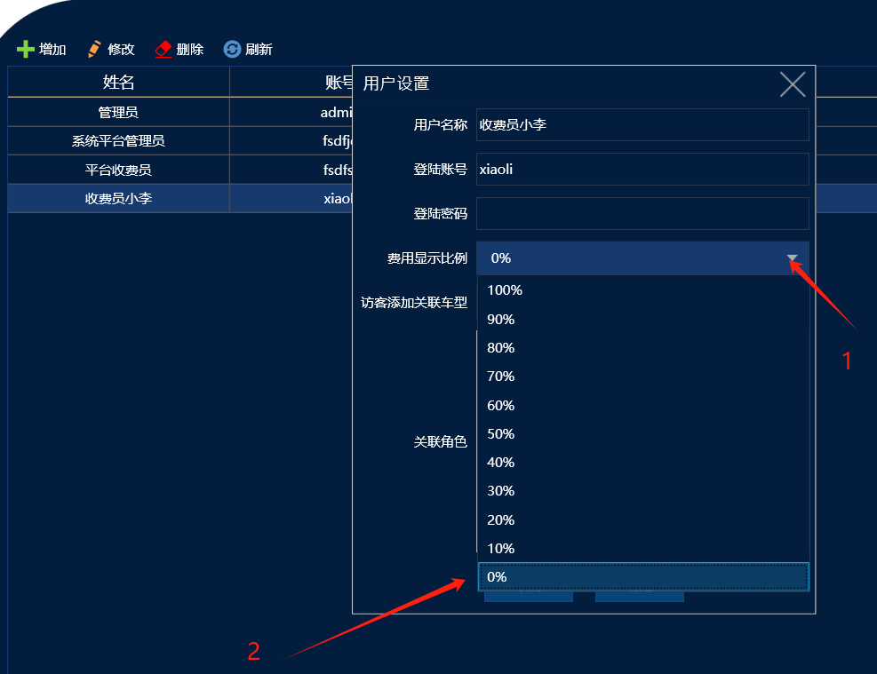

首先需要添加收费员账号，然后设置费用显示比例

登入账号和密码是在管理端，用户管理里面添加，然后设置收费员角色，收费员角色只授权岗亭管理的权限，最后收费员账号在绑定收费员角色

可以实现收费员在收费端登入账号的时候，查询不到收费金额和收费总额

操作流程：

一。在管理端用户管理里面添加收费员账号，然后绑定收费员的角色，角色只授权岗亭管理的权限

二。在用户管理里面设置显示金额的比例，改成百分之0，这样这个收费员账号登入收费端，就查不到收费的金额，然后因为收费员账号是没有设置管理端软件的角色菜单权限的，所以收费员账号登入管理端是什么也看不到的，只有岗亭收费管理的权限，此账号就只能登入收费端软件

改成百分之0就可以了
