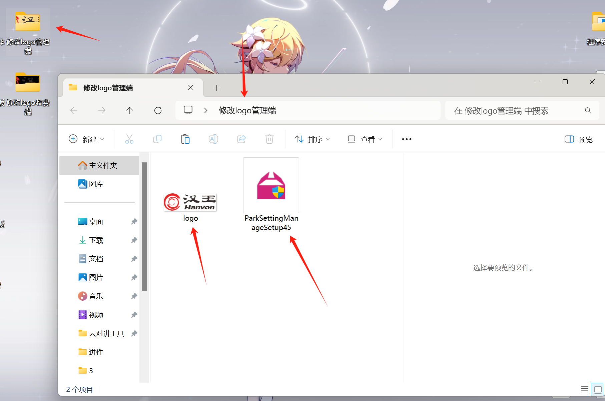
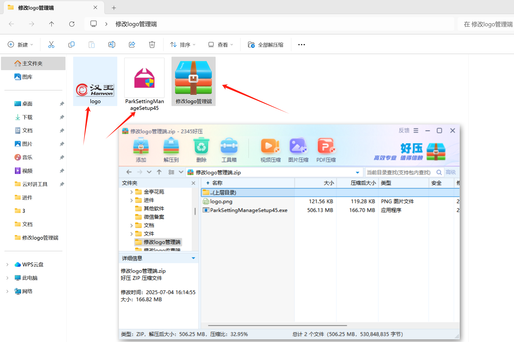

## 一：已安装包方式替换logo，优点是直接安装软件就能显示logo，不需要每台电脑都去上传logo

### 二：操作说明

#### 1.在电脑桌面上创建一个文件夹，然后在文件夹里面放入需要上传的图片，和软件安装包

#### 重点：（图片名称需要改成logo，图片格式 .png）

#### 2.下载软件安装包，把安装包复制到这个文件夹里面，之后解压，然后删除安装包

#### 3.这样图片和安装包就都在这个文件夹里面，然后直接点击软件安装程序，安装软件就能显示这个logo了

#### 4.在文件夹里面选中这2个文件，添加成压缩包，就能把压缩包发给客户安装软件了，

#### 客户那边只需要解压后，在解压后的文件夹里面点击软件安装程序直接安装即可。

## 三：收费端软件修改logo操作同理
