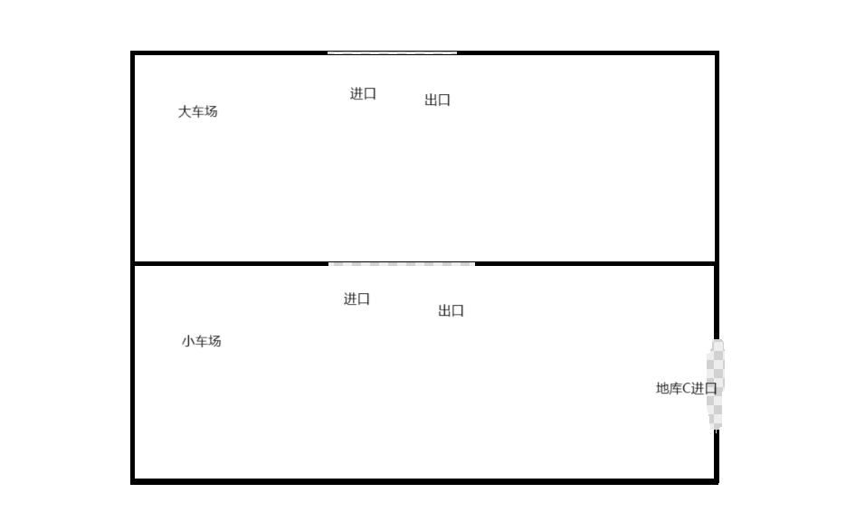
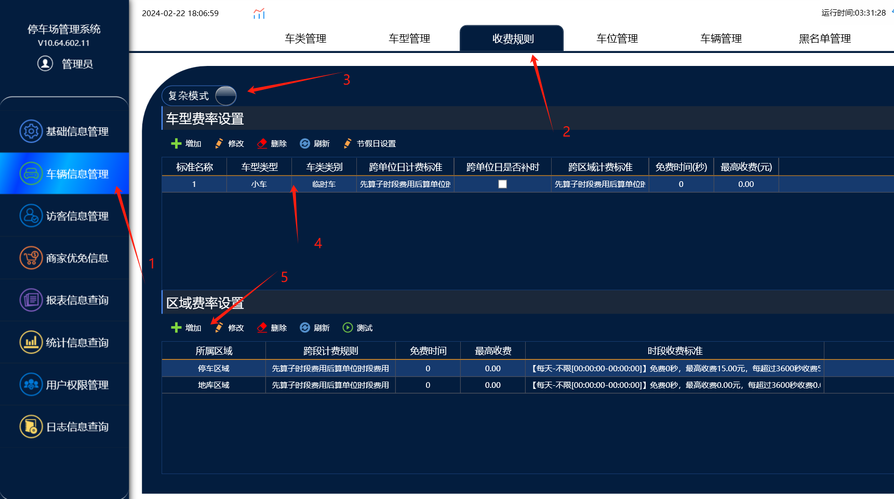
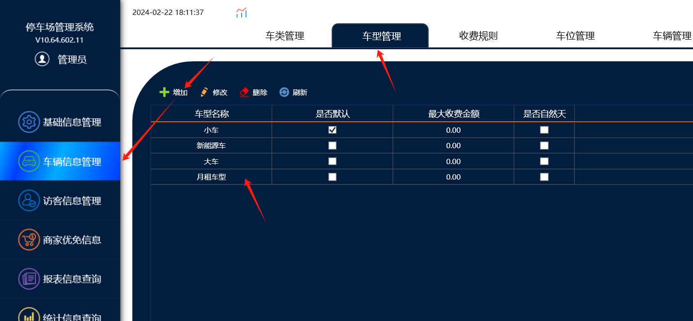
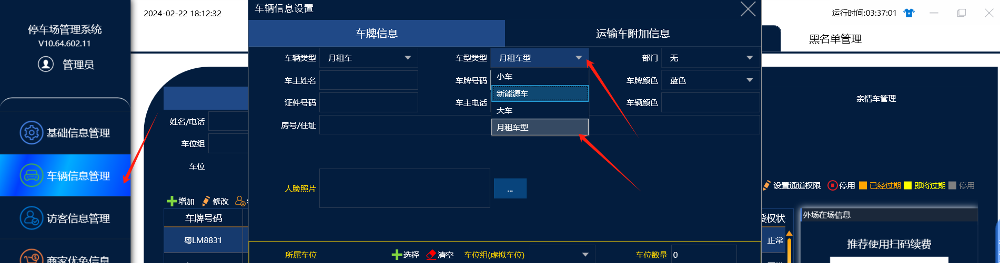
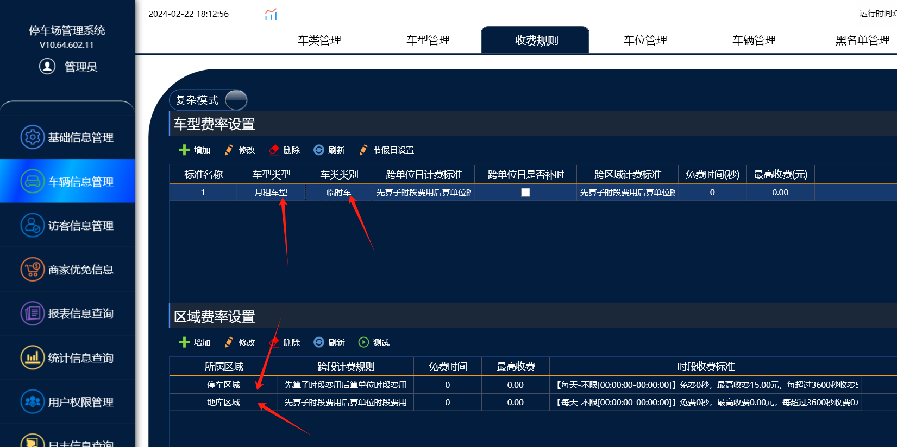

如图：假设月租车在大车场收费，小车场免费，但是小车场还有一个C进口，月租车从C进口入场，在从地库出场，在场地面出场就会导致地面没有在场记录，会自动生成1条和地库入场时间一致的入场时间

这样就会导致出场地面收费。

月租车嵌套进出:

可以实现功能在大小车场的情况下，月租车不进大车场直接从小车场入场在从小车场出场，在从大车场出场，在免费时间内免费出场。

功能配置流程：

一。收费规则需要选择复杂模式，然后给地面和地库区域都需要添加收费规则，地面区域添加正常收费的规则，地库区域添加一个收费0元的收费规则

添加2个收费规则，地面区域配置收费，地库区域配置免费。

二。如果地库临时车也要收费的情况下，就需要在添加一个车型，把月租车和临时车区分出来

1.首先添加一个月租车型

2.在车辆信息里面把添加的月租车的车型从原来的小车车型改成月租车型。

3.然后在复杂模式的收费规则里面给月租车型配置收费规则，也是配置地面区域收费，地库区域免费。

操作流程：

添加收费规则的时候 车型选月租车型，车类还是临时车，然后给地面区域添加收费，地库区域添加免费。
